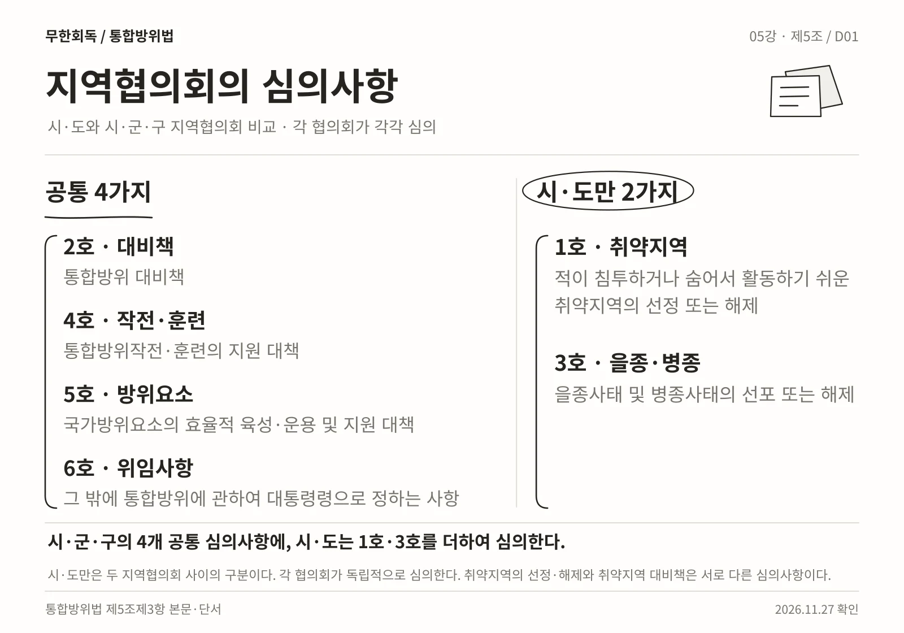
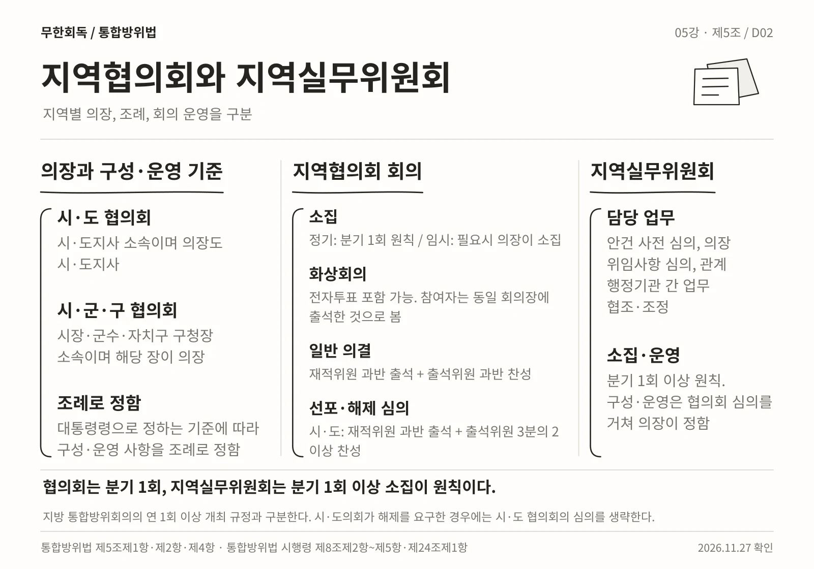
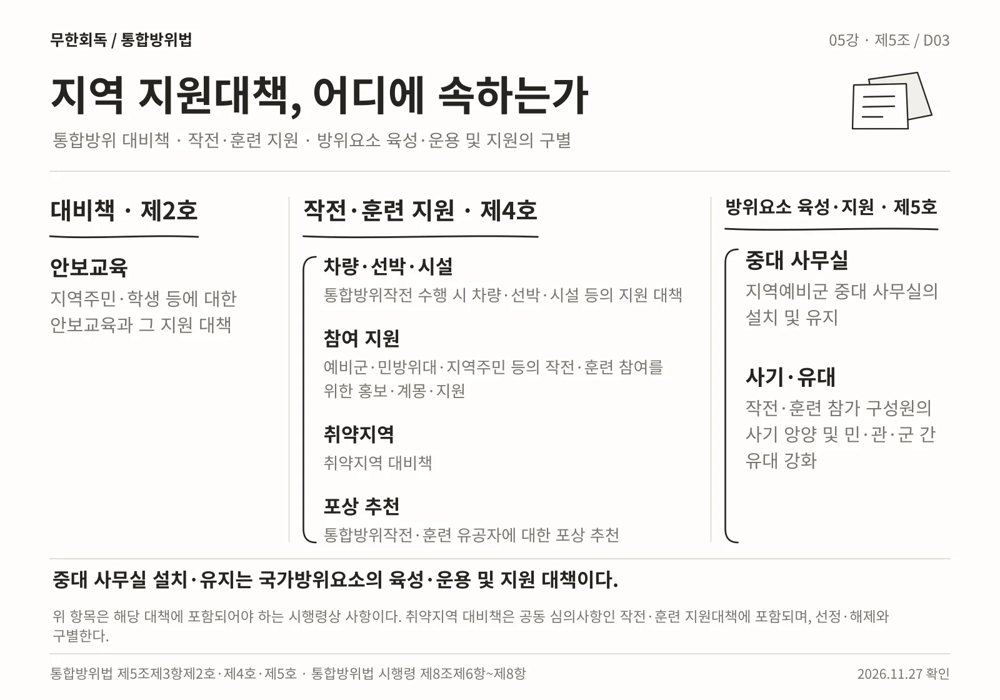
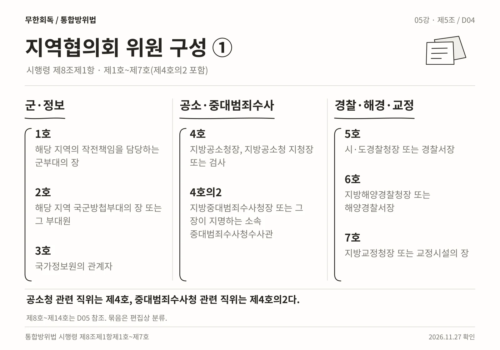
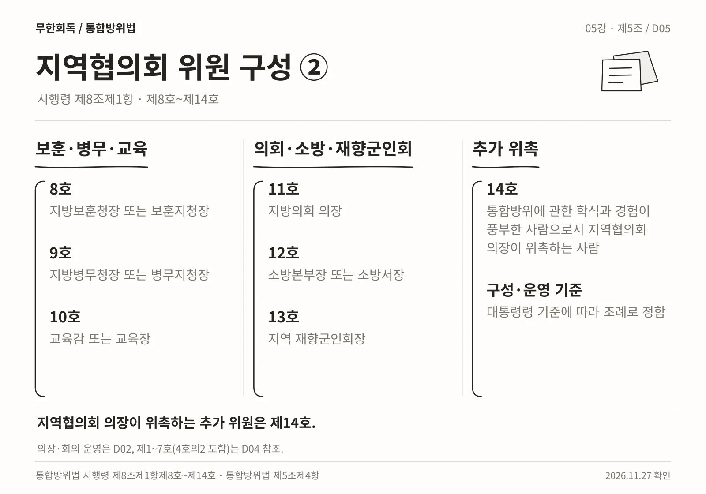

# 05강 · 지역 통합방위협의회

**제80회 기존 강의 스크립트 기준 · TB-005 · 7번 선택 스타일**

[전체 도식 목록](../../../notion-v1/)

## D01 · 지역협의회의 심의사항

시·도와 시·군·구 지역협의회 비교 · 각 협의회가 각각 심의

[PNG](TB-005-D01-regional-four-plus-two.png) · [SVG](TB-005-D01-regional-four-plus-two.svg) · [WebP](TB-005-D01-regional-four-plus-two.webp)

### 공통 4가지

| 구분 | 내용 |
|---|---|
| 2호 · 대비책 | 통합방위 대비책 |
| 4호 · 작전·훈련 | 통합방위작전·훈련의 지원 대책 |
| 5호 · 방위요소 | 국가방위요소의 효율적 육성·운용 및 지원 대책 |
| 6호 · 위임사항 | 그 밖에 통합방위에 관하여 대통령령으로 정하는 사항 |

### 시·도만 2가지

| 구분 | 내용 |
|---|---|
| 1호 · 취약지역 | 적이 침투하거나 숨어서 활동하기 쉬운 취약지역의 선정 또는 해제 |
| 3호 · 을종·병종 | 을종사태 및 병종사태의 선포 또는 해제 |

**기억할 문장:** 시·군·구의 4개 공통 심의사항에, 시·도는 1호·3호를 더하여 심의한다.

### 조건·범위

- 시·도만이라는 제한은 법 제5조의 두 지역협의회 사이의 구분이다. 중앙협의회의 심의 범위를 제한하는 뜻은 아니다.
- 취약지역의 선정·해제와 취약지역 대비책은 서로 다른 사항이다.
- 협의회별 심의 권한의 비교이며 상하 지휘관계를 뜻하지 않는다.

### 근거

- [통합방위법 제5조제3항 본문·단서](https://www.law.go.kr/LSW/lsInfoR.do?ancYnChk=0&chrClsCd=010202&efYd=20251001&lsiSeq=276315)

## D02 · 지역협의회와 지역실무위원회

지역별 의장, 조례, 회의 운영을 구분

[PNG](TB-005-D02-regional-council-operation.png) · [SVG](TB-005-D02-regional-council-operation.svg) · [WebP](TB-005-D02-regional-council-operation.webp)

### 의장과 구성·운영 기준

| 구분 | 내용 |
|---|---|
| 시·도 협의회 | 시·도지사 소속이며 의장도 시·도지사 |
| 시·군·구 협의회 | 시장·군수·자치구 구청장 소속이며 해당 장이 의장 |
| 조례로 정함 | 대통령령으로 정하는 기준에 따라 구성·운영 사항을 조례로 정함 |

### 지역협의회 회의

| 구분 | 내용 |
|---|---|
| 소집 | 정기: 분기 1회 원칙 / 임시: 필요시 의장이 소집 |
| 화상회의 | 전자투표 포함 가능. 참여자는 동일 회의장에 출석한 것으로 봄 |
| 일반 의결 | 재적위원 과반 출석 + 출석위원 과반 찬성 |
| 선포·해제 심의 | 시·도: 재적위원 과반 출석 + 출석위원 3분의 2 이상 찬성 |

### 지역실무위원회

| 구분 | 내용 |
|---|---|
| 담당 업무 | 안건 사전 심의, 의장 위임사항 심의, 관계 행정기관 간 업무 협조·조정 |
| 소집·운영 | 분기 1회 이상 원칙. 구성·운영은 협의회 심의를 거쳐 의장이 정함 |

**기억할 문장:** 협의회는 분기 1회, 지역실무위원회는 분기 1회 이상 소집이 원칙이다.

### 조건·범위

- 지방 통합방위회의의 연 1회 이상 개최 규정과 구분한다.
- 일반 의결은 시행령 제7조제2항 준용이며, 사태 선포·해제에는 시행령 제24조제1항의 특별 기준을 적용한다.
- 지역협의회 위원의 개별 직위 목록은 시행령 제8조제1항에 따르며 이 도식에는 열거하지 않는다.
- 국회 또는 시·도의회의 해제 요구에 따른 심의 생략은 법 제14조제2항·제5항 단서에 따른다.

### 근거

- [통합방위법 제5조제1항·제2항·제4항](https://www.law.go.kr/LSW/lsInfoR.do?ancYnChk=0&chrClsCd=010202&efYd=20251001&lsiSeq=276315)
- [통합방위법 시행령 제8조제2항~제5항·제24조제1항](https://www.law.go.kr/LSW/lsInfoR.do?ancYnChk=0&chrClsCd=010202&efYd=20261002&lsiSeq=290507)
- [통합방위법 제14조제2항·제5항 단서](https://www.law.go.kr/LSW/lsInfoR.do?ancYnChk=0&chrClsCd=010202&efYd=20251001&lsiSeq=276315)

## D03 · 지역 지원대책, 어디에 속하는가

통합방위 대비책 · 작전·훈련 지원 · 방위요소 육성·운용 및 지원의 구별

[PNG](TB-005-D03-regional-support-classification.png) · [SVG](TB-005-D03-regional-support-classification.svg) · [WebP](TB-005-D03-regional-support-classification.webp)

### 대비책 · 제2호

| 구분 | 내용 |
|---|---|
| 안보교육 | 지역주민·학생 등에 대한 안보교육과 그 지원 대책 |

### 작전·훈련 지원 · 제4호

| 구분 | 내용 |
|---|---|
| 차량·선박·시설 | 통합방위작전 수행 시 차량·선박·시설 등의 지원 대책 |
| 참여 지원 | 예비군·민방위대·지역주민 등의 작전·훈련 참여를 위한 홍보·계몽·지원 |
| 취약지역 | 취약지역 대비책 |
| 포상 추천 | 통합방위작전·훈련 유공자에 대한 포상 추천 |

### 방위요소 육성·지원 · 제5호

| 구분 | 내용 |
|---|---|
| 중대 사무실 | 지역예비군 중대 사무실의 설치 및 유지 |
| 사기·유대 | 작전·훈련 참가 구성원의 사기 앙양 및 민·관·군 간 유대 강화 |

**기억할 문장:** 중대 사무실 설치·유지는 국가방위요소의 육성·운용 및 지원 대책이다.

### 조건·범위

- 위 항목은 해당 대책에 포함되어야 하는 시행령상 사항이다.
- 취약지역 대비책은 공동 심의사항인 작전·훈련 지원대책에 포함되며, 선정·해제와 구별한다.

### 근거

- [통합방위법 제5조제3항제2호·제4호·제5호](https://www.law.go.kr/LSW/lsInfoR.do?ancYnChk=0&chrClsCd=010202&efYd=20251001&lsiSeq=276315)
- [통합방위법 시행령 제8조제6항~제8항](https://www.law.go.kr/LSW/lsInfoR.do?ancYnChk=0&chrClsCd=010202&efYd=20261002&lsiSeq=290507)

## D04 · 지역협의회 위원 구성 ①

시행령 제8조제1항 · 제1호~제7호(제4호의2 포함)

[PNG](TB-005-D04-regional-council-members-part-one.png) · [SVG](TB-005-D04-regional-council-members-part-one.svg) · [WebP](TB-005-D04-regional-council-members-part-one.webp)

### 군·정보

| 구분 | 내용 |
|---|---|
| 1호 | 해당 지역의 작전책임을 담당하는 군부대의 장 |
| 2호 | 해당 지역 국군방첩부대의 장 또는 그 부대원 |
| 3호 | 국가정보원의 관계자 |

### 공소·중대범죄수사

| 구분 | 내용 |
|---|---|
| 4호 | 지방공소청장, 지방공소청 지청장 또는 검사 |
| 4호의2 | 지방중대범죄수사청장 또는 그 장이 지명하는 소속 중대범죄수사청수사관 |

### 경찰·해경·교정

| 구분 | 내용 |
|---|---|
| 5호 | 시·도경찰청장 또는 경찰서장 |
| 6호 | 지방해양경찰청장 또는 해양경찰서장 |
| 7호 | 지방교정청장 또는 교정시설의 장 |

**기억할 문장:** 공소청 관련 직위는 제4호, 중대범죄수사청 관련 직위는 제4호의2다.

### 조건·범위

- 제1호~제7호와 제4호의2를 정리했으며, 제8호~제14호는 D05에서 확인한다.
- 세 묶음은 학습용 분류이며 법정 호 번호는 그대로 표시한다.

### 근거

- [통합방위법 시행령 제8조제1항제1호~제7호](https://www.law.go.kr/LSW/lsInfoR.do?ancYnChk=0&chrClsCd=010202&efYd=20261002&lsiSeq=290507)

## D05 · 지역협의회 위원 구성 ②

시행령 제8조제1항 · 제8호~제14호

[PNG](TB-005-D05-regional-council-members-part-two.png) · [SVG](TB-005-D05-regional-council-members-part-two.svg) · [WebP](TB-005-D05-regional-council-members-part-two.webp)

### 보훈·병무·교육

| 구분 | 내용 |
|---|---|
| 8호 | 지방보훈청장 또는 보훈지청장 |
| 9호 | 지방병무청장 또는 병무지청장 |
| 10호 | 교육감 또는 교육장 |

### 의회·소방·재향군인회

| 구분 | 내용 |
|---|---|
| 11호 | 지방의회 의장 |
| 12호 | 소방본부장 또는 소방서장 |
| 13호 | 지역 재향군인회장 |

### 추가 위촉

| 구분 | 내용 |
|---|---|
| 14호 | 통합방위에 관한 학식과 경험이 풍부한 사람으로서 지역협의회 의장이 위촉하는 사람 |
| 구성·운영 기준 | 대통령령 기준에 따라 조례로 정함 |

**기억할 문장:** 지역협의회 의장이 위촉하는 추가 위원은 제14호.

### 조건·범위

- 제1호~제7호와 제4호의2는 D04 참조. 조례 위임 근거는 법 제5조제4항이다.
- 시·도 협의회와 시·군·구 협의회의 의장 및 소집 기준은 기존 D02 참조.

### 근거

- [통합방위법 시행령 제8조제1항제8호~제14호](https://www.law.go.kr/LSW/lsInfoR.do?ancYnChk=0&chrClsCd=010202&efYd=20261002&lsiSeq=290507)
- [통합방위법 제5조제4항](https://www.law.go.kr/LSW/lsInfoR.do?ancYnChk=0&chrClsCd=010202&efYd=20251001&lsiSeq=276315)

