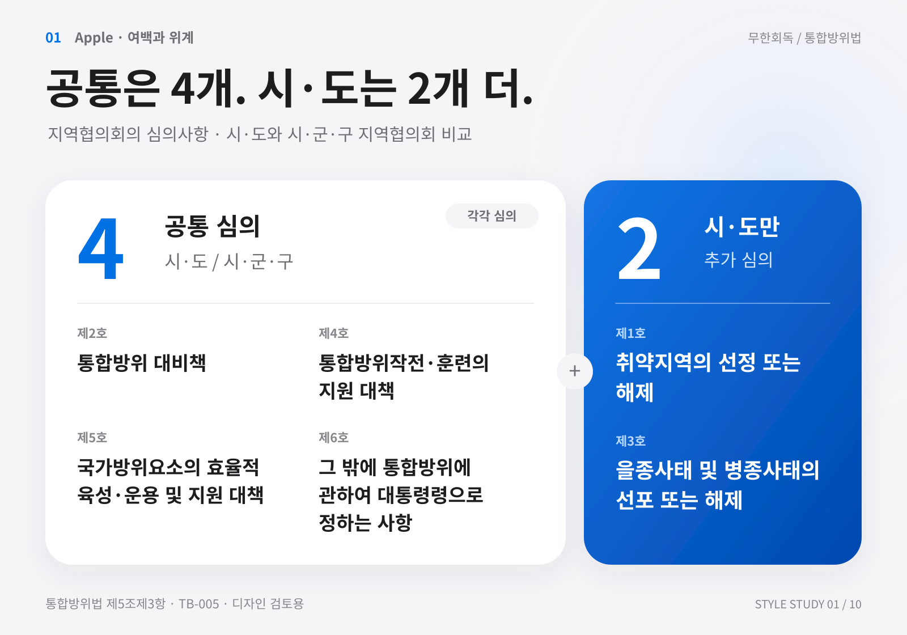
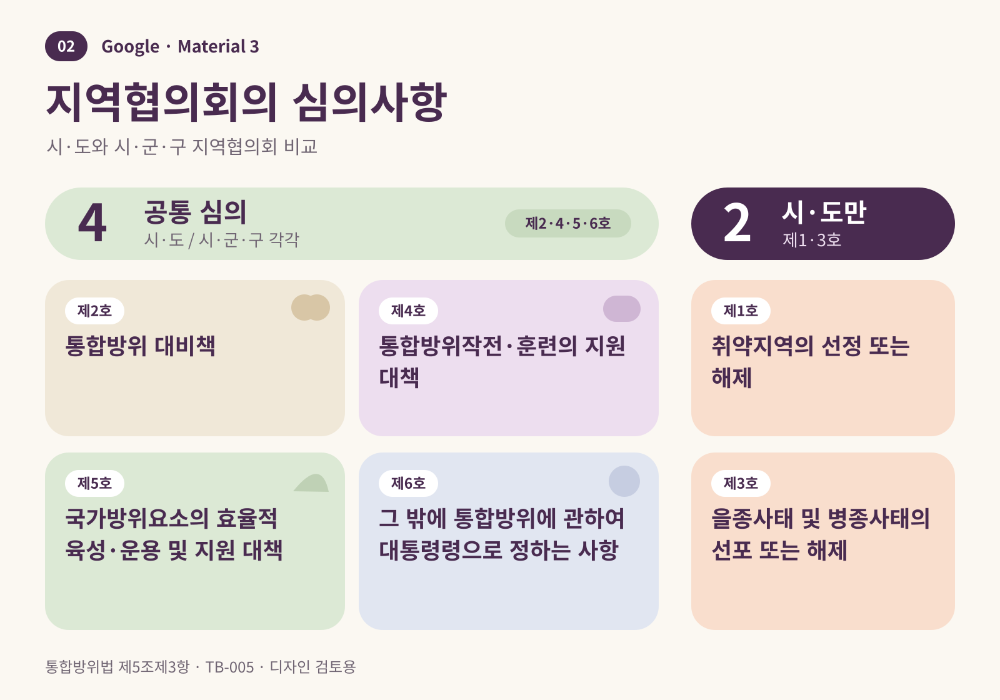
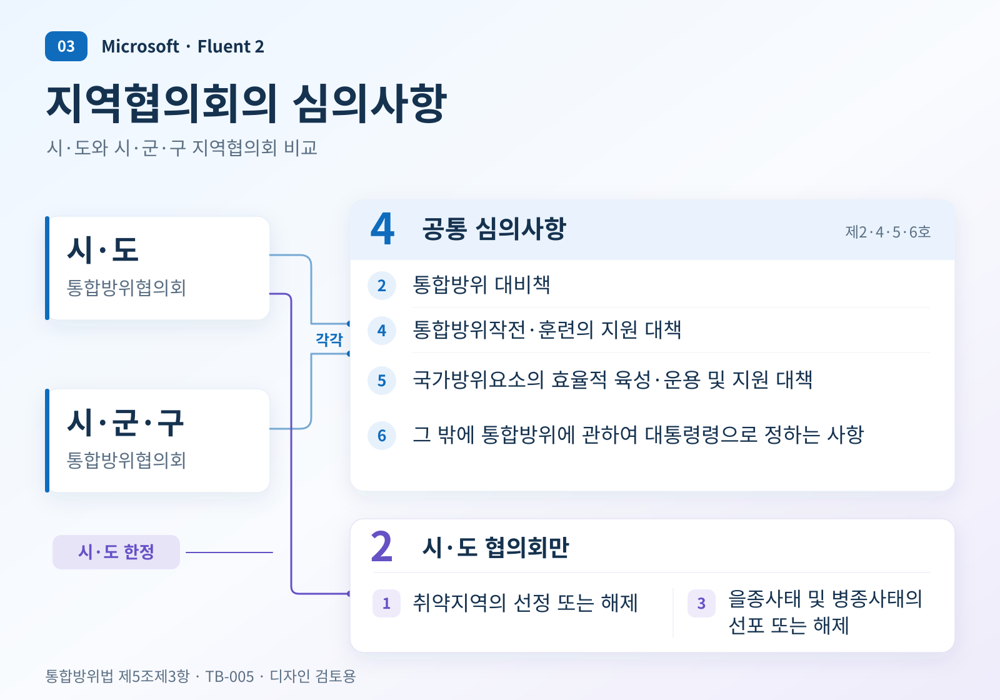
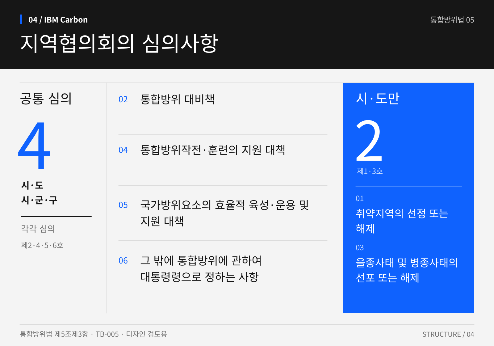
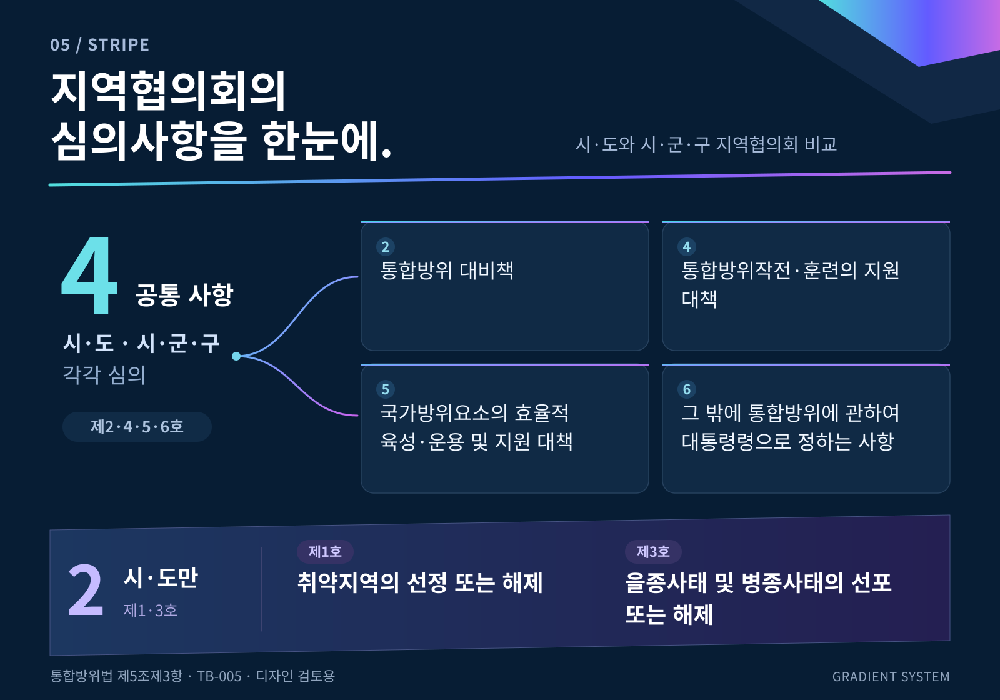
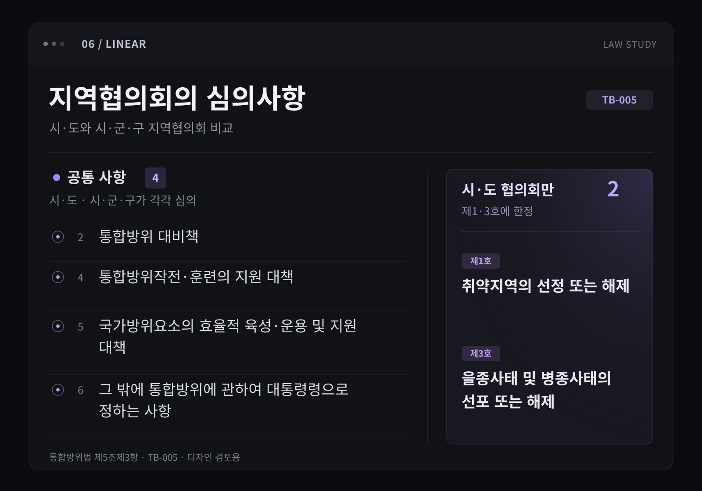
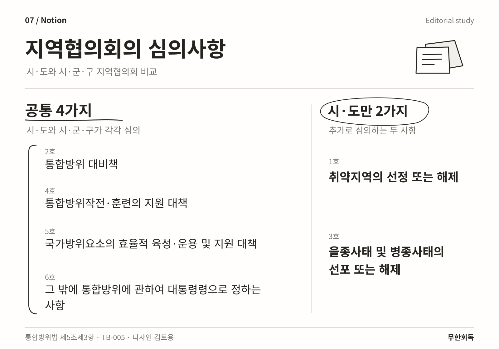
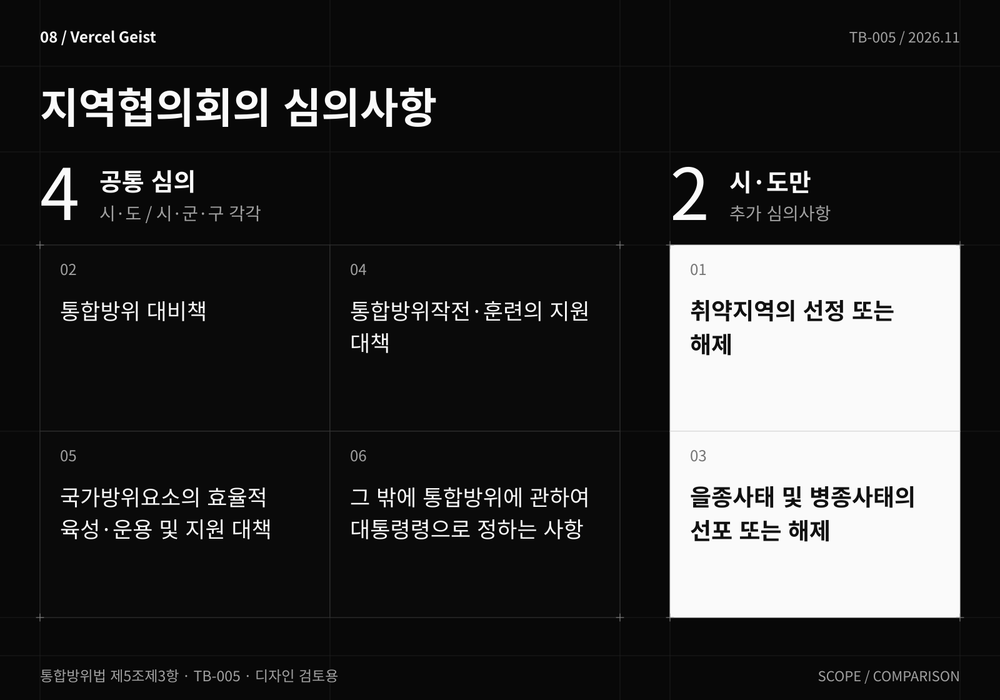
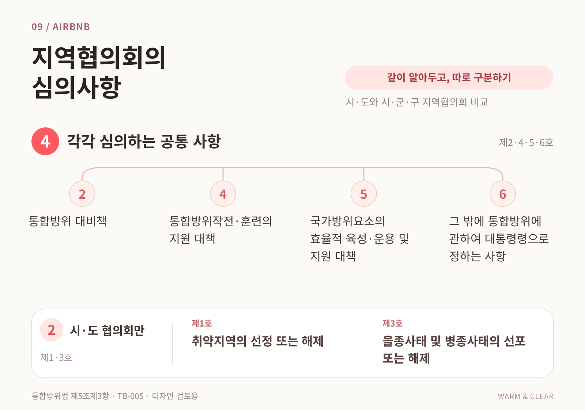
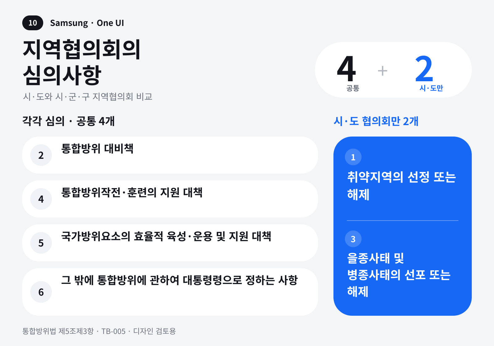

# 통합방위법 도식 · 회사 디자인 참고 시안 10종

**선택 완료: 07 Notion 참고 편집형 · 2026년 11월 27일**

[선택 스타일을 적용한 25강 · 49개 도식](../../../notion-v1/)

기존 도식의 디자인 개선 요청에 따라 같은 법령 내용을 10개의 시각 표현으로 제작했다. 모든 시안은 통합방위법 제5조제3항의 공통 심의사항 4개와 시·도 협의회에만 적용되는 2개를 담는다.

공식 디자인 자료와 제품 표현을 참고한 자체 시안이다. 회사가 제작하거나 승인한 도식을 뜻하지 않는다.

[확대 갤러리](index.html) · [10종 비교 이미지](overview.webp) · [파일 정보](manifest.json)

## 시안 목록

| 번호 | 참고 회사 | 디자인 방향 | 파일 |
|---|---|---|---|
| 01 | Apple | 여백과 위계 | [PNG](01-apple-minimal.png) · [SVG](01-apple-minimal.svg) · [WebP](01-apple-minimal.webp) |
| 02 | Google Material 3 | 색으로 구분하는 구조 | [PNG](02-google-material3.png) · [SVG](02-google-material3.svg) · [WebP](02-google-material3.webp) |
| 03 | Microsoft Fluent 2 | 관계가 보이는 연결 | [PNG](03-microsoft-fluent2.png) · [SVG](03-microsoft-fluent2.svg) · [WebP](03-microsoft-fluent2.webp) |
| 04 | IBM Carbon | 정렬과 대비 | [PNG](04-ibm-carbon.png) · [SVG](04-ibm-carbon.svg) · [WebP](04-ibm-carbon.webp) |
| 05 | Stripe | 색이 흐르는 도식 | [PNG](05-stripe-gradient.png) · [SVG](05-stripe-gradient.svg) · [WebP](05-stripe-gradient.webp) |
| 06 | Linear | 차분한 다크 화면 | [PNG](06-linear-dark.png) · [SVG](06-linear-dark.svg) · [WebP](06-linear-dark.webp) |
| 07 | Notion | 편집된 학습 노트 | [PNG](07-notion-editorial.png) · [SVG](07-notion-editorial.svg) · [WebP](07-notion-editorial.webp) |
| 08 | Vercel Geist | 선과 면의 대비 | [PNG](08-vercel-geist.png) · [SVG](08-vercel-geist.svg) · [WebP](08-vercel-geist.webp) |
| 09 | Airbnb | 따뜻한 연결 | [PNG](09-airbnb-warm.png) · [SVG](09-airbnb-warm.svg) · [WebP](09-airbnb-warm.webp) |
| 10 | Samsung One UI | 크고 편안한 구획 | [PNG](10-samsung-one-ui.png) · [SVG](10-samsung-one-ui.svg) · [WebP](10-samsung-one-ui.webp) |

## 같은 내용을 유지한 비교

- 공통 심의: 제2·4·5·6호. 시·도와 시·군·구 협의회가 각각 심의한다.
- 시·도 협의회만 심의: 제1·3호. 취약지역의 선정 또는 해제, 을종사태 및 병종사태의 선포 또는 해제.
- 여섯 항목의 원문 문구를 10개 SVG 모두에서 대조했다. 그림은 심의사항 비교이며 선포권자 또는 공동회의를 설명하지 않는다.
- [공식 법령 제5조](https://www.law.go.kr/lsLawLinkInfo.do?chrClsCd=010202&lsJoLnkSeq=1000774174)

## 제작·사용

1600×1120의 가로 디자인 검토본이다. 회사별 구성과 분위기를 비교해 선택한 뒤 실제 강의의 세로·가로 화면에 맞춰 글자 크기와 정보량을 조정한다. SVG는 확대 가능한 편집 원본이며, PNG·WebP는 한글 모양이 고정된 이미지다. SVG 렌더링에는 Noto Sans CJK KR 글꼴을 사용한다.

## 개별 예시

### 01 · Apple

큰 숫자, 넓은 여백, 부드러운 면으로 정보의 중요도를 나눈 시안.

[공식 참고 자료](https://developer.apple.com/design/human-interface-guidelines/materials)

### 02 · Google Material 3

파스텔 컨테이너와 플럼 강조, 공통 4개의 2×2 배치.

[공식 참고 자료](https://m3.material.io/styles/color/the-color-system/)

### 03 · Microsoft Fluent 2

두 협의회의 공통 심의와 시·도 한정 심의를 독립 연결선으로 구별.

[공식 참고 자료](https://fluent2.microsoft.design/design-principles)

### 04 · IBM Carbon

엄격한 세로 3단, 검정 헤더와 코발트 강조 열.

[공식 참고 자료](https://www.carbondesignsystem.com/building-blocks/foundations/typography/overview)

### 05 · Stripe

네이비 바탕에 그라데이션 선과 곡선 분기, 하단 예외 영역.

[공식 참고 자료](https://stripe.com/blog/connect-front-end-experience)

### 06 · Linear

차콜 목록, 미세한 경계, 보라색 시·도 한정 영역.

[공식 참고 자료](https://linear.app/now/behind-the-latest-design-refresh)

### 07 · Notion

흰 종이 같은 바탕, 흑백, 손으로 그린 괄호와 밑줄.

[공식 참고 자료](https://www.notion.com/about)

### 08 · Vercel Geist

검정 격자와 흰색 예외 열로 구획을 선명하게 구분.

[공식 참고 자료](https://vercel.com/geist/grid)

### 09 · Airbnb

코럴과 따뜻한 흰색, 수평 가지, 넓은 여백.

[공식 참고 자료](https://news.airbnb.com/airbnb-2025-summer-release/)

### 10 · Samsung One UI

큰 제목과 4+2 캡슐, 둥근 목록, 선명한 블루 영역.

[공식 참고 자료](https://design.samsung.com/global/contents/one-ui-7/)

