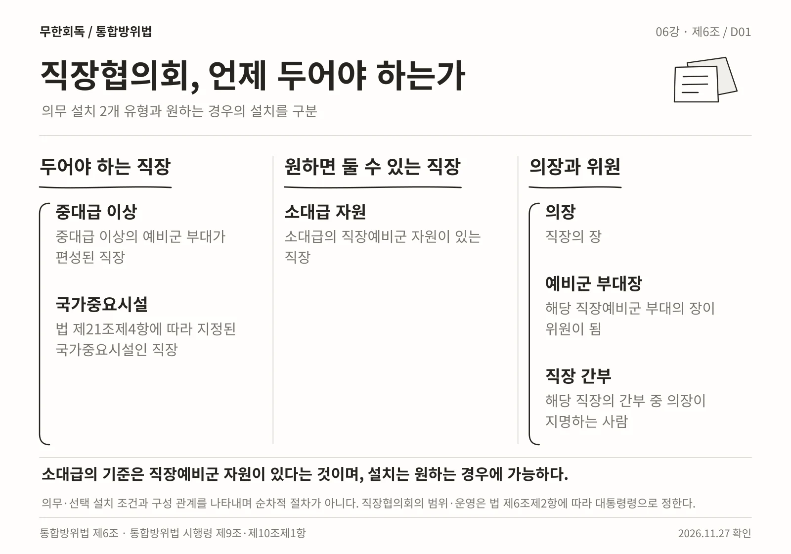
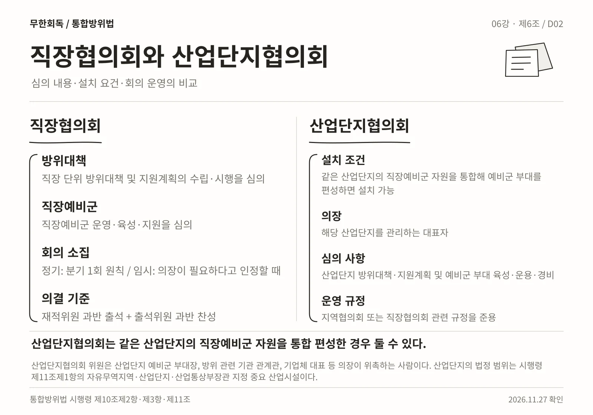

# 06강 · 직장 통합방위협의회

**TB-006 · 통합방위법 제6조 · 7번 선택 스타일 적용**

[전체 도식 목록](../../../notion-v1/)

## D01 · 직장협의회, 언제 두어야 하는가

의무 설치 2개 유형과 원하는 경우의 설치를 구분

[PNG](TB-006-D01-workplace-council-scope.png) · [SVG](TB-006-D01-workplace-council-scope.svg) · [WebP](TB-006-D01-workplace-council-scope.webp)

### 두어야 하는 직장

| 구분 | 내용 |
|---|---|
| 중대급 이상 | 중대급 이상의 예비군 부대가 편성된 직장 |
| 국가중요시설 | 법 제21조제4항에 따라 지정된 국가중요시설인 직장 |

### 원하면 둘 수 있는 직장

| 구분 | 내용 |
|---|---|
| 소대급 자원 | 소대급의 직장예비군 자원이 있는 직장 |

### 의장과 위원

| 구분 | 내용 |
|---|---|
| 의장 | 직장의 장 |
| 예비군 부대장 | 해당 직장예비군 부대의 장이 위원이 됨 |
| 직장 간부 | 해당 직장의 간부 중 의장이 지명하는 사람 |

**기억할 문장:** 소대급의 기준은 직장예비군 자원이 있다는 것이며, 설치는 원하는 경우에 가능하다.

### 조건·범위

- 의무·선택 설치 조건과 구성 관계를 나타내며 순차적 절차가 아니다.
- 직장협의회의 범위·운영은 법 제6조제2항에 따라 대통령령으로 정한다.

### 근거

- [통합방위법 제6조](https://www.law.go.kr/LSW/lsInfoR.do?ancYnChk=0&chrClsCd=010202&efYd=20251001&lsiSeq=276315)
- [통합방위법 시행령 제9조·제10조제1항](https://www.law.go.kr/LSW/lsInfoR.do?ancYnChk=0&chrClsCd=010202&efYd=20261002&lsiSeq=290507)

## D02 · 직장협의회와 산업단지협의회

심의 내용·설치 요건·회의 운영의 비교

[PNG](TB-006-D02-workplace-and-industrial-council.png) · [SVG](TB-006-D02-workplace-and-industrial-council.svg) · [WebP](TB-006-D02-workplace-and-industrial-council.webp)

### 직장협의회

| 구분 | 내용 |
|---|---|
| 방위대책 | 직장 단위 방위대책 및 지원계획의 수립·시행을 심의 |
| 직장예비군 | 직장예비군 운영·육성·지원을 심의 |
| 회의 소집 | 정기: 분기 1회 원칙 / 임시: 의장이 필요하다고 인정할 때 |
| 의결 기준 | 재적위원 과반 출석 + 출석위원 과반 찬성 |

### 산업단지협의회

| 구분 | 내용 |
|---|---|
| 설치 조건 | 같은 산업단지의 직장예비군 자원을 통합해 예비군 부대를 편성하면 설치 가능 |
| 의장 | 해당 산업단지를 관리하는 대표자 |
| 심의 사항 | 산업단지 방위대책·지원계획 및 예비군 부대 육성·운용·경비 |
| 운영 규정 | 지역협의회 또는 직장협의회 관련 규정을 준용 |

**기억할 문장:** 산업단지협의회는 같은 산업단지의 직장예비군 자원을 통합 편성한 경우 둘 수 있다.

### 조건·범위

- 산업단지협의회 위원은 산업단지 예비군 부대장, 방위 관련 기관 관계관, 기업체 대표 등 의장이 위촉하는 사람이다.
- 산업단지의 법정 범위는 시행령 제11조제1항의 자유무역지역·산업단지·산업통상부장관 지정 중요 산업시설이다.

### 근거

- [통합방위법 시행령 제10조제2항·제3항·제11조](https://www.law.go.kr/LSW/lsInfoR.do?ancYnChk=0&chrClsCd=010202&efYd=20261002&lsiSeq=290507)

