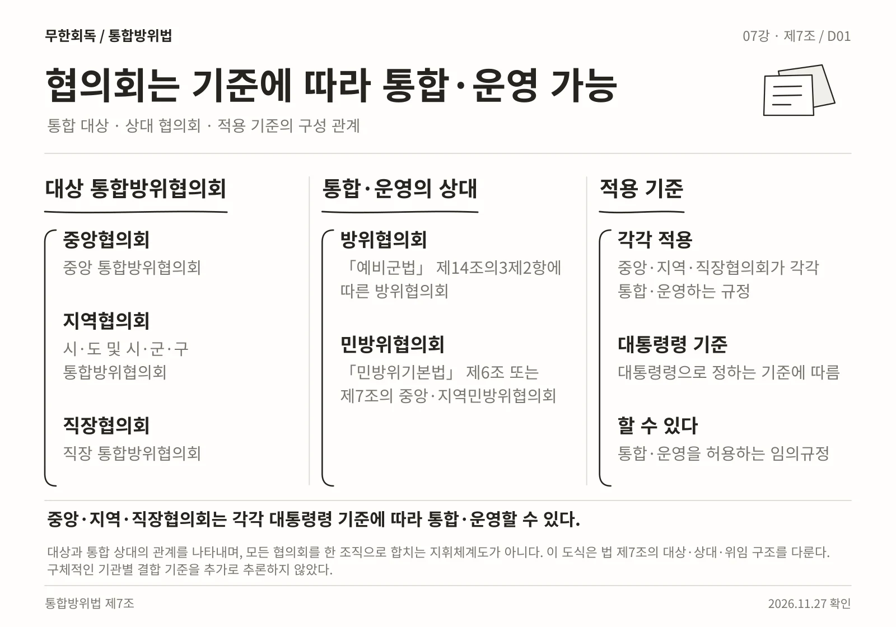

# 07강 · 협의회의 통합·운영

**TB-007 · 통합방위법 제7조 · 7번 선택 스타일 적용**

[전체 도식 목록](../../../notion-v1/)

## D01 · 협의회는 기준에 따라 통합·운영 가능

통합 대상 · 상대 협의회 · 적용 기준의 구성 관계

[PNG](TB-007-D01-councils-integrated-operation.png) · [SVG](TB-007-D01-councils-integrated-operation.svg) · [WebP](TB-007-D01-councils-integrated-operation.webp)

### 대상 통합방위협의회

| 구분 | 내용 |
|---|---|
| 중앙협의회 | 중앙 통합방위협의회 |
| 지역협의회 | 시·도 및 시·군·구 통합방위협의회 |
| 직장협의회 | 직장 통합방위협의회 |

### 통합·운영의 상대

| 구분 | 내용 |
|---|---|
| 방위협의회 | 「예비군법」 제14조의3제2항에 따른 방위협의회 |
| 민방위협의회 | 「민방위기본법」 제6조 또는 제7조의 중앙·지역민방위협의회 |

### 적용 기준

| 구분 | 내용 |
|---|---|
| 각각 적용 | 중앙·지역·직장협의회가 각각 통합·운영하는 규정 |
| 대통령령 기준 | 대통령령으로 정하는 기준에 따름 |
| 할 수 있다 | 통합·운영을 허용하는 임의규정 |

**기억할 문장:** 중앙·지역·직장협의회는 각각 대통령령 기준에 따라 통합·운영할 수 있다.

### 조건·범위

- 대상과 통합 상대의 관계를 나타내며, 모든 협의회를 한 조직으로 합치는 지휘체계도가 아니다.
- 이 도식은 법 제7조의 대상·상대·위임 구조를 다룬다. 구체적인 기관별 결합 기준을 추가로 추론하지 않았다.

### 근거

- [통합방위법 제7조](https://www.law.go.kr/LSW/lsInfoR.do?ancYnChk=0&chrClsCd=010202&efYd=20251001&lsiSeq=276315)

