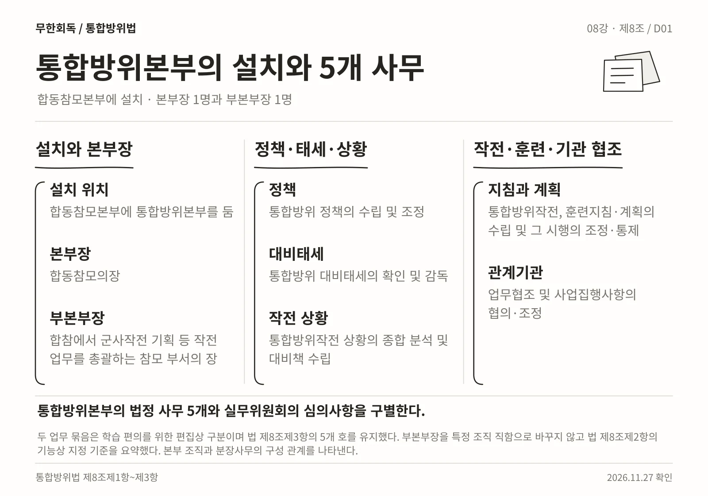
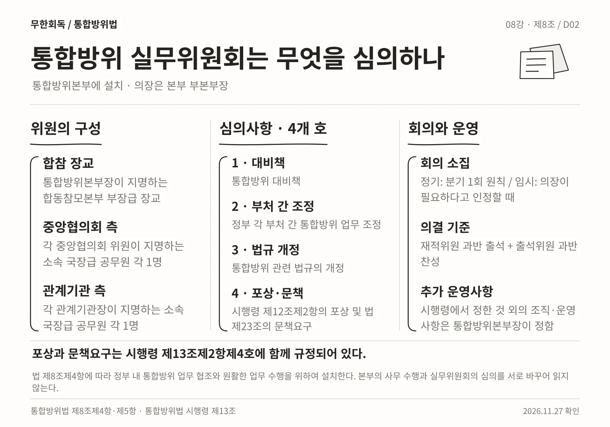
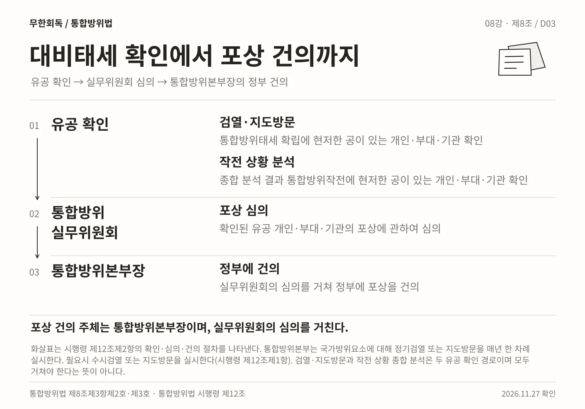

# 08강 · 통합방위본부

**TB-008 · 통합방위법 제8조 · 7번 선택 스타일 적용**

[전체 도식 목록](../../../notion-v1/)

## D01 · 통합방위본부의 설치와 5개 사무

합동참모본부에 설치 · 본부장 1명과 부본부장 1명

[PNG](TB-008-D01-headquarters-organization-and-duties.png) · [SVG](TB-008-D01-headquarters-organization-and-duties.svg) · [WebP](TB-008-D01-headquarters-organization-and-duties.webp)

### 설치와 본부장

| 구분 | 내용 |
|---|---|
| 설치 위치 | 합동참모본부에 통합방위본부를 둠 |
| 본부장 | 합동참모의장 |
| 부본부장 | 합참에서 군사작전 기획 등 작전 업무를 총괄하는 참모 부서의 장 |

### 정책·태세·상황

| 구분 | 내용 |
|---|---|
| 정책 | 통합방위 정책의 수립 및 조정 |
| 대비태세 | 통합방위 대비태세의 확인 및 감독 |
| 작전 상황 | 통합방위작전 상황의 종합 분석 및 대비책 수립 |

### 작전·훈련·기관 협조

| 구분 | 내용 |
|---|---|
| 지침과 계획 | 통합방위작전, 훈련지침·계획의 수립 및 그 시행의 조정·통제 |
| 관계기관 | 업무협조 및 사업집행사항의 협의·조정 |

**기억할 문장:** 통합방위본부의 법정 사무 5개와 실무위원회의 심의사항을 구별한다.

### 조건·범위

- 두 업무 묶음은 학습 편의를 위한 편집상 구분이며 법 제8조제3항의 5개 호를 유지했다.
- 부본부장을 특정 조직 직함으로 바꾸지 않고 법 제8조제2항의 기능상 지정 기준을 요약했다.
- 본부 조직과 분장사무의 구성 관계를 나타낸다.

### 근거

- [통합방위법 제8조제1항~제3항](https://www.law.go.kr/LSW/lsInfoR.do?ancYnChk=0&chrClsCd=010202&efYd=20251001&lsiSeq=276315)

## D02 · 통합방위 실무위원회는 무엇을 심의하나

통합방위본부에 설치 · 의장은 본부 부본부장

[PNG](TB-008-D02-headquarters-working-committee.png) · [SVG](TB-008-D02-headquarters-working-committee.svg) · [WebP](TB-008-D02-headquarters-working-committee.webp)

### 위원의 구성

| 구분 | 내용 |
|---|---|
| 합참 장교 | 통합방위본부장이 지명하는 합동참모본부 부장급 장교 |
| 중앙협의회 측 | 각 중앙협의회 위원이 지명하는 소속 국장급 공무원 각 1명 |
| 관계기관 측 | 각 관계기관장이 지명하는 소속 국장급 공무원 각 1명 |

### 심의사항 · 4개 호

| 구분 | 내용 |
|---|---|
| 1 · 대비책 | 통합방위 대비책 |
| 2 · 부처 간 조정 | 정부 각 부처 간 통합방위 업무 조정 |
| 3 · 법규 개정 | 통합방위 관련 법규의 개정 |
| 4 · 포상·문책 | 시행령 제12조제2항의 포상 및 법 제23조의 문책요구 |

### 회의와 운영

| 구분 | 내용 |
|---|---|
| 회의 소집 | 정기: 분기 1회 원칙 / 임시: 의장이 필요하다고 인정할 때 |
| 의결 기준 | 재적위원 과반 출석 + 출석위원 과반 찬성 |
| 추가 운영사항 | 시행령에서 정한 것 외의 조직·운영 사항은 통합방위본부장이 정함 |

**기억할 문장:** 포상과 문책요구는 시행령 제13조제2항제4호에 함께 규정되어 있다.

### 조건·범위

- 법 제8조제4항에 따라 정부 내 통합방위 업무 협조와 원활한 업무 수행을 위하여 설치한다.
- 본부의 사무 수행과 실무위원회의 심의를 서로 바꾸어 읽지 않는다.

### 근거

- [통합방위법 제8조제4항·제5항](https://www.law.go.kr/LSW/lsInfoR.do?ancYnChk=0&chrClsCd=010202&efYd=20251001&lsiSeq=276315)
- [통합방위법 시행령 제13조](https://www.law.go.kr/LSW/lsInfoR.do?ancYnChk=0&chrClsCd=010202&efYd=20261002&lsiSeq=290507)

## D03 · 대비태세 확인에서 포상 건의까지

유공 확인 → 실무위원회 심의 → 통합방위본부장의 정부 건의

[PNG](TB-008-D03-inspection-and-award-recommendation.png) · [SVG](TB-008-D03-inspection-and-award-recommendation.svg) · [WebP](TB-008-D03-inspection-and-award-recommendation.webp)

### 유공 확인

| 구분 | 내용 |
|---|---|
| 검열·지도방문 | 통합방위태세 확립에 현저한 공이 있는 개인·부대·기관 확인 |
| 작전 상황 분석 | 종합 분석 결과 통합방위작전에 현저한 공이 있는 개인·부대·기관 확인 |

### 통합방위 실무위원회

| 구분 | 내용 |
|---|---|
| 포상 심의 | 확인된 유공 개인·부대·기관의 포상에 관하여 심의 |

### 통합방위본부장

| 구분 | 내용 |
|---|---|
| 정부에 건의 | 실무위원회의 심의를 거쳐 정부에 포상을 건의 |

**기억할 문장:** 포상 건의 주체는 통합방위본부장이며, 실무위원회의 심의를 거친다.

### 조건·범위

- 화살표는 시행령 제12조제2항의 확인·심의·건의 절차를 나타낸다.
- 통합방위본부는 국가방위요소에 대해 정기검열 또는 지도방문을 매년 한 차례 실시한다. 필요시 수시검열 또는 지도방문을 실시한다(시행령 제12조제1항).
- 검열·지도방문과 작전 상황 종합 분석은 두 유공 확인 경로이며 모두 거쳐야 한다는 뜻이 아니다.

### 근거

- [통합방위법 제8조제3항제2호·제3호](https://www.law.go.kr/LSW/lsInfoR.do?ancYnChk=0&chrClsCd=010202&efYd=20251001&lsiSeq=276315)
- [통합방위법 시행령 제12조](https://www.law.go.kr/LSW/lsInfoR.do?ancYnChk=0&chrClsCd=010202&efYd=20261002&lsiSeq=290507)

