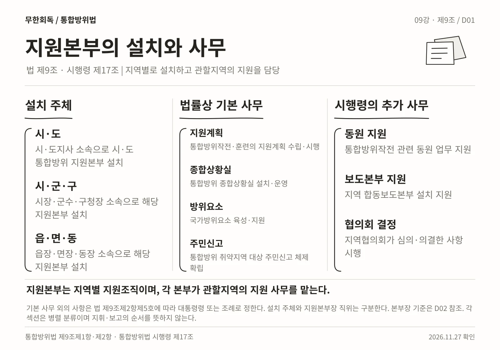
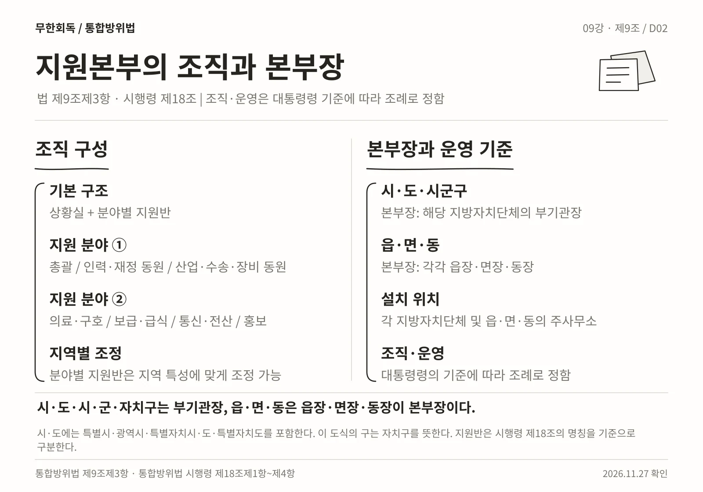
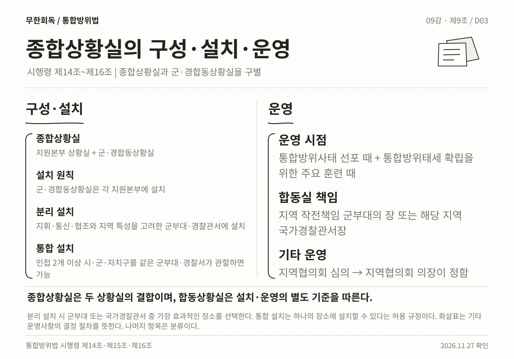

# 09강 · 통합방위 지원본부

**TB-009 · 통합방위법 제9조 · 7번 선택 스타일 적용**

[전체 도식 목록](../../../notion-v1/)

## D01 · 지원본부의 설치와 사무

법 제9조 · 시행령 제17조 | 지역별로 설치하고 관할지역의 지원을 담당

[PNG](TB-009-D01-support-headquarters-and-duties.png) · [SVG](TB-009-D01-support-headquarters-and-duties.svg) · [WebP](TB-009-D01-support-headquarters-and-duties.webp)

### 설치 주체

| 구분 | 내용 |
|---|---|
| 시·도 | 시·도지사 소속으로 시·도 통합방위 지원본부 설치 |
| 시·군·구 | 시장·군수·구청장 소속으로 해당 지원본부 설치 |
| 읍·면·동 | 읍장·면장·동장 소속으로 해당 지원본부 설치 |

### 법률상 기본 사무

| 구분 | 내용 |
|---|---|
| 지원계획 | 통합방위작전·훈련의 지원계획 수립·시행 |
| 종합상황실 | 통합방위 종합상황실 설치·운영 |
| 방위요소 | 국가방위요소 육성·지원 |
| 주민신고 | 통합방위 취약지역 대상 주민신고 체제 확립 |

### 시행령의 추가 사무

| 구분 | 내용 |
|---|---|
| 동원 지원 | 통합방위작전 관련 동원 업무 지원 |
| 보도본부 지원 | 지역 합동보도본부 설치 지원 |
| 협의회 결정 | 지역협의회가 심의·의결한 사항 시행 |

**기억할 문장:** 지원본부는 지역별 지원조직이며, 각 본부가 관할지역의 지원 사무를 맡는다.

### 조건·범위

- 기본 사무 외의 사항은 법 제9조제2항제5호에 따라 대통령령 또는 조례로 정한다.
- 설치 주체와 지원본부장 직위는 구분한다. 본부장 기준은 D02 참조.
- 각 섹션은 병렬 분류이며 지휘·보고의 순서를 뜻하지 않는다.

### 근거

- [통합방위법 제9조제1항·제2항](https://www.law.go.kr/LSW/lsInfoR.do?ancYnChk=0&chrClsCd=010202&efYd=20251001&lsiSeq=276315)
- [통합방위법 시행령 제17조](https://www.law.go.kr/LSW/lsInfoR.do?ancYnChk=0&chrClsCd=010202&efYd=20261002&lsiSeq=290507)

## D02 · 지원본부의 조직과 본부장

법 제9조제3항 · 시행령 제18조 | 조직·운영은 대통령령 기준에 따라 조례로 정함

[PNG](TB-009-D02-support-headquarters-organization.png) · [SVG](TB-009-D02-support-headquarters-organization.svg) · [WebP](TB-009-D02-support-headquarters-organization.webp)

### 조직 구성

| 구분 | 내용 |
|---|---|
| 기본 구조 | 상황실 + 분야별 지원반 |
| 지원 분야 ① | 총괄 / 인력·재정 동원 / 산업·수송·장비 동원 |
| 지원 분야 ② | 의료·구호 / 보급·급식 / 통신·전산 / 홍보 |
| 지역별 조정 | 분야별 지원반은 지역 특성에 맞게 조정 가능 |

### 본부장과 운영 기준

| 구분 | 내용 |
|---|---|
| 시·도·시군구 | 본부장: 해당 지방자치단체의 부기관장 |
| 읍·면·동 | 본부장: 각각 읍장·면장·동장 |
| 설치 위치 | 각 지방자치단체 및 읍·면·동의 주사무소 |
| 조직·운영 | 대통령령의 기준에 따라 조례로 정함 |

**기억할 문장:** 시·도·시·군·자치구는 부기관장, 읍·면·동은 읍장·면장·동장이 본부장이다.

### 조건·범위

- 시·도에는 특별시·광역시·특별자치시·도·특별자치도를 포함한다.
- 이 도식의 구는 자치구를 뜻한다. 지원반은 시행령 제18조의 명칭을 기준으로 구분한다.

### 근거

- [통합방위법 제9조제3항](https://www.law.go.kr/LSW/lsInfoR.do?ancYnChk=0&chrClsCd=010202&efYd=20251001&lsiSeq=276315)
- [통합방위법 시행령 제18조제1항~제4항](https://www.law.go.kr/LSW/lsInfoR.do?ancYnChk=0&chrClsCd=010202&efYd=20261002&lsiSeq=290507)

## D03 · 종합상황실의 구성·설치·운영

시행령 제14조~제16조 | 종합상황실과 군·경합동상황실을 구별

[PNG](TB-009-D03-integrated-situation-room.png) · [SVG](TB-009-D03-integrated-situation-room.svg) · [WebP](TB-009-D03-integrated-situation-room.webp)

### 구성·설치

| 구분 | 내용 |
|---|---|
| 종합상황실 | 지원본부 상황실 + 군·경합동상황실 |
| 설치 원칙 | 군·경합동상황실은 각 지원본부에 설치 |
| 분리 설치 | 지휘·통신·협조와 지역 특성을 고려한 군부대·경찰관서에 설치 |
| 통합 설치 | 인접 2개 이상 시·군·자치구를 같은 군부대·경찰서가 관할하면 가능 |

### 운영

| 구분 | 내용 |
|---|---|
| 운영 시점 | 통합방위사태 선포 때 + 통합방위태세 확립을 위한 주요 훈련 때 |
| 합동실 책임 | 지역 작전책임 군부대의 장 또는 해당 지역 국가경찰관서장 |
| 기타 운영 | 지역협의회 심의 → 지역협의회 의장이 정함 |

**기억할 문장:** 종합상황실은 두 상황실의 결합이며, 합동상황실은 설치·운영의 별도 기준을 따른다.

### 조건·범위

- 분리 설치 시 군부대 또는 국가경찰관서 중 가장 효과적인 장소를 선택한다.
- 통합 설치는 하나의 장소에 설치할 수 있다는 허용 규정이다.
- 화살표는 기타 운영사항의 결정 절차를 뜻한다. 나머지 항목은 분류이다.

### 근거

- [통합방위법 시행령 제14조·제15조·제16조](https://www.law.go.kr/LSW/lsInfoR.do?ancYnChk=0&chrClsCd=010202&efYd=20261002&lsiSeq=290507)

