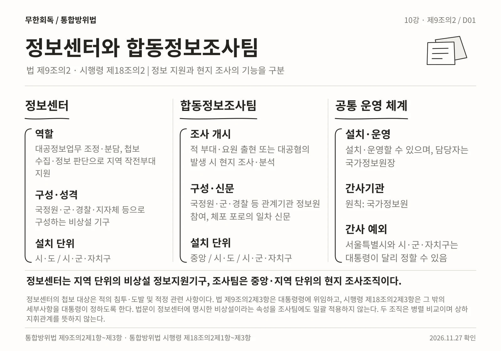

# 10강 · 정보센터 및 합동정보조사팀

**TB-010 · 통합방위법 제9조의2 · 7번 선택 스타일 적용**

[전체 도식 목록](../../../notion-v1/)

## D01 · 정보센터와 합동정보조사팀

법 제9조의2 · 시행령 제18조의2 | 정보 지원과 현지 조사의 기능을 구분

[PNG](TB-010-D01-information-center-vs-investigation-team.png) · [SVG](TB-010-D01-information-center-vs-investigation-team.svg) · [WebP](TB-010-D01-information-center-vs-investigation-team.webp)

### 정보센터

| 구분 | 내용 |
|---|---|
| 역할 | 대공정보 조정·분담, 첩보 수집·판단으로 지역 작전부대 지원 |
| 구성·성격 | 국정원·군·경찰·지자체 등으로 구성하는 비상설 기구 |
| 설치 단위 | 시·도 / 시·군·자치구 |

### 합동정보조사팀

| 구분 | 내용 |
|---|---|
| 조사 개시 | 적 부대·요원 출현 또는 대공혐의 발생 시 현지 조사·분석 |
| 구성·신문 | 국정원·군·경찰 등 관계기관 정보원 참여, 체포 포로의 일차 신문 |
| 설치 단위 | 중앙 / 시·도 / 시·군·자치구 |

### 공통 운영 체계

| 구분 | 내용 |
|---|---|
| 설치·운영 | 설치·운영할 수 있으며, 담당자는 국가정보원장 |
| 간사기관 | 원칙: 국가정보원 |
| 간사 예외 | 서울특별시와 시·군·자치구는 대통령이 달리 정할 수 있음 |

**기억할 문장:** 정보센터는 지역 단위의 비상설 정보지원기구, 조사팀은 중앙·지역 단위의 현지 조사조직이다.

### 조건·범위

- 정보센터의 첩보 대상은 적의 침투·도발 및 적정 관련 사항이다.
- 법 제9조의2제3항은 대통령령에 위임하고, 시행령 제18조의2제3항은 그 밖의 세부사항을 대통령이 정하도록 한다.
- 법문이 정보센터에 명시한 비상설이라는 속성을 조사팀에도 일괄 적용하지 않는다.
- 두 조직은 병렬 비교이며 상하 지휘관계를 뜻하지 않는다.

### 근거

- [통합방위법 제9조의2제1항~제3항](https://www.law.go.kr/LSW/lsInfoR.do?ancYnChk=0&chrClsCd=010202&efYd=20251001&lsiSeq=276315)
- [통합방위법 시행령 제18조의2제1항~제3항](https://www.law.go.kr/LSW/lsInfoR.do?ancYnChk=0&chrClsCd=010202&efYd=20261002&lsiSeq=290507)

