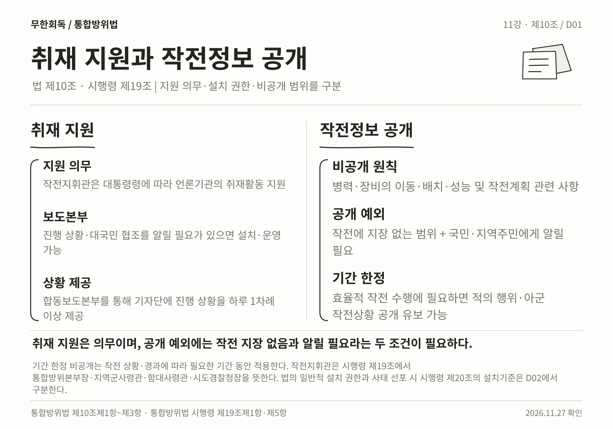
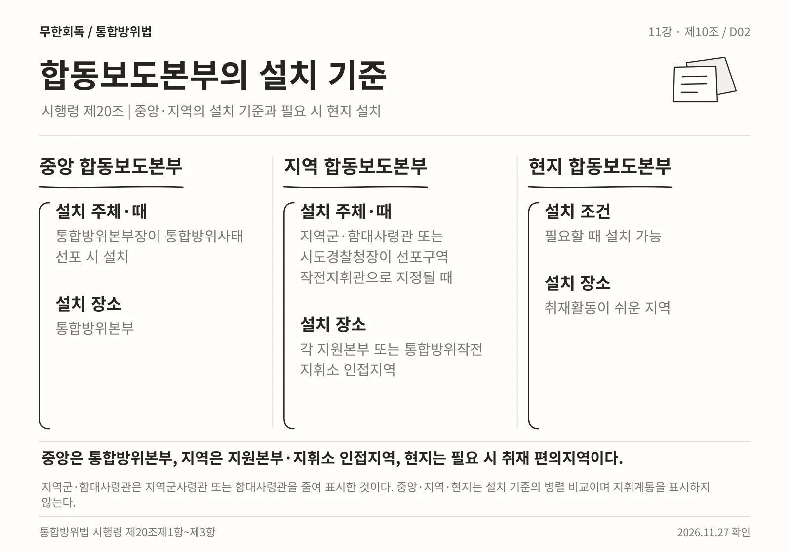
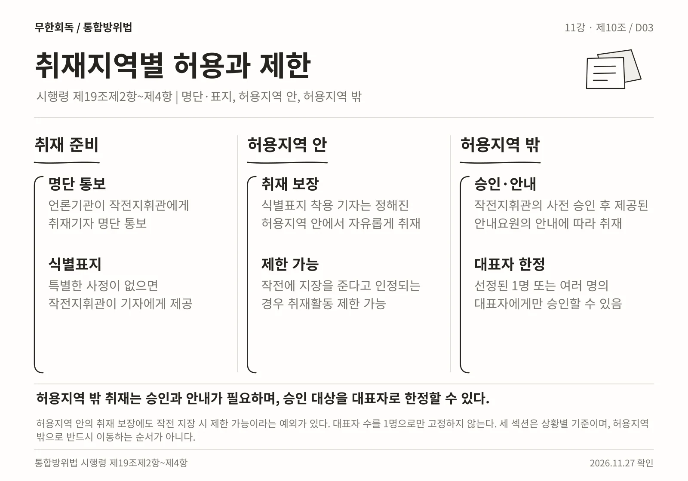

# 11강 · 합동보도본부 등

**TB-011 · 통합방위법 제10조 · 7번 선택 스타일 적용**

[전체 도식 목록](../../../notion-v1/)

## D01 · 취재 지원과 작전정보 공개

법 제10조 · 시행령 제19조 | 지원 의무·설치 권한·비공개 범위를 구분

[PNG](TB-011-D01-media-support-and-disclosure.png) · [SVG](TB-011-D01-media-support-and-disclosure.svg) · [WebP](TB-011-D01-media-support-and-disclosure.webp)

### 취재 지원

| 구분 | 내용 |
|---|---|
| 지원 의무 | 작전지휘관은 대통령령에 따라 언론기관의 취재활동 지원 |
| 보도본부 | 진행 상황·대국민 협조를 알릴 필요가 있으면 설치·운영 가능 |
| 상황 제공 | 합동보도본부를 통해 기자단에 진행 상황을 하루 1차례 이상 제공 |

### 작전정보 공개

| 구분 | 내용 |
|---|---|
| 비공개 원칙 | 병력·장비의 이동·배치·성능 및 작전계획 관련 사항 |
| 공개 예외 | 작전에 지장 없는 범위 + 국민·지역주민에게 알릴 필요 |
| 기간 한정 | 효율적 작전 수행에 필요하면 적의 행위·아군 작전상황 공개 유보 가능 |

**기억할 문장:** 취재 지원은 의무이며, 공개 예외에는 작전 지장 없음과 알릴 필요라는 두 조건이 필요하다.

### 조건·범위

- 기간 한정 비공개는 작전 상황·경과에 따라 필요한 기간 동안 적용한다.
- 작전지휘관은 시행령 제19조에서 통합방위본부장·지역군사령관·함대사령관·시도경찰청장을 뜻한다.
- 법의 일반적 설치 권한과 사태 선포 시 시행령 제20조의 설치기준은 D02에서 구분한다.

### 근거

- [통합방위법 제10조제1항~제3항](https://www.law.go.kr/LSW/lsInfoR.do?ancYnChk=0&chrClsCd=010202&efYd=20251001&lsiSeq=276315)
- [통합방위법 시행령 제19조제1항·제5항](https://www.law.go.kr/LSW/lsInfoR.do?ancYnChk=0&chrClsCd=010202&efYd=20261002&lsiSeq=290507)

## D02 · 합동보도본부의 설치 기준

시행령 제20조 | 중앙·지역의 설치 기준과 필요 시 현지 설치

[PNG](TB-011-D02-joint-media-headquarters.png) · [SVG](TB-011-D02-joint-media-headquarters.svg) · [WebP](TB-011-D02-joint-media-headquarters.webp)

### 중앙 합동보도본부

| 구분 | 내용 |
|---|---|
| 설치 주체·때 | 통합방위본부장이 통합방위사태 선포 시 설치 |
| 설치 장소 | 통합방위본부 |

### 지역 합동보도본부

| 구분 | 내용 |
|---|---|
| 설치 주체·때 | 지역군·함대사령관 또는 시도경찰청장이 선포구역 작전지휘관으로 지정될 때 |
| 설치 장소 | 각 지원본부 또는 통합방위작전 지휘소 인접지역 |

### 현지 합동보도본부

| 구분 | 내용 |
|---|---|
| 설치 조건 | 필요할 때 설치 가능 |
| 설치 장소 | 취재활동이 쉬운 지역 |

**기억할 문장:** 중앙은 통합방위본부, 지역은 지원본부·지휘소 인접지역, 현지는 필요 시 취재 편의지역이다.

### 조건·범위

- 지역군·함대사령관은 지역군사령관 또는 함대사령관을 줄여 표시한 것이다.
- 중앙·지역·현지는 설치 기준의 병렬 비교이며 지휘계통을 표시하지 않는다.

### 근거

- [통합방위법 시행령 제20조제1항~제3항](https://www.law.go.kr/lsLinkCommonInfo.do?chrClsCd=010202&lsJoLnkSeq=1030135783)

## D03 · 취재지역별 허용과 제한

시행령 제19조제2항~제4항 | 명단·표지, 허용지역 안, 허용지역 밖

[PNG](TB-011-D03-reporting-access-rules.png) · [SVG](TB-011-D03-reporting-access-rules.svg) · [WebP](TB-011-D03-reporting-access-rules.webp)

### 취재 준비

| 구분 | 내용 |
|---|---|
| 명단 통보 | 언론기관이 작전지휘관에게 취재기자 명단 통보 |
| 식별표지 | 특별한 사정이 없으면 작전지휘관이 기자에게 제공 |

### 허용지역 안

| 구분 | 내용 |
|---|---|
| 취재 보장 | 식별표지 착용 기자는 정해진 허용지역 안에서 자유롭게 취재 |
| 제한 가능 | 작전에 지장을 준다고 인정되는 경우 취재활동 제한 가능 |

### 허용지역 밖

| 구분 | 내용 |
|---|---|
| 승인·안내 | 작전지휘관의 사전 승인 후 제공된 안내요원의 안내에 따라 취재 |
| 대표자 한정 | 선정된 1명 또는 여러 명의 대표자에게만 승인할 수 있음 |

**기억할 문장:** 허용지역 밖 취재는 승인과 안내가 필요하며, 승인 대상을 대표자로 한정할 수 있다.

### 조건·범위

- 허용지역 안의 취재 보장에도 작전 지장 시 제한 가능이라는 예외가 있다.
- 대표자 수를 1명으로만 고정하지 않는다.
- 세 섹션은 상황별 기준이며, 허용지역 밖으로 반드시 이동하는 순서가 아니다.

### 근거

- [통합방위법 시행령 제19조제2항~제4항](https://www.law.go.kr/LSW/lsInfoR.do?ancYnChk=0&chrClsCd=010202&efYd=20261002&lsiSeq=290507)

