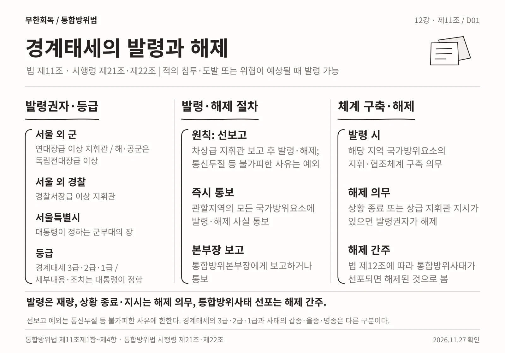
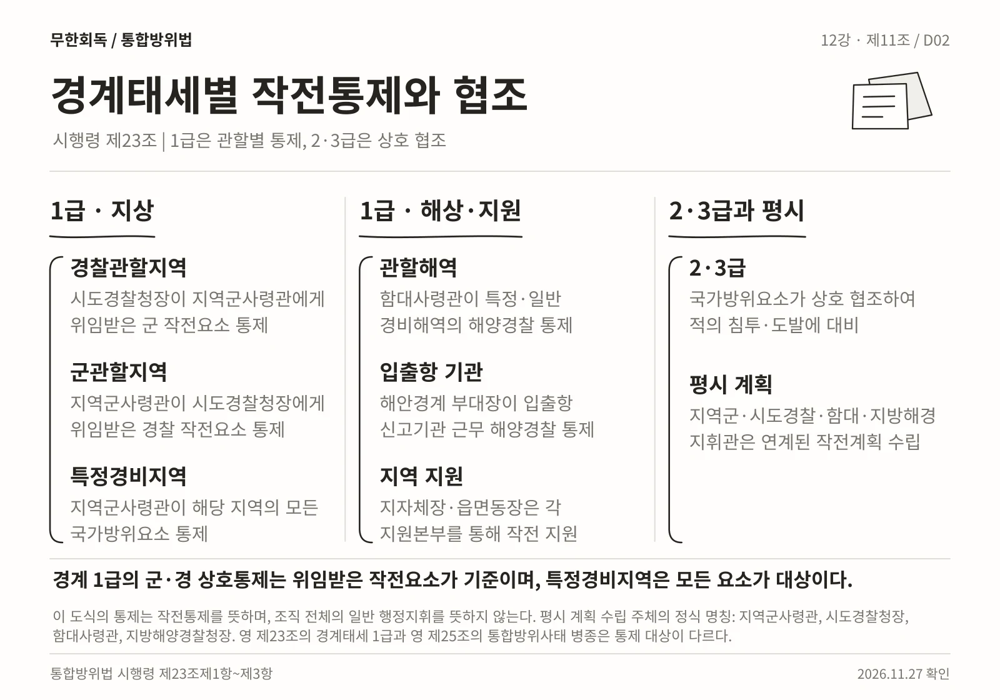

# 12강 · 경계태세

**TB-012 · 통합방위법 제11조 · 7번 선택 스타일 적용**

[전체 도식 목록](../../../notion-v1/)

## D01 · 경계태세의 발령과 해제

법 제11조 · 시행령 제21조·제22조 | 적의 침투·도발 또는 위협이 예상될 때 발령 가능

[PNG](TB-012-D01-alert-declaration-and-release.png) · [SVG](TB-012-D01-alert-declaration-and-release.svg) · [WebP](TB-012-D01-alert-declaration-and-release.webp)

### 발령권자·등급

| 구분 | 내용 |
|---|---|
| 서울 외 군 | 연대장급 이상 지휘관 / 해·공군은 독립전대장급 이상 |
| 서울 외 경찰 | 경찰서장급 이상 지휘관 |
| 서울특별시 | 대통령이 정하는 군부대의 장 |
| 등급 | 경계태세 3급·2급·1급 / 세부내용·조치는 대통령이 정함 |

### 발령·해제 절차

| 구분 | 내용 |
|---|---|
| 원칙: 선보고 | 차상급 지휘관 보고 후 발령·해제; 통신두절 등 불가피한 사유는 예외 |
| 즉시 통보 | 관할지역의 모든 국가방위요소에 발령·해제 사실 통보 |
| 본부장 보고 | 통합방위본부장에게 보고하거나 통보 |

### 체계 구축·해제

| 구분 | 내용 |
|---|---|
| 발령 시 | 해당 지역 국가방위요소의 지휘·협조체계 구축 의무 |
| 해제 의무 | 상황 종료 또는 상급 지휘관 지시가 있으면 발령권자가 해제 |
| 해제 간주 | 법 제12조에 따라 통합방위사태가 선포되면 해제된 것으로 봄 |

**기억할 문장:** 발령은 재량, 상황 종료·지시는 해제 의무, 통합방위사태 선포는 해제 간주.

### 조건·범위

- 법 제11조는 4개 항으로 구성된다. 발령권자·절차·등급의 세부사항은 시행령 제21조·제22조이다.
- 선보고 예외는 통신두절 등 불가피한 사유가 있을 때에 한한다.
- 서울특별시와 그 밖의 지역의 발령권자를 서로 혼합하지 않는다.
- 경계태세 3급·2급·1급을 통합방위사태 갑종·을종·병종에 일대일 대응시키지 않는다.

### 근거

- [통합방위법 제11조제1항~제4항](https://law.go.kr/lsLinkCommonInfo.do?lsJoLnkSeq=1010050927)
- [통합방위법 시행령 제21조·제22조](https://www.law.go.kr/LSW/lsInfoR.do?ancYnChk=0&chrClsCd=010202&efYd=20261002&lsiSeq=290507)

## D02 · 경계태세별 작전통제와 협조

시행령 제23조 | 1급은 관할별 통제, 2·3급은 상호 협조

[PNG](TB-012-D02-alert-command-and-cooperation.png) · [SVG](TB-012-D02-alert-command-and-cooperation.svg) · [WebP](TB-012-D02-alert-command-and-cooperation.webp)

### 1급 · 지상

| 구분 | 내용 |
|---|---|
| 경찰관할지역 | 시도경찰청장이 지역군사령관에게 위임받은 군 작전요소 통제 |
| 군관할지역 | 지역군사령관이 시도경찰청장에게 위임받은 경찰 작전요소 통제 |
| 특정경비지역 | 지역군사령관이 해당 지역의 모든 국가방위요소 통제 |

### 1급 · 해상·지원

| 구분 | 내용 |
|---|---|
| 관할해역 | 함대사령관이 특정·일반 경비해역의 해양경찰 통제 |
| 입출항 기관 | 해안경계 부대장이 입출항 신고기관 근무 해양경찰 통제 |
| 지역 지원 | 지자체장·읍면동장은 각 지원본부를 통해 작전 지원 |

### 2·3급과 평시

| 구분 | 내용 |
|---|---|
| 2·3급 | 국가방위요소가 상호 협조하여 적의 침투·도발에 대비 |
| 평시 계획 | 지역군·시도경찰·함대·지방해경 지휘관은 연계된 작전계획 수립 |

**기억할 문장:** 경계 1급의 군·경 상호통제는 위임받은 작전요소가 기준이며, 특정경비지역은 모든 요소가 대상이다.

### 조건·범위

- 이 도식의 통제는 작전통제를 뜻하며, 조직 전체의 일반 행정지휘를 뜻하지 않는다.
- 평시 계획 수립 주체의 정식 명칭: 지역군사령관, 시도경찰청장, 함대사령관, 지방해양경찰청장.
- 영 제23조의 경계태세 1급과 영 제25조의 통합방위사태 병종은 통제 대상이 다르다.

### 근거

- [통합방위법 시행령 제23조제1항~제3항](https://www.law.go.kr/LSW/lsInfoR.do?ancYnChk=0&chrClsCd=010202&efYd=20261002&lsiSeq=290507)

