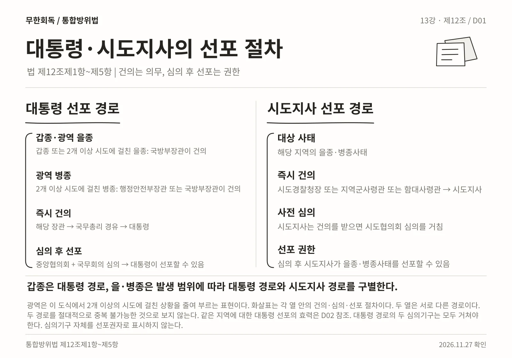
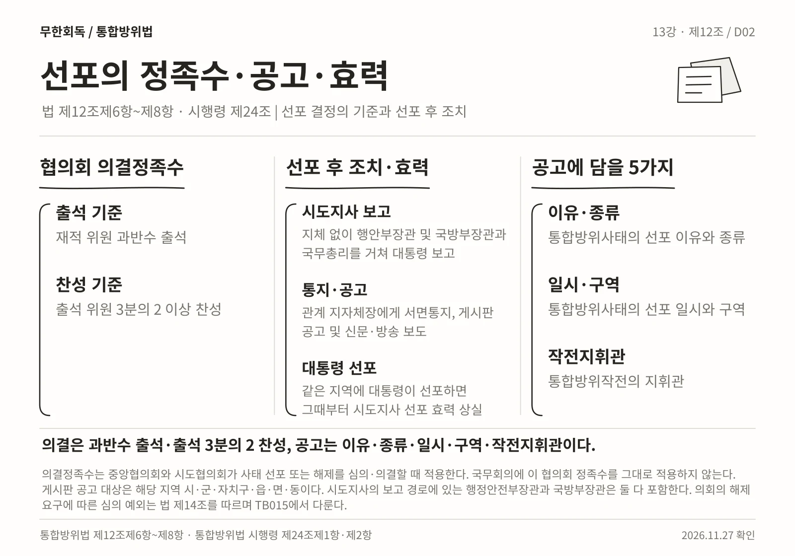

# 13강 · 통합방위사태의 선포

**TB-013 · 통합방위법 제12조 · 7번 선택 스타일 적용**

[전체 도식 목록](../../../notion-v1/)

## D01 · 대통령·시도지사의 선포 절차

법 제12조제1항~제5항 | 건의는 의무, 심의 후 선포는 권한

[PNG](TB-013-D01-declaration-authorities-and-procedure.png) · [SVG](TB-013-D01-declaration-authorities-and-procedure.svg) · [WebP](TB-013-D01-declaration-authorities-and-procedure.webp)

### 대통령 선포 경로

| 구분 | 내용 |
|---|---|
| 갑종·광역 을종 | 갑종 또는 2개 이상 시도에 걸친 을종: 국방부장관이 건의 |
| 광역 병종 | 2개 이상 시도에 걸친 병종: 행정안전부장관 또는 국방부장관이 건의 |
| 즉시 건의 | 해당 장관 → 국무총리 경유 → 대통령 |
| 심의 후 선포 | 중앙협의회 + 국무회의 심의 → 대통령이 선포할 수 있음 |

### 시도지사 선포 경로

| 구분 | 내용 |
|---|---|
| 대상 사태 | 해당 지역의 을종·병종사태 |
| 즉시 건의 | 시도경찰청장 또는 지역군사령관 또는 함대사령관 → 시도지사 |
| 사전 심의 | 시도지사는 건의를 받으면 시도협의회 심의를 거침 |
| 선포 권한 | 심의 후 시도지사가 을종·병종사태를 선포할 수 있음 |

**기억할 문장:** 갑종은 대통령 경로, 을·병종은 발생 범위에 따라 대통령 경로와 시도지사 경로를 구별한다.

### 조건·범위

- 광역은 이 도식에서 2개 이상의 시도에 걸친 상황을 줄여 부르는 표현이다.
- 화살표는 각 열 안의 건의·심의·선포 절차이다. 두 열은 서로 다른 경로이다.
- 두 경로를 절대적으로 중복 불가능한 것으로 보지 않는다. 같은 지역에 대한 대통령 선포의 효력은 D02 참조.
- 대통령 경로의 두 심의기구는 모두 거쳐야 한다. 심의기구 자체를 선포권자로 표시하지 않는다.

### 근거

- [통합방위법 제12조제1항~제5항](https://law.go.kr/lsLinkCommonInfo.do?lsJoLnkSeq=1021980027)

## D02 · 선포의 정족수·공고·효력

법 제12조제6항~제8항 · 시행령 제24조 | 선포 결정의 기준과 선포 후 조치

[PNG](TB-013-D02-declaration-publication-and-effect.png) · [SVG](TB-013-D02-declaration-publication-and-effect.svg) · [WebP](TB-013-D02-declaration-publication-and-effect.webp)

### 협의회 의결정족수

| 구분 | 내용 |
|---|---|
| 출석 기준 | 재적 위원 과반수 출석 |
| 찬성 기준 | 출석 위원 3분의 2 이상 찬성 |

### 선포 후 조치·효력

| 구분 | 내용 |
|---|---|
| 시도지사 보고 | 지체 없이 행안부장관 및 국방부장관과 국무총리를 거쳐 대통령 보고 |
| 통지·공고 | 관계 지자체장에게 서면통지, 게시판 공고 및 신문·방송 보도 |
| 대통령 선포 | 같은 지역에 대통령이 선포하면 그때부터 시도지사 선포 효력 상실 |

### 공고에 담을 5가지

| 구분 | 내용 |
|---|---|
| 이유·종류 | 통합방위사태의 선포 이유와 종류 |
| 일시·구역 | 통합방위사태의 선포 일시와 구역 |
| 작전지휘관 | 통합방위작전의 지휘관 |

**기억할 문장:** 의결은 과반수 출석·출석 3분의 2 찬성, 공고는 이유·종류·일시·구역·작전지휘관이다.

### 조건·범위

- 의결정족수는 중앙협의회와 시도협의회가 사태 선포 또는 해제를 심의·의결할 때 적용한다.
- 국무회의에 이 협의회 정족수를 그대로 적용하지 않는다.
- 게시판 공고 대상은 해당 지역 시·군·자치구·읍·면·동이다.
- 시도지사의 보고 경로에 있는 행정안전부장관과 국방부장관은 둘 다 포함한다.
- 의회의 해제 요구에 따른 심의 예외는 법 제14조를 따르며 TB015에서 다룬다.

### 근거

- [통합방위법 제12조제6항~제8항](https://law.go.kr/lsLinkCommonInfo.do?lsJoLnkSeq=1021980027)
- [통합방위법 시행령 제24조제1항·제2항](https://www.law.go.kr/LSW/lsInfoR.do?ancYnChk=0&chrClsCd=010202&efYd=20261002&lsiSeq=290507)

