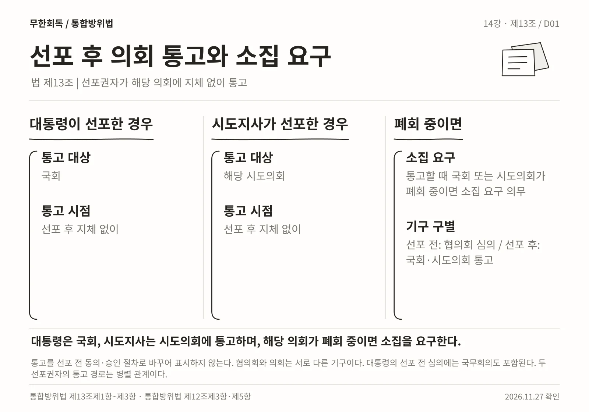

# 14강 · 국회 또는 시도의회에 대한 통고

**TB-014 · 통합방위법 제13조 · 7번 선택 스타일 적용**

[전체 도식 목록](../../../notion-v1/)

## D01 · 선포 후 의회 통고와 소집 요구

법 제13조 | 선포권자가 해당 의회에 지체 없이 통고

[PNG](TB-014-D01-notice-to-legislatures.png) · [SVG](TB-014-D01-notice-to-legislatures.svg) · [WebP](TB-014-D01-notice-to-legislatures.webp)

### 대통령이 선포한 경우

| 구분 | 내용 |
|---|---|
| 통고 대상 | 국회 |
| 통고 시점 | 선포 후 지체 없이 |

### 시도지사가 선포한 경우

| 구분 | 내용 |
|---|---|
| 통고 대상 | 해당 시도의회 |
| 통고 시점 | 선포 후 지체 없이 |

### 폐회 중이면

| 구분 | 내용 |
|---|---|
| 소집 요구 | 통고할 때 국회 또는 시도의회가 폐회 중이면 소집 요구 의무 |
| 기구 구별 | 선포 전: 협의회 심의 / 선포 후: 국회·시도의회 통고 |

**기억할 문장:** 대통령은 국회, 시도지사는 시도의회에 통고하며, 해당 의회가 폐회 중이면 소집을 요구한다.

### 조건·범위

- 통고를 선포 전 동의·승인 절차로 바꾸어 표시하지 않는다.
- 협의회와 의회는 서로 다른 기구이다. 대통령의 선포 전 심의에는 국무회의도 포함된다.
- 두 선포권자의 통고 경로는 병렬 관계이다.

### 근거

- [통합방위법 제13조제1항~제3항](https://www.law.go.kr/LSW/lsInfoR.do?ancYnChk=0&chrClsCd=010202&efYd=20251001&lsiSeq=276315)
- [통합방위법 제12조제3항·제5항](https://www.law.go.kr/LSW/lsInfoR.do?ancYnChk=0&chrClsCd=010202&efYd=20251001&lsiSeq=276315)

