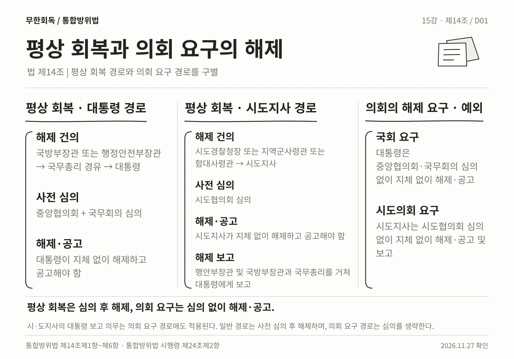

# 15강 · 통합방위사태의 해제

**TB-015 · 통합방위법 제14조 · 7번 선택 스타일 적용**

[전체 도식 목록](../../../notion-v1/)

## D01 · 평상 회복과 의회 요구의 해제

법 제14조 | 평상 회복 경로와 의회 요구 경로를 구별

[PNG](TB-015-D01-termination-procedure-and-exception.png) · [SVG](TB-015-D01-termination-procedure-and-exception.svg) · [WebP](TB-015-D01-termination-procedure-and-exception.webp)

### 평상 회복 · 대통령 경로

| 구분 | 내용 |
|---|---|
| 해제 건의 | 국방부장관 또는 행정안전부장관 → 국무총리 경유 → 대통령 |
| 사전 심의 | 중앙협의회 + 국무회의 심의 |
| 해제·공고 | 대통령이 지체 없이 해제하고 공고해야 함 |

### 평상 회복 · 시도지사 경로

| 구분 | 내용 |
|---|---|
| 해제 건의 | 시도경찰청장 또는 지역군사령관 또는 함대사령관 → 시도지사 |
| 사전 심의 | 시도협의회 심의 |
| 해제·공고 | 시도지사가 지체 없이 해제하고 공고해야 함 |
| 해제 보고 | 행안부장관 및 국방부장관과 국무총리를 거쳐 대통령에게 보고 |

### 의회의 해제 요구 · 예외

| 구분 | 내용 |
|---|---|
| 국회 요구 | 대통령은 중앙협의회·국무회의 심의 없이 지체 없이 해제·공고 |
| 시도의회 요구 | 시도지사는 시도협의회 심의 없이 지체 없이 해제·공고 및 보고 |

**기억할 문장:** 평상 회복은 심의 후 해제, 의회 요구는 심의 없이 해제·공고.

### 조건·범위

- 평상 회복 경로는 건의 → 심의 → 해제·공고 순서이다. 심의와 해제의 순서를 뒤집지 않는다.
- 세 번째 섹션은 첫째·둘째 경로의 심의 단계를 건너뛰는 별도 조건 분기이다.
- 법 제14조제1항·제4항은 평상상태 회복 또는 해당 의회의 해제 요구를 해제 사유로 정한다.
- 해제 건의도 평상상태 회복 시의 의무이며, 시도지사의 대통령 보고 의무는 의회 요구 경로에도 적용된다.
- 선포·해제 시 서면통지·게시판 공고·신문방송 보도 방법은 시행령 제24조제2항에 따른다.

### 근거

- [통합방위법 제14조제1항~제6항](https://www.law.go.kr/LSW/lsInfoR.do?ancYnChk=0&chrClsCd=010202&efYd=20251001&lsiSeq=276315)
- [통합방위법 시행령 제24조제2항](https://www.law.go.kr/LSW/lsInfoR.do?ancYnChk=0&chrClsCd=010202&efYd=20261002&lsiSeq=290507)

