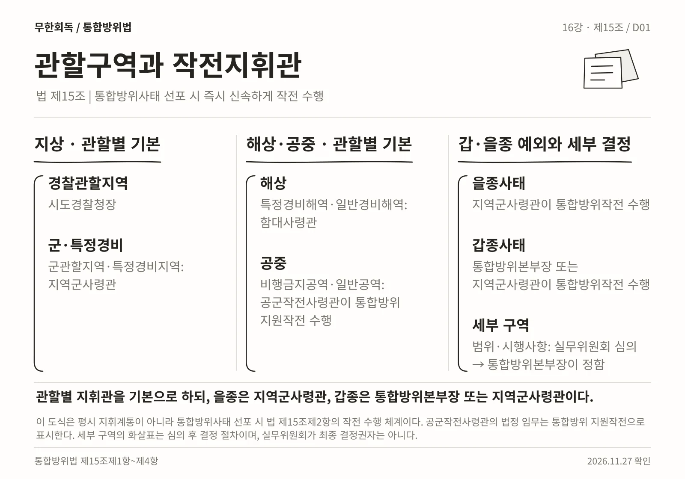
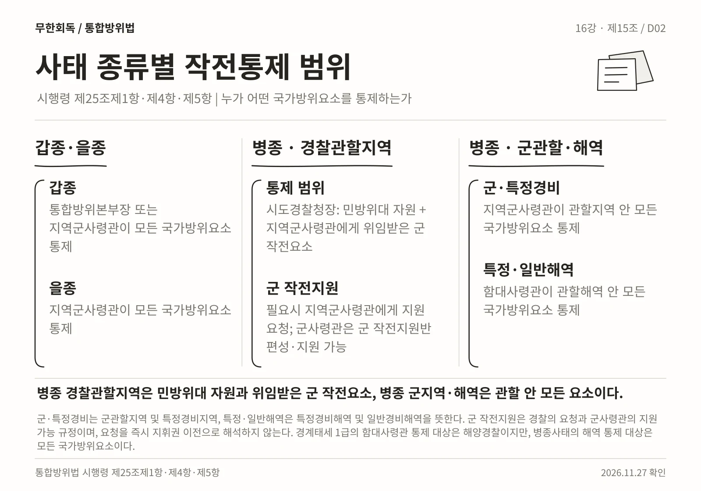
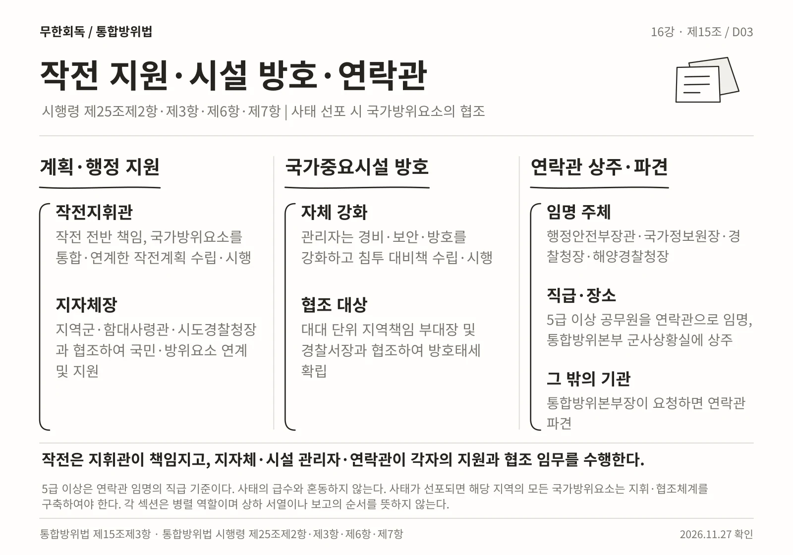
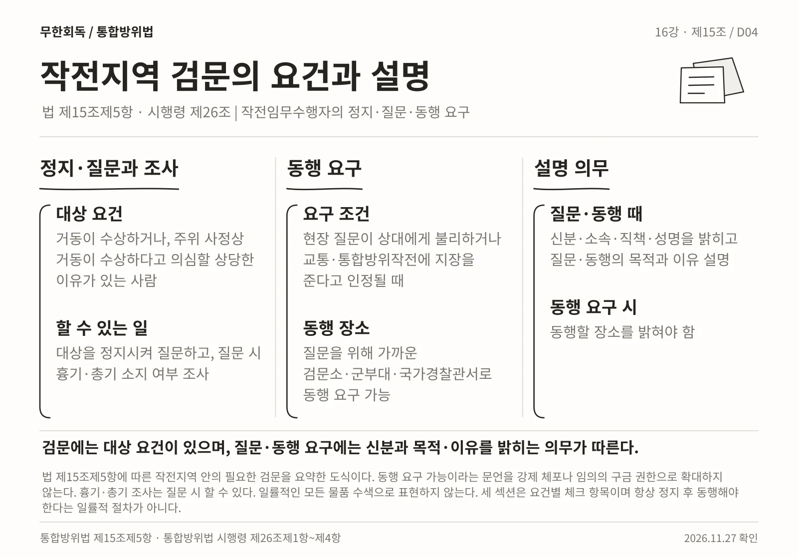

# 16강 · 통합방위작전

**TB-016 · 통합방위법 제15조 · 7번 선택 스타일 적용**

[전체 도식 목록](../../../notion-v1/)

## D01 · 관할구역과 작전지휘관

법 제15조 | 통합방위사태 선포 시 즉시 신속하게 작전 수행

[PNG](TB-016-D01-operation-areas-and-commanders.png) · [SVG](TB-016-D01-operation-areas-and-commanders.svg) · [WebP](TB-016-D01-operation-areas-and-commanders.webp)

### 지상 · 관할별 기본

| 구분 | 내용 |
|---|---|
| 경찰관할지역 | 시도경찰청장 |
| 군·특정경비 | 군관할지역·특정경비지역: 지역군사령관 |

### 해상·공중 · 관할별 기본

| 구분 | 내용 |
|---|---|
| 해상 | 특정경비해역·일반경비해역: 함대사령관 |
| 공중 | 비행금지공역·일반공역: 공군작전사령관이 통합방위 지원작전 수행 |

### 갑·을종 예외와 세부 결정

| 구분 | 내용 |
|---|---|
| 을종사태 | 지역군사령관이 통합방위작전 수행 |
| 갑종사태 | 통합방위본부장 또는 지역군사령관이 통합방위작전 수행 |
| 세부 구역 | 범위·시행사항: 실무위원회 심의 → 통합방위본부장이 정함 |

**기억할 문장:** 관할별 지휘관을 기본으로 하되, 을종은 지역군사령관, 갑종은 통합방위본부장 또는 지역군사령관이다.

### 조건·범위

- 이 도식은 평시 지휘계통이 아니라 통합방위사태 선포 시 법 제15조제2항의 작전 수행 체계이다.
- 공군작전사령관의 법정 임무는 통합방위 지원작전으로 표시한다.
- 세부 구역의 화살표는 심의 후 결정 절차이며, 실무위원회가 최종 결정권자는 아니다.

### 근거

- [통합방위법 제15조제1항~제4항](https://www.law.go.kr/lsLinkCommonInfo.do?chrClsCd=010202&lsJoLnkSeq=1029461673)

## D02 · 사태 종류별 작전통제 범위

시행령 제25조제1항·제4항·제5항 | 누가 어떤 국가방위요소를 통제하는가

[PNG](TB-016-D02-operation-control-by-state.png) · [SVG](TB-016-D02-operation-control-by-state.svg) · [WebP](TB-016-D02-operation-control-by-state.webp)

### 갑종·을종

| 구분 | 내용 |
|---|---|
| 갑종 | 통합방위본부장 또는 지역군사령관이 모든 국가방위요소 통제 |
| 을종 | 지역군사령관이 모든 국가방위요소 통제 |

### 병종 · 경찰관할지역

| 구분 | 내용 |
|---|---|
| 통제 범위 | 시도경찰청장: 민방위대 자원 + 지역군사령관에게 위임받은 군 작전요소 |
| 군 작전지원 | 필요시 지역군사령관에게 지원 요청; 군사령관은 군 작전지원반 편성·지원 가능 |

### 병종 · 군관할·해역

| 구분 | 내용 |
|---|---|
| 군·특정경비 | 지역군사령관이 관할지역 안 모든 국가방위요소 통제 |
| 특정·일반해역 | 함대사령관이 관할해역 안 모든 국가방위요소 통제 |

**기억할 문장:** 병종 경찰관할지역은 민방위대 자원과 위임받은 군 작전요소, 병종 군지역·해역은 관할 안 모든 요소이다.

### 조건·범위

- 군·특정경비는 군관할지역 및 특정경비지역, 특정·일반해역은 특정경비해역 및 일반경비해역을 뜻한다.
- 군 작전지원은 경찰의 요청과 군사령관의 지원 가능 규정이며, 요청을 즉시 지휘권 이전으로 해석하지 않는다.
- 경계태세 1급의 함대사령관 통제 대상은 해양경찰이지만, 병종사태의 해역 통제 대상은 모든 국가방위요소이다.

### 근거

- [통합방위법 시행령 제25조제1항·제4항·제5항](https://law.go.kr/lsLinkCommonInfo.do?chrClsCd=010202&lspttninfSeq=64943)

## D03 · 작전 지원·시설 방호·연락관

시행령 제25조제2항·제3항·제6항·제7항 | 사태 선포 시 국가방위요소의 협조

[PNG](TB-016-D03-operation-support-and-liaison.png) · [SVG](TB-016-D03-operation-support-and-liaison.svg) · [WebP](TB-016-D03-operation-support-and-liaison.webp)

### 계획·행정 지원

| 구분 | 내용 |
|---|---|
| 작전지휘관 | 작전 전반 책임, 국가방위요소를 통합·연계한 작전계획 수립·시행 |
| 지자체장 | 지역군·함대사령관·시도경찰청장과 협조하여 국민·방위요소 연계 및 지원 |

### 국가중요시설 방호

| 구분 | 내용 |
|---|---|
| 자체 강화 | 관리자는 경비·보안·방호를 강화하고 침투 대비책 수립·시행 |
| 협조 대상 | 대대 단위 지역책임 부대장 및 경찰서장과 협조하여 방호태세 확립 |

### 연락관 상주·파견

| 구분 | 내용 |
|---|---|
| 임명 주체 | 행정안전부장관·국가정보원장·경찰청장·해양경찰청장 |
| 직급·장소 | 5급 이상 공무원을 연락관으로 임명, 통합방위본부 군사상황실에 상주 |
| 그 밖의 기관 | 통합방위본부장이 요청하면 연락관 파견 |

**기억할 문장:** 작전은 지휘관이 책임지고, 지자체·시설 관리자·연락관이 각자의 지원과 협조 임무를 수행한다.

### 조건·범위

- 5급 이상은 연락관 임명의 직급 기준이다. 사태의 급수와 혼동하지 않는다.
- 사태가 선포되면 해당 지역의 모든 국가방위요소는 지휘·협조체계를 구축하여야 한다.
- 각 섹션은 병렬 역할이며 상하 서열이나 보고의 순서를 뜻하지 않는다.

### 근거

- [통합방위법 제15조제3항](https://www.law.go.kr/LSW/lsInfoR.do?ancYnChk=0&chrClsCd=010202&efYd=20251001&lsiSeq=276315)
- [통합방위법 시행령 제25조제2항·제3항·제6항·제7항](https://www.law.go.kr/LSW/lsInfoR.do?ancYnChk=0&chrClsCd=010202&efYd=20261002&lsiSeq=290507)

## D04 · 작전지역 검문의 요건과 설명

법 제15조제5항 · 시행령 제26조 | 작전임무수행자의 정지·질문·동행 요구

[PNG](TB-016-D04-operation-checkpoint-procedure.png) · [SVG](TB-016-D04-operation-checkpoint-procedure.svg) · [WebP](TB-016-D04-operation-checkpoint-procedure.webp)

### 정지·질문과 조사

| 구분 | 내용 |
|---|---|
| 대상 요건 | 거동이 수상하거나, 주위 사정상 거동이 수상하다고 의심할 상당한 이유가 있는 사람 |
| 할 수 있는 일 | 대상을 정지시켜 질문하고, 질문 시 흉기·총기 소지 여부 조사 |

### 동행 요구

| 구분 | 내용 |
|---|---|
| 요구 조건 | 현장 질문이 상대에게 불리하거나 교통·통합방위작전에 지장을 준다고 인정될 때 |
| 동행 장소 | 질문을 위해 가까운 검문소·군부대·국가경찰관서로 동행 요구 가능 |

### 설명 의무

| 구분 | 내용 |
|---|---|
| 질문·동행 때 | 신분·소속·직책·성명을 밝히고 질문·동행의 목적과 이유 설명 |
| 동행 요구 시 | 동행할 장소를 밝혀야 함 |

**기억할 문장:** 검문에는 대상 요건이 있으며, 질문·동행 요구에는 신분과 목적·이유를 밝히는 의무가 따른다.

### 조건·범위

- 법 제15조제5항에 따른 작전지역 안의 필요한 검문을 요약한 도식이다.
- 동행 요구 가능이라는 문언을 강제 체포나 임의의 구금 권한으로 확대하지 않는다.
- 흉기·총기 조사는 질문 시 할 수 있다. 일률적인 모든 물품 수색으로 표현하지 않는다.
- 세 섹션은 요건별 체크 항목이며 항상 정지 후 동행해야 한다는 일률적 절차가 아니다.

### 근거

- [통합방위법 제15조제5항](https://www.law.go.kr/LSW/lsInfoR.do?ancYnChk=0&chrClsCd=010202&efYd=20251001&lsiSeq=276315)
- [통합방위법 시행령 제26조제1항~제4항](https://www.law.go.kr/LSW/lsInfoR.do?ancYnChk=0&chrClsCd=010202&efYd=20261002&lsiSeq=290507)

