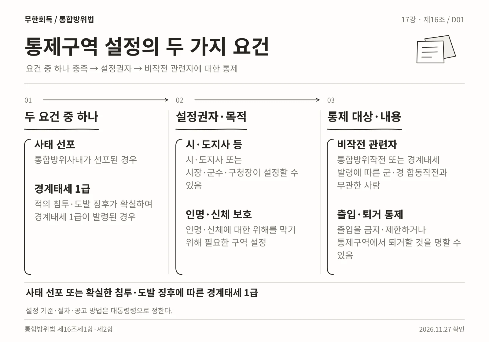
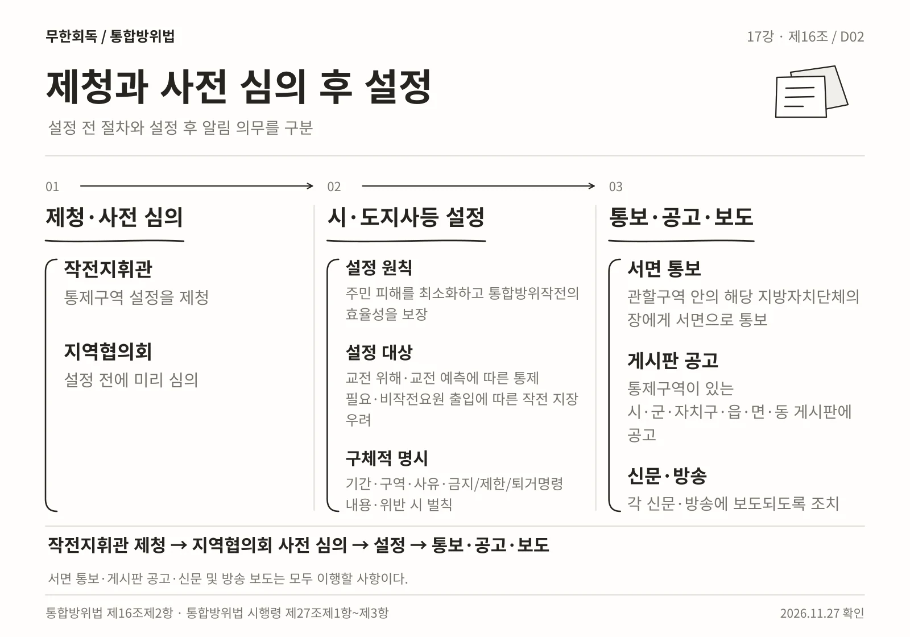

# 17강 · 통제구역

**TB-017 · 통합방위법 제16조 · 7번 선택 스타일 적용**

[전체 도식 목록](../../../notion-v1/)

## D01 · 통제구역 설정의 두 가지 요건

요건 중 하나 충족 → 설정권자 → 비작전 관련자에 대한 통제

[PNG](TB-017-D01-controlled-area-authority.png) · [SVG](TB-017-D01-controlled-area-authority.svg) · [WebP](TB-017-D01-controlled-area-authority.webp)

### ① 두 요건 중 하나

| 구분 | 내용 |
|---|---|
| 사태 선포 | 통합방위사태가 선포된 경우 |
| 경계태세 1급 | 적의 침투·도발 징후가 확실하여 경계태세 1급이 발령된 경우 |

### ② 설정권자·목적

| 구분 | 내용 |
|---|---|
| 시·도지사 등 | 시·도지사 또는 시장·군수·구청장이 설정할 수 있음 |
| 인명·신체 보호 | 인명·신체에 대한 위해를 막기 위해 필요한 구역 설정 |

### ③ 통제 대상·내용

| 구분 | 내용 |
|---|---|
| 비작전 관련자 | 통합방위작전 또는 경계태세 발령에 따른 군·경 합동작전과 무관한 사람 |
| 출입·퇴거 통제 | 출입을 금지·제한하거나 통제구역에서 퇴거할 것을 명할 수 있음 |

**기억할 문장:** 사태 선포 또는 확실한 침투·도발 징후에 따른 경계태세 1급

### 조건·범위

- 설정 기준·절차·공고 방법은 대통령령으로 정한다.

### 근거

- [통합방위법 제16조제1항·제2항](https://www.law.go.kr/LSW/lsInfoR.do?ancYnChk=0&chrClsCd=010202&efYd=20251001&lsiSeq=276315)

## D02 · 제청과 사전 심의 후 설정

설정 전 절차와 설정 후 알림 의무를 구분

[PNG](TB-017-D02-controlled-area-procedure.png) · [SVG](TB-017-D02-controlled-area-procedure.svg) · [WebP](TB-017-D02-controlled-area-procedure.webp)

### ① 제청·사전 심의

| 구분 | 내용 |
|---|---|
| 작전지휘관 | 통제구역 설정을 제청 |
| 지역협의회 | 설정 전에 미리 심의 |

### ② 시·도지사등 설정

| 구분 | 내용 |
|---|---|
| 설정 원칙 | 주민 피해를 최소화하고 통합방위작전의 효율성을 보장 |
| 설정 대상 | 교전 위해·교전 예측에 따른 통제 필요·비작전요원 출입에 따른 작전 지장 우려 |
| 구체적 명시 | 기간·구역·사유·금지/제한/퇴거명령 내용·위반 시 벌칙 |

### ③ 통보·공고·보도

| 구분 | 내용 |
|---|---|
| 서면 통보 | 관할구역 안의 해당 지방자치단체의 장에게 서면으로 통보 |
| 게시판 공고 | 통제구역이 있는 시·군·자치구·읍·면·동 게시판에 공고 |
| 신문·방송 | 각 신문·방송에 보도되도록 조치 |

**기억할 문장:** 작전지휘관 제청 → 지역협의회 사전 심의 → 설정 → 통보·공고·보도

### 조건·범위

- 서면 통보·게시판 공고·신문 및 방송 보도는 모두 이행할 사항이다.

### 근거

- [통합방위법 제16조제2항](https://www.law.go.kr/LSW/lsInfoR.do?ancYnChk=0&chrClsCd=010202&efYd=20251001&lsiSeq=276315)
- [통합방위법 시행령 제27조제1항~제3항](https://www.law.go.kr/LSW/lsInfoR.do?ancYnChk=0&chrClsCd=010202&efYd=20261002&lsiSeq=290507)

