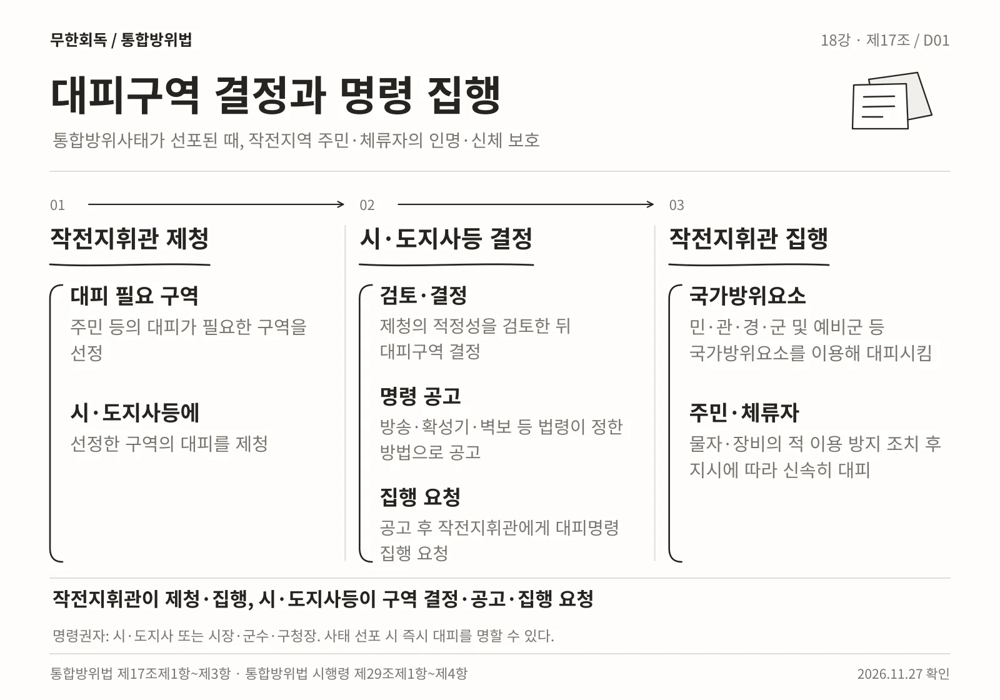
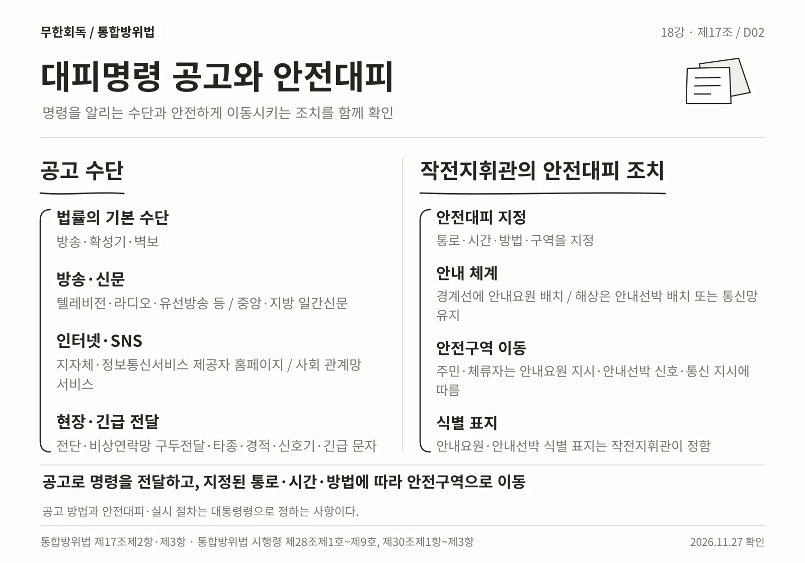

# 18강 · 대피명령

**TB-018 · 통합방위법 제17조 · 7번 선택 스타일 적용**

[전체 도식 목록](../../../notion-v1/)

## D01 · 대피구역 결정과 명령 집행

통합방위사태가 선포된 때, 작전지역 주민·체류자의 인명·신체 보호

[PNG](TB-018-D01-evacuation-order-procedure.png) · [SVG](TB-018-D01-evacuation-order-procedure.svg) · [WebP](TB-018-D01-evacuation-order-procedure.webp)

### ① 작전지휘관 제청

| 구분 | 내용 |
|---|---|
| 대피 필요 구역 | 주민 등의 대피가 필요한 구역을 선정 |
| 시·도지사등에 | 선정한 구역의 대피를 제청 |

### ② 시·도지사등 결정

| 구분 | 내용 |
|---|---|
| 검토·결정 | 제청의 적정성을 검토한 뒤 대피구역 결정 |
| 명령 공고 | 방송·확성기·벽보 등 법령이 정한 방법으로 공고 |
| 집행 요청 | 공고 후 작전지휘관에게 대피명령 집행 요청 |

### ③ 작전지휘관 집행

| 구분 | 내용 |
|---|---|
| 국가방위요소 | 민·관·경·군 및 예비군 등 국가방위요소를 이용해 대피시킴 |
| 주민·체류자 | 물자·장비의 적 이용 방지 조치 후 지시에 따라 신속히 대피 |

**기억할 문장:** 작전지휘관이 제청·집행, 시·도지사등이 구역 결정·공고·집행 요청

### 조건·범위

- 명령권자: 시·도지사 또는 시장·군수·구청장. 사태 선포 시 즉시 대피를 명할 수 있다.

### 근거

- [통합방위법 제17조제1항~제3항](https://www.law.go.kr/LSW/lsInfoR.do?ancYnChk=0&chrClsCd=010202&efYd=20251001&lsiSeq=276315)
- [통합방위법 시행령 제29조제1항~제4항](https://www.law.go.kr/LSW/lsInfoR.do?ancYnChk=0&chrClsCd=010202&efYd=20261002&lsiSeq=290507)

## D02 · 대피명령 공고와 안전대피

명령을 알리는 수단과 안전하게 이동시키는 조치를 함께 확인

[PNG](TB-018-D02-evacuation-notice-safety.png) · [SVG](TB-018-D02-evacuation-notice-safety.svg) · [WebP](TB-018-D02-evacuation-notice-safety.webp)

### 공고 수단

| 구분 | 내용 |
|---|---|
| 법률의 기본 수단 | 방송·확성기·벽보 |
| 방송·신문 | 텔레비전·라디오·유선방송 등 / 중앙·지방 일간신문 |
| 인터넷·SNS | 지자체·정보통신서비스 제공자 홈페이지 / 사회 관계망 서비스 |
| 현장·긴급 전달 | 전단·비상연락망 구두전달·타종·경적·신호기·긴급 문자 |

### 작전지휘관의 안전대피 조치

| 구분 | 내용 |
|---|---|
| 안전대피 지정 | 통로·시간·방법·구역을 지정 |
| 안내 체계 | 경계선에 안내요원 배치 / 해상은 안내선박 배치 또는 통신망 유지 |
| 안전구역 이동 | 주민·체류자는 안내요원 지시·안내선박 신호·통신 지시에 따름 |
| 식별 표지 | 안내요원·안내선박 식별 표지는 작전지휘관이 정함 |

**기억할 문장:** 공고로 명령을 전달하고, 지정된 통로·시간·방법에 따라 안전구역으로 이동

### 조건·범위

- 공고 방법과 안전대피·실시 절차는 대통령령으로 정하는 사항이다.

### 근거

- [통합방위법 제17조제2항·제3항](https://www.law.go.kr/LSW/lsInfoR.do?ancYnChk=0&chrClsCd=010202&efYd=20251001&lsiSeq=276315)
- [통합방위법 시행령 제28조제1호~제9호, 제30조제1항~제3항](https://www.law.go.kr/LSW/lsInfoR.do?ancYnChk=0&chrClsCd=010202&efYd=20261002&lsiSeq=290507)

