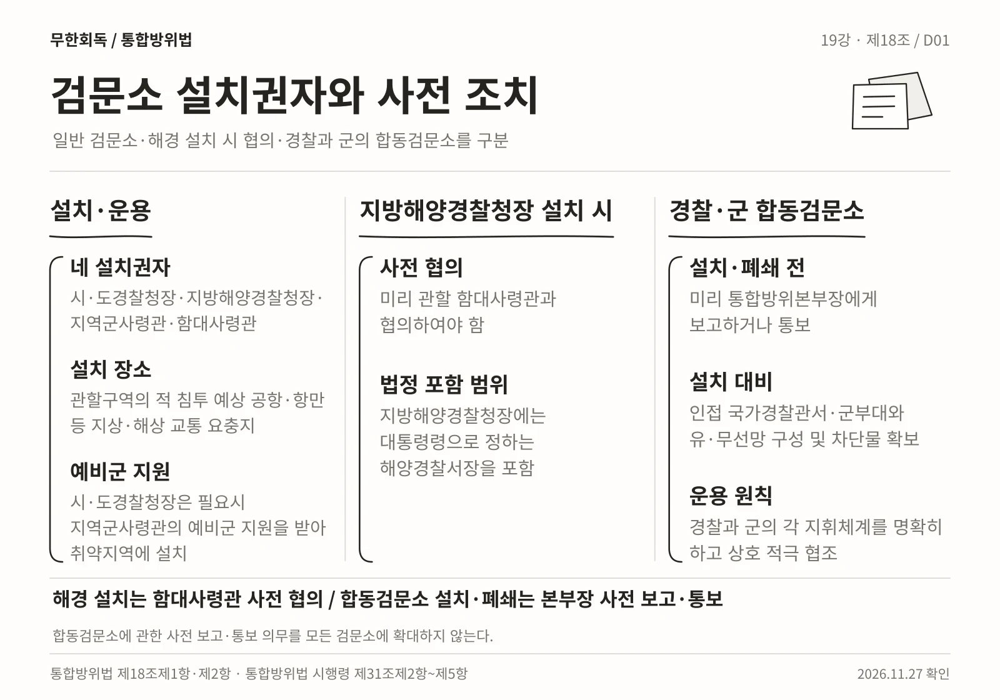

# 19강 · 검문소의 운용

**TB-019 · 통합방위법 제18조 · 7번 선택 스타일 적용**

[전체 도식 목록](../../../notion-v1/)

## D01 · 검문소 설치권자와 사전 조치

일반 검문소·해경 설치 시 협의·경찰과 군의 합동검문소를 구분

[PNG](TB-019-D01-checkpoint-authority-operation.png) · [SVG](TB-019-D01-checkpoint-authority-operation.svg) · [WebP](TB-019-D01-checkpoint-authority-operation.webp)

### 설치·운용

| 구분 | 내용 |
|---|---|
| 네 설치권자 | 시·도경찰청장·지방해양경찰청장·지역군사령관·함대사령관 |
| 설치 장소 | 관할구역의 적 침투 예상 공항·항만 등 지상·해상 교통 요충지 |
| 예비군 지원 | 시·도경찰청장은 필요시 지역군사령관의 예비군 지원을 받아 취약지역에 설치 |

### 지방해양경찰청장 설치 시

| 구분 | 내용 |
|---|---|
| 사전 협의 | 미리 관할 함대사령관과 협의하여야 함 |
| 법정 포함 범위 | 지방해양경찰청장에는 대통령령으로 정하는 해양경찰서장을 포함 |

### 경찰·군 합동검문소

| 구분 | 내용 |
|---|---|
| 설치·폐쇄 전 | 미리 통합방위본부장에게 보고하거나 통보 |
| 설치 대비 | 인접 국가경찰관서·군부대와 유·무선망 구성 및 차단물 확보 |
| 운용 원칙 | 경찰과 군의 각 지휘체계를 명확히 하고 상호 적극 협조 |

**기억할 문장:** 해경 설치는 함대사령관 사전 협의 / 합동검문소 설치·폐쇄는 본부장 사전 보고·통보

### 조건·범위

- 합동검문소에 관한 사전 보고·통보 의무를 모든 검문소에 확대하지 않는다.

### 근거

- [통합방위법 제18조제1항·제2항](https://www.law.go.kr/LSW/lsInfoR.do?ancYnChk=0&chrClsCd=010202&efYd=20251001&lsiSeq=276315)
- [통합방위법 시행령 제31조제2항~제5항](https://www.law.go.kr/LSW/lsInfoR.do?ancYnChk=0&chrClsCd=010202&efYd=20261002&lsiSeq=290507)

