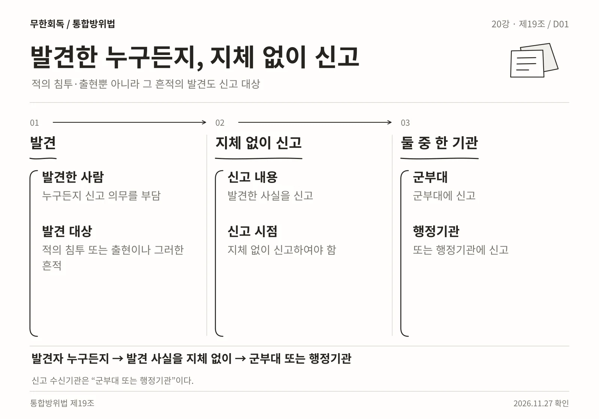

# 20강 · 신고

**TB-020 · 통합방위법 제19조 · 7번 선택 스타일 적용**

[전체 도식 목록](../../../notion-v1/)

## D01 · 발견한 누구든지, 지체 없이 신고

적의 침투·출현뿐 아니라 그 흔적의 발견도 신고 대상

[PNG](TB-020-D01-report-discovery-without-delay.png) · [SVG](TB-020-D01-report-discovery-without-delay.svg) · [WebP](TB-020-D01-report-discovery-without-delay.webp)

### ① 발견

| 구분 | 내용 |
|---|---|
| 발견한 사람 | 누구든지 신고 의무를 부담 |
| 발견 대상 | 적의 침투 또는 출현이나 그러한 흔적 |

### ② 지체 없이 신고

| 구분 | 내용 |
|---|---|
| 신고 내용 | 발견한 사실을 신고 |
| 신고 시점 | 지체 없이 신고하여야 함 |

### ③ 둘 중 한 기관

| 구분 | 내용 |
|---|---|
| 군부대 | 군부대에 신고 |
| 행정기관 | 또는 행정기관에 신고 |

**기억할 문장:** 발견자 누구든지 → 발견 사실을 지체 없이 → 군부대 또는 행정기관

### 조건·범위

- 신고 수신기관은 “군부대 또는 행정기관”이다.

### 근거

- [통합방위법 제19조](https://www.law.go.kr/LSW/lsInfoR.do?ancYnChk=0&chrClsCd=010202&efYd=20251001&lsiSeq=276315)

