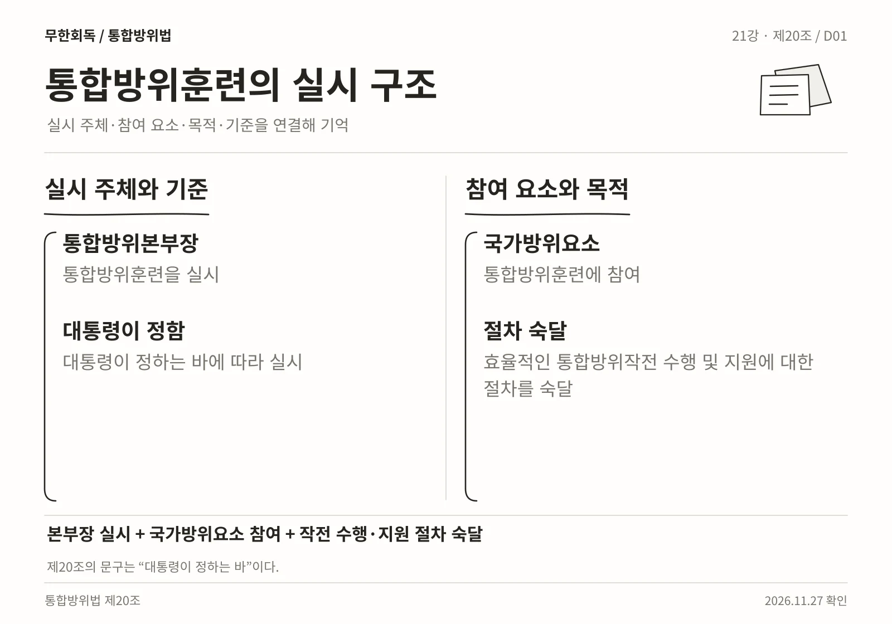

# 21강 · 통합방위훈련

**TB-021 · 통합방위법 제20조 · 7번 선택 스타일 적용**

[전체 도식 목록](../../../notion-v1/)

## D01 · 통합방위훈련의 실시 구조

실시 주체·참여 요소·목적·기준을 연결해 기억

[PNG](TB-021-D01-integrated-defense-training.png) · [SVG](TB-021-D01-integrated-defense-training.svg) · [WebP](TB-021-D01-integrated-defense-training.webp)

### 실시 주체와 기준

| 구분 | 내용 |
|---|---|
| 통합방위본부장 | 통합방위훈련을 실시 |
| 대통령이 정함 | 대통령이 정하는 바에 따라 실시 |

### 참여 요소와 목적

| 구분 | 내용 |
|---|---|
| 국가방위요소 | 통합방위훈련에 참여 |
| 절차 숙달 | 효율적인 통합방위작전 수행 및 지원에 대한 절차를 숙달 |

**기억할 문장:** 본부장 실시 + 국가방위요소 참여 + 작전 수행·지원 절차 숙달

### 조건·범위

- 제20조의 문구는 “대통령이 정하는 바”이다.

### 근거

- [통합방위법 제20조](https://www.law.go.kr/LSW/lsInfoR.do?ancYnChk=0&chrClsCd=010202&efYd=20251001&lsiSeq=276315)

