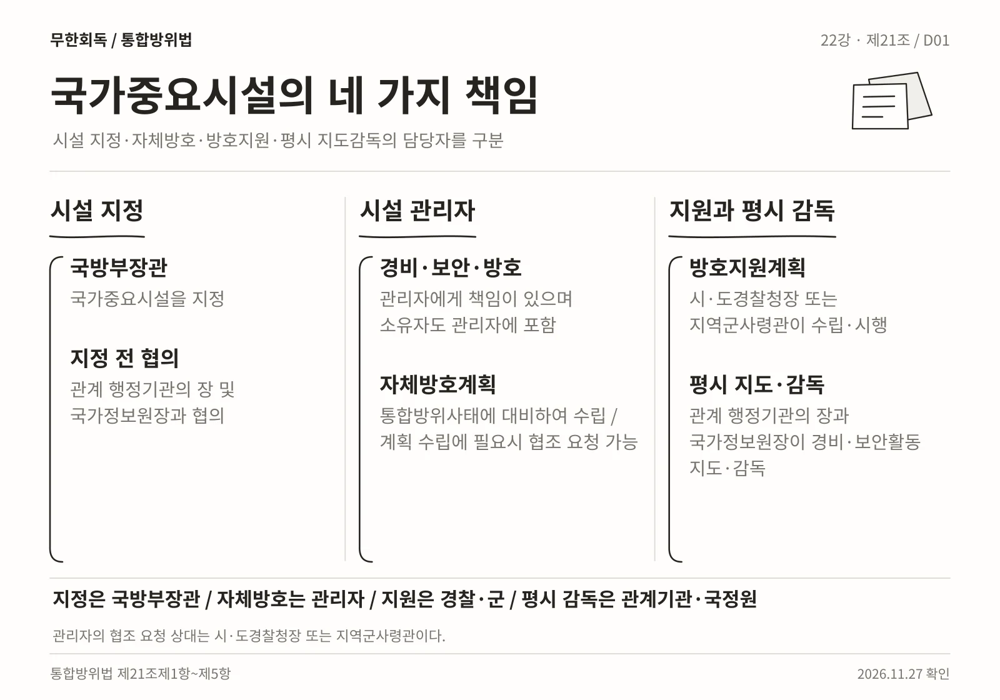
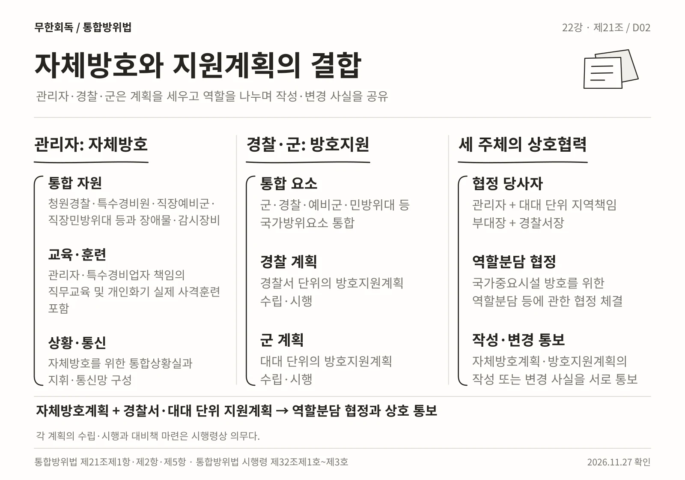

# 22강 · 국가중요시설의 경비·보안 및 방호

**TB-022 · 통합방위법 제21조 · 7번 선택 스타일 적용**

[전체 도식 목록](../../../notion-v1/)

## D01 · 국가중요시설의 네 가지 책임

시설 지정·자체방호·방호지원·평시 지도감독의 담당자를 구분

[PNG](TB-022-D01-critical-facility-responsibilities.png) · [SVG](TB-022-D01-critical-facility-responsibilities.svg) · [WebP](TB-022-D01-critical-facility-responsibilities.webp)

### 시설 지정

| 구분 | 내용 |
|---|---|
| 국방부장관 | 국가중요시설을 지정 |
| 지정 전 협의 | 관계 행정기관의 장 및 국가정보원장과 협의 |

### 시설 관리자

| 구분 | 내용 |
|---|---|
| 경비·보안·방호 | 관리자에게 책임이 있으며 소유자도 관리자에 포함 |
| 자체방호계획 | 통합방위사태에 대비하여 수립 / 계획 수립에 필요시 협조 요청 가능 |

### 지원과 평시 감독

| 구분 | 내용 |
|---|---|
| 방호지원계획 | 시·도경찰청장 또는 지역군사령관이 수립·시행 |
| 평시 지도·감독 | 관계 행정기관의 장과 국가정보원장이 경비·보안활동 지도·감독 |

**기억할 문장:** 지정은 국방부장관 / 자체방호는 관리자 / 지원은 경찰·군 / 평시 감독은 관계기관·국정원

### 조건·범위

- 관리자의 협조 요청 상대는 시·도경찰청장 또는 지역군사령관이다.

### 근거

- [통합방위법 제21조제1항~제5항](https://www.law.go.kr/LSW/lsInfoR.do?ancYnChk=0&chrClsCd=010202&efYd=20251001&lsiSeq=276315)

## D02 · 자체방호와 지원계획의 결합

관리자·경찰·군은 계획을 세우고 역할을 나누며 작성·변경 사실을 공유

[PNG](TB-022-D02-critical-facility-plan-coordination.png) · [SVG](TB-022-D02-critical-facility-plan-coordination.svg) · [WebP](TB-022-D02-critical-facility-plan-coordination.webp)

### 관리자: 자체방호

| 구분 | 내용 |
|---|---|
| 통합 자원 | 청원경찰·특수경비원·직장예비군·직장민방위대 등과 장애물·감시장비 |
| 교육·훈련 | 관리자·특수경비업자 책임의 직무교육 및 개인화기 실제 사격훈련 포함 |
| 상황·통신 | 자체방호를 위한 통합상황실과 지휘·통신망 구성 |

### 경찰·군: 방호지원

| 구분 | 내용 |
|---|---|
| 통합 요소 | 군·경찰·예비군·민방위대 등 국가방위요소 통합 |
| 경찰 계획 | 경찰서 단위의 방호지원계획 수립·시행 |
| 군 계획 | 대대 단위의 방호지원계획 수립·시행 |

### 세 주체의 상호협력

| 구분 | 내용 |
|---|---|
| 협정 당사자 | 관리자 + 대대 단위 지역책임 부대장 + 경찰서장 |
| 역할분담 협정 | 국가중요시설 방호를 위한 역할분담 등에 관한 협정 체결 |
| 작성·변경 통보 | 자체방호계획·방호지원계획의 작성 또는 변경 사실을 서로 통보 |

**기억할 문장:** 자체방호계획 + 경찰서·대대 단위 지원계획 → 역할분담 협정과 상호 통보

### 조건·범위

- 각 계획의 수립·시행과 대비책 마련은 시행령상 의무다.

### 근거

- [통합방위법 제21조제1항·제2항·제5항](https://www.law.go.kr/LSW/lsInfoR.do?ancYnChk=0&chrClsCd=010202&efYd=20251001&lsiSeq=276315)
- [통합방위법 시행령 제32조제1호~제3호](https://www.law.go.kr/LSW/lsInfoR.do?ancYnChk=0&chrClsCd=010202&efYd=20261002&lsiSeq=290507)

