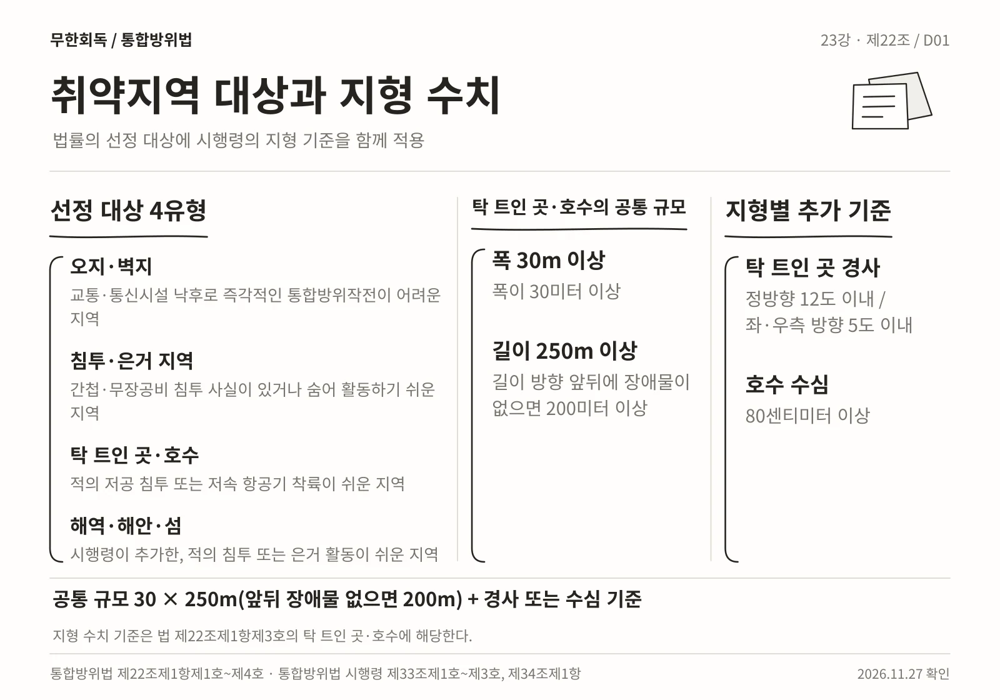
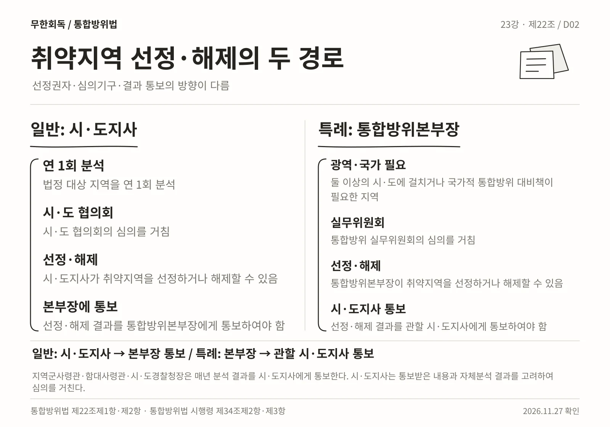
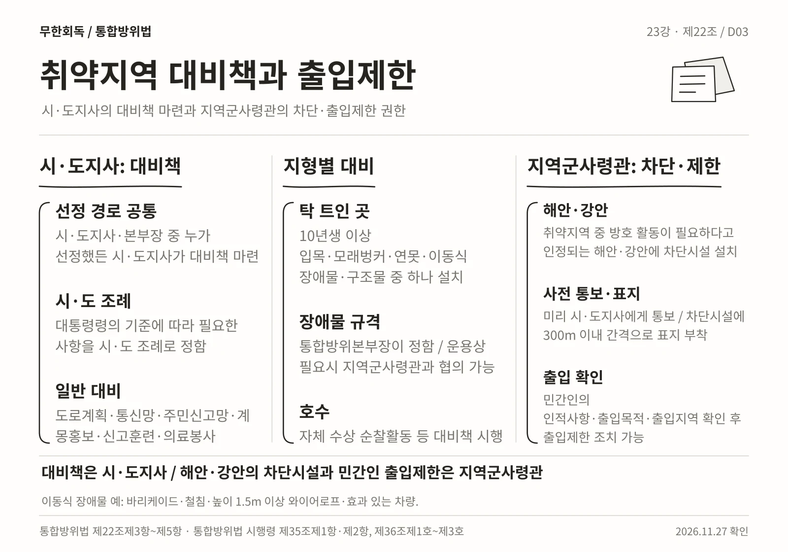

# 23강 · 취약지역의 선정 및 관리

**TB-023 · 통합방위법 제22조 · 7번 선택 스타일 적용**

[전체 도식 목록](../../../notion-v1/)

## D01 · 취약지역 대상과 지형 수치

법률의 선정 대상에 시행령의 지형 기준을 함께 적용

[PNG](TB-023-D01-vulnerable-area-types-thresholds.png) · [SVG](TB-023-D01-vulnerable-area-types-thresholds.svg) · [WebP](TB-023-D01-vulnerable-area-types-thresholds.webp)

### 선정 대상 4유형

| 구분 | 내용 |
|---|---|
| 오지·벽지 | 교통·통신시설 낙후로 즉각적인 통합방위작전이 어려운 지역 |
| 침투·은거 지역 | 간첩·무장공비 침투 사실이 있거나 숨어 활동하기 쉬운 지역 |
| 탁 트인 곳·호수 | 적의 저공 침투 또는 저속 항공기 착륙이 쉬운 지역 |
| 해역·해안·섬 | 시행령이 추가한, 적의 침투 또는 은거 활동이 쉬운 지역 |

### 탁 트인 곳·호수의 공통 규모

| 구분 | 내용 |
|---|---|
| 폭 30m 이상 | 폭이 30미터 이상 |
| 길이 250m 이상 | 길이 방향 앞뒤에 장애물이 없으면 200미터 이상 |

### 지형별 추가 기준

| 구분 | 내용 |
|---|---|
| 탁 트인 곳 경사 | 정방향 12도 이내 / 좌·우측 방향 5도 이내 |
| 호수 수심 | 80센티미터 이상 |

**기억할 문장:** 공통 규모 30 × 250m(앞뒤 장애물 없으면 200m) + 경사 또는 수심 기준

### 조건·범위

- 지형 수치 기준은 법 제22조제1항제3호의 탁 트인 곳·호수에 해당한다.

### 근거

- [통합방위법 제22조제1항제1호~제4호](https://www.law.go.kr/LSW/lsInfoR.do?ancYnChk=0&chrClsCd=010202&efYd=20251001&lsiSeq=276315)
- [통합방위법 시행령 제33조제1호~제3호, 제34조제1항](https://www.law.go.kr/LSW/lsInfoR.do?ancYnChk=0&chrClsCd=010202&efYd=20261002&lsiSeq=290507)

## D02 · 취약지역 선정·해제의 두 경로

선정권자·심의기구·결과 통보의 방향이 다름

[PNG](TB-023-D02-vulnerable-area-selection-paths.png) · [SVG](TB-023-D02-vulnerable-area-selection-paths.svg) · [WebP](TB-023-D02-vulnerable-area-selection-paths.webp)

### 일반: 시·도지사

| 구분 | 내용 |
|---|---|
| 연 1회 분석 | 법정 대상 지역을 연 1회 분석 |
| 시·도 협의회 | 시·도 협의회의 심의를 거침 |
| 선정·해제 | 시·도지사가 취약지역을 선정하거나 해제할 수 있음 |
| 본부장에 통보 | 선정·해제 결과를 통합방위본부장에게 통보하여야 함 |

### 특례: 통합방위본부장

| 구분 | 내용 |
|---|---|
| 광역·국가 필요 | 둘 이상의 시·도에 걸치거나 국가적 통합방위 대비책이 필요한 지역 |
| 실무위원회 | 통합방위 실무위원회의 심의를 거침 |
| 선정·해제 | 통합방위본부장이 취약지역을 선정하거나 해제할 수 있음 |
| 시·도지사 통보 | 선정·해제 결과를 관할 시·도지사에게 통보하여야 함 |

**기억할 문장:** 일반: 시·도지사 → 본부장 통보 / 특례: 본부장 → 관할 시·도지사 통보

### 조건·범위

- 지역군사령관·함대사령관·시·도경찰청장은 매년 분석 결과를 시·도지사에게 통보한다.
- 시·도지사는 통보받은 내용과 자체분석 결과를 고려하여 심의를 거친다.

### 근거

- [통합방위법 제22조제1항·제2항](https://www.law.go.kr/LSW/lsInfoR.do?ancYnChk=0&chrClsCd=010202&efYd=20251001&lsiSeq=276315)
- [통합방위법 시행령 제34조제2항·제3항](https://www.law.go.kr/LSW/lsInfoR.do?ancYnChk=0&chrClsCd=010202&efYd=20261002&lsiSeq=290507)

## D03 · 취약지역 대비책과 출입제한

시·도지사의 대비책 마련과 지역군사령관의 차단·출입제한 권한

[PNG](TB-023-D03-vulnerable-area-countermeasures.png) · [SVG](TB-023-D03-vulnerable-area-countermeasures.svg) · [WebP](TB-023-D03-vulnerable-area-countermeasures.webp)

### 시·도지사: 대비책

| 구분 | 내용 |
|---|---|
| 선정 경로 공통 | 시·도지사·본부장 중 누가 선정했든 시·도지사가 대비책 마련 |
| 시·도 조례 | 대통령령의 기준에 따라 필요한 사항을 시·도 조례로 정함 |
| 일반 대비 | 도로계획·통신망·주민신고망·계몽홍보·신고훈련·의료봉사 |

### 지형별 대비

| 구분 | 내용 |
|---|---|
| 탁 트인 곳 | 10년생 이상 입목·모래벙커·연못·이동식 장애물·구조물 중 하나 설치 |
| 장애물 규격 | 통합방위본부장이 정함 / 운용상 필요시 지역군사령관과 협의 가능 |
| 호수 | 자체 수상 순찰활동 등 대비책 시행 |

### 지역군사령관: 차단·제한

| 구분 | 내용 |
|---|---|
| 해안·강안 | 취약지역 중 방호 활동이 필요하다고 인정되는 해안·강안에 차단시설 설치 |
| 사전 통보·표지 | 미리 시·도지사에게 통보 / 차단시설에 300m 이내 간격으로 표지 부착 |
| 출입 확인 | 민간인의 인적사항·출입목적·출입지역 확인 후 출입제한 조치 가능 |

**기억할 문장:** 대비책은 시·도지사 / 해안·강안의 차단시설과 민간인 출입제한은 지역군사령관

### 조건·범위

- 이동식 장애물 예: 바리케이드·철침·높이 1.5m 이상 와이어로프·효과 있는 차량.

### 근거

- [통합방위법 제22조제3항~제5항](https://www.law.go.kr/LSW/lsInfoR.do?ancYnChk=0&chrClsCd=010202&efYd=20251001&lsiSeq=276315)
- [통합방위법 시행령 제35조제1항·제2항, 제36조제1호~제3호](https://www.law.go.kr/LSW/lsInfoR.do?ancYnChk=0&chrClsCd=010202&efYd=20261002&lsiSeq=290507)

