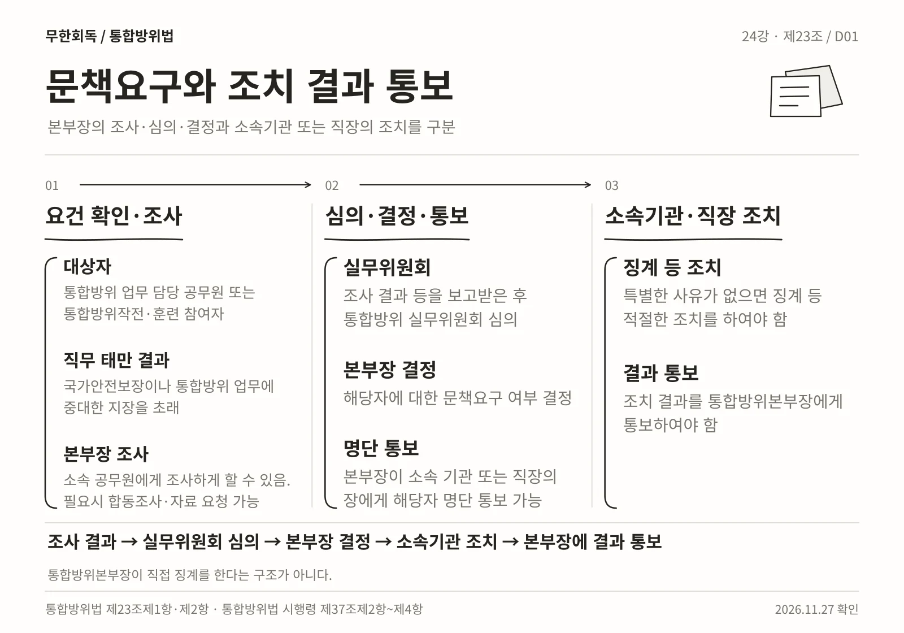
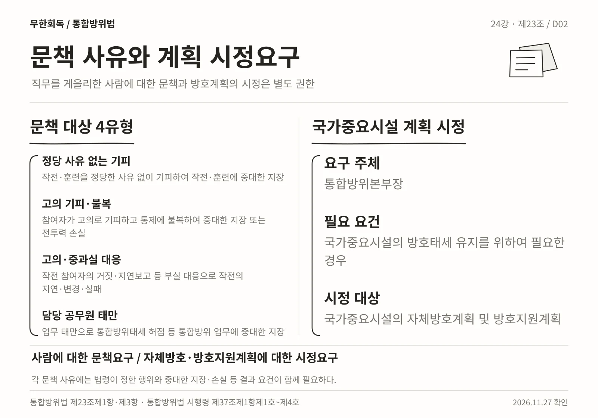

# 24강 · 문책 및 시정요구

**TB-024 · 통합방위법 제23조 · 7번 선택 스타일 적용**

[전체 도식 목록](../../../notion-v1/)

## D01 · 문책요구와 조치 결과 통보

본부장의 조사·심의·결정과 소속기관 또는 직장의 조치를 구분

[PNG](TB-024-D01-disciplinary-request-procedure.png) · [SVG](TB-024-D01-disciplinary-request-procedure.svg) · [WebP](TB-024-D01-disciplinary-request-procedure.webp)

### ① 요건 확인·조사

| 구분 | 내용 |
|---|---|
| 대상자 | 통합방위 업무 담당 공무원 또는 통합방위작전·훈련 참여자 |
| 직무 태만 결과 | 국가안전보장이나 통합방위 업무에 중대한 지장을 초래 |
| 본부장 조사 | 소속 공무원에게 조사하게 할 수 있음. 필요시 합동조사·자료 요청 가능 |

### ② 심의·결정·통보

| 구분 | 내용 |
|---|---|
| 실무위원회 | 조사 결과 등을 보고받은 후 통합방위 실무위원회 심의 |
| 본부장 결정 | 해당자에 대한 문책요구 여부 결정 |
| 명단 통보 | 본부장이 소속 기관 또는 직장의 장에게 해당자 명단 통보 가능 |

### ③ 소속기관·직장 조치

| 구분 | 내용 |
|---|---|
| 징계 등 조치 | 특별한 사유가 없으면 징계 등 적절한 조치를 하여야 함 |
| 결과 통보 | 조치 결과를 통합방위본부장에게 통보하여야 함 |

**기억할 문장:** 조사 결과 → 실무위원회 심의 → 본부장 결정 → 소속기관 조치 → 본부장에 결과 통보

### 조건·범위

- 통합방위본부장이 직접 징계를 한다는 구조가 아니다.

### 근거

- [통합방위법 제23조제1항·제2항](https://www.law.go.kr/LSW/lsInfoR.do?ancYnChk=0&chrClsCd=010202&efYd=20251001&lsiSeq=276315)
- [통합방위법 시행령 제37조제2항~제4항](https://www.law.go.kr/LSW/lsInfoR.do?ancYnChk=0&chrClsCd=010202&efYd=20261002&lsiSeq=290507)

## D02 · 문책 사유와 계획 시정요구

직무를 게을리한 사람에 대한 문책과 방호계획의 시정은 별도 권한

[PNG](TB-024-D02-discipline-grounds-plan-correction.png) · [SVG](TB-024-D02-discipline-grounds-plan-correction.svg) · [WebP](TB-024-D02-discipline-grounds-plan-correction.webp)

### 문책 대상 4유형

| 구분 | 내용 |
|---|---|
| 정당 사유 없는 기피 | 작전·훈련을 정당한 사유 없이 기피하여 작전·훈련에 중대한 지장 |
| 고의 기피·불복 | 참여자가 고의로 기피하고 통제에 불복하여 중대한 지장 또는 전투력 손실 |
| 고의·중과실 대응 | 작전 참여자의 거짓·지연보고 등 부실 대응으로 작전의 지연·변경·실패 |
| 담당 공무원 태만 | 업무 태만으로 통합방위태세 허점 등 통합방위 업무에 중대한 지장 |

### 국가중요시설 계획 시정

| 구분 | 내용 |
|---|---|
| 요구 주체 | 통합방위본부장 |
| 필요 요건 | 국가중요시설의 방호태세 유지를 위하여 필요한 경우 |
| 시정 대상 | 국가중요시설의 자체방호계획 및 방호지원계획 |

**기억할 문장:** 사람에 대한 문책요구 / 자체방호·방호지원계획에 대한 시정요구

### 조건·범위

- 각 문책 사유에는 법령이 정한 행위와 중대한 지장·손실 등 결과 요건이 함께 필요하다.

### 근거

- [통합방위법 제23조제1항·제3항](https://www.law.go.kr/LSW/lsInfoR.do?ancYnChk=0&chrClsCd=010202&efYd=20251001&lsiSeq=276315)
- [통합방위법 시행령 제37조제1항제1호~제4호](https://www.law.go.kr/LSW/lsInfoR.do?ancYnChk=0&chrClsCd=010202&efYd=20261002&lsiSeq=290507)

