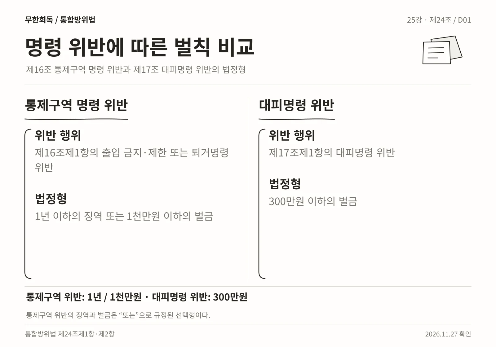

# 25강 · 벌칙

**TB-025 · 통합방위법 제24조 · 7번 선택 스타일 적용**

[전체 도식 목록](../../../notion-v1/)

## D01 · 명령 위반에 따른 벌칙 비교

제16조 통제구역 명령 위반과 제17조 대피명령 위반의 법정형

[PNG](TB-025-D01-penalty-comparison.png) · [SVG](TB-025-D01-penalty-comparison.svg) · [WebP](TB-025-D01-penalty-comparison.webp)

### 통제구역 명령 위반

| 구분 | 내용 |
|---|---|
| 위반 행위 | 제16조제1항의 출입 금지·제한 또는 퇴거명령 위반 |
| 법정형 | 1년 이하의 징역 또는 1천만원 이하의 벌금 |

### 대피명령 위반

| 구분 | 내용 |
|---|---|
| 위반 행위 | 제17조제1항의 대피명령 위반 |
| 법정형 | 300만원 이하의 벌금 |

**기억할 문장:** 통제구역 위반: 1년 / 1천만원 · 대피명령 위반: 300만원

### 조건·범위

- 통제구역 위반의 징역과 벌금은 “또는”으로 규정된 선택형이다.

### 근거

- [통합방위법 제24조제1항·제2항](https://www.law.go.kr/LSW/lsInfoR.do?ancYnChk=0&chrClsCd=010202&efYd=20251001&lsiSeq=276315)

