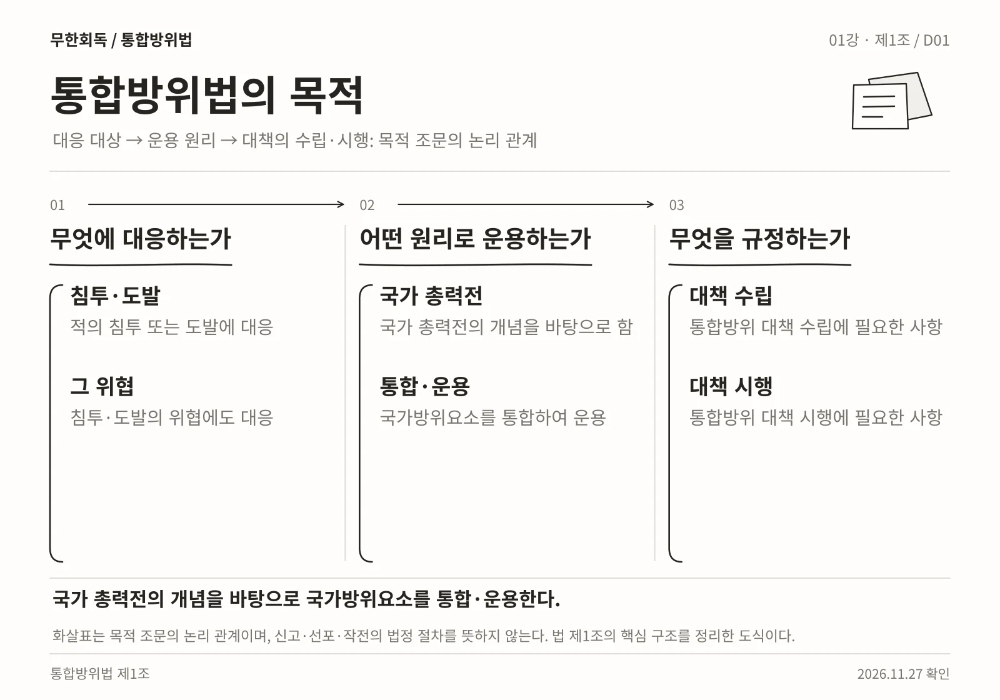
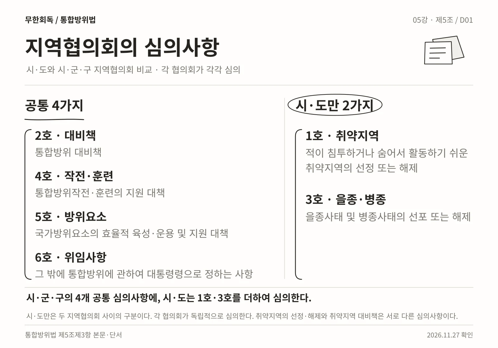
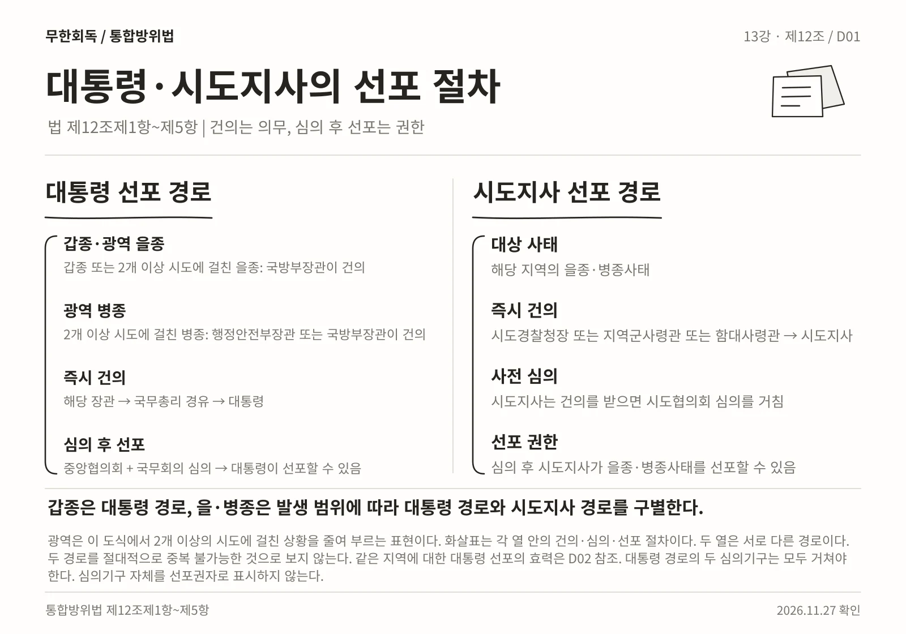
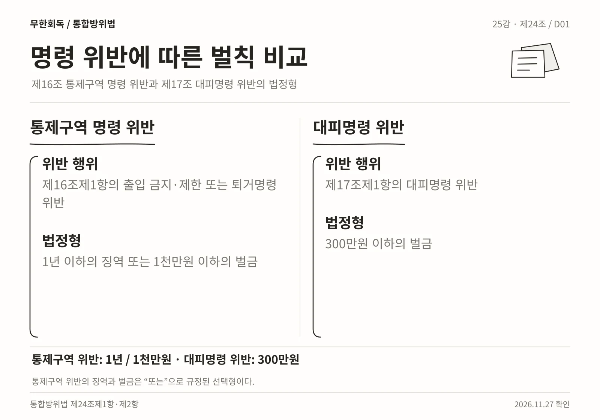

# 통합방위법 · 7번 선택 스타일 핵심 도식

**25강 · 55개 도식 · 2026년 11월 27일 작성·법령 확인**

사용자가 선택한 **07 Notion 참고 편집형**을 공통 스타일로 적용했다. 흰 종이 바탕, 흑백 글자, 얇은 선, 괄호와 밑줄을 사용한다. 도식별 내용에 맞춰 논리 흐름·비교·권한·조건을 다르게 구성했다.

[갤러리](index.html) · [파일 목록·해시](manifest.json) · [강의 연결표](lecture-map.json) · [제작 기준](style-guide.md) · [검수 기록](verification.json)

## 강의별 목록

| 강의·조문 | 주제 | 장수 | 도식 |
|---|---|---:|---|
| [01강 · 제1조](../lesson-001/diagrams/notion-v1/) | 목적 | 1 | 통합방위법의 목적 |
| [02강 · 제2조](../lesson-002/diagrams/notion-v1/) | 정의 | 3 | 국가방위요소는 7개 법정 항목 / 갑종·을종·병종을 구분하는 기준 / 용어를 관계와 기준으로 구분 |
| [03강 · 제3조](../lesson-003/diagrams/notion-v1/) | 통합방위태세의 확립 등 | 4 | 시책·협조는 의무, 비용 지원은 재량 / 중앙·지방 통합방위회의는 연 1회 이상 / 중앙 통합방위회의 참석 대상 / 회의 참석 대상의 선정과 지방회의 |
| [04강 · 제4조](../lesson-004/diagrams/notion-v1/) | 중앙 통합방위협의회 | 4 | 중앙협의회, 구성과 회의 운영 / 중앙협의회가 심의하는 사항 / 중앙협의회 법정 위원 · 장관 / 중앙협의회 법정 위원과 추가 위원 |
| [05강 · 제5조](../lesson-005/diagrams/notion-v1/) | 지역 통합방위협의회 | 5 | 지역협의회의 심의사항 / 지역협의회와 지역실무위원회 / 지역 지원대책, 어디에 속하는가 / 지역협의회 위원 구성 ① / 지역협의회 위원 구성 ② |
| [06강 · 제6조](../lesson-006/diagrams/notion-v1/) | 직장 통합방위협의회 | 2 | 직장협의회, 언제 두어야 하는가 / 직장협의회와 산업단지협의회 |
| [07강 · 제7조](../lesson-007/diagrams/notion-v1/) | 협의회의 통합·운영 | 1 | 협의회는 기준에 따라 통합·운영 가능 |
| [08강 · 제8조](../lesson-008/diagrams/notion-v1/) | 통합방위본부 | 3 | 통합방위본부의 설치와 5개 사무 / 통합방위 실무위원회는 무엇을 심의하나 / 대비태세 확인에서 포상 건의까지 |
| [09강 · 제9조](../lesson-009/diagrams/notion-v1/) | 통합방위 지원본부 | 3 | 지원본부의 설치와 사무 / 지원본부의 조직과 본부장 / 종합상황실의 구성·설치·운영 |
| [10강 · 제9조의2](../lesson-010/diagrams/notion-v1/) | 정보센터 및 합동정보조사팀 | 1 | 정보센터와 합동정보조사팀 |
| [11강 · 제10조](../lesson-011/diagrams/notion-v1/) | 합동보도본부 등 | 3 | 취재 지원과 작전정보 공개 / 합동보도본부의 설치 기준 / 취재지역별 허용과 제한 |
| [12강 · 제11조](../lesson-012/diagrams/notion-v1/) | 경계태세 | 2 | 경계태세의 발령과 해제 / 경계태세별 작전통제와 협조 |
| [13강 · 제12조](../lesson-013/diagrams/notion-v1/) | 통합방위사태의 선포 | 2 | 대통령·시도지사의 선포 절차 / 선포의 정족수·공고·효력 |
| [14강 · 제13조](../lesson-014/diagrams/notion-v1/) | 국회 또는 시도의회에 대한 통고 | 1 | 선포 후 의회 통고와 소집 요구 |
| [15강 · 제14조](../lesson-015/diagrams/notion-v1/) | 통합방위사태의 해제 | 1 | 평상 회복과 의회 요구의 해제 |
| [16강 · 제15조](../lesson-016/diagrams/notion-v1/) | 통합방위작전 | 4 | 관할구역과 작전지휘관 / 사태 종류별 작전통제 범위 / 작전 지원·시설 방호·연락관 / 작전지역 검문의 요건과 설명 |
| [17강 · 제16조](../lesson-017/diagrams/notion-v1/) | 통제구역 | 2 | 통제구역 설정의 두 가지 요건 / 제청과 사전 심의 후 설정 |
| [18강 · 제17조](../lesson-018/diagrams/notion-v1/) | 대피명령 | 2 | 대피구역 결정과 명령 집행 / 대피명령 공고와 안전대피 |
| [19강 · 제18조](../lesson-019/diagrams/notion-v1/) | 검문소의 운용 | 1 | 검문소 설치권자와 사전 조치 |
| [20강 · 제19조](../lesson-020/diagrams/notion-v1/) | 신고 | 1 | 발견한 누구든지, 지체 없이 신고 |
| [21강 · 제20조](../lesson-021/diagrams/notion-v1/) | 통합방위훈련 | 1 | 통합방위훈련의 실시 구조 |
| [22강 · 제21조](../lesson-022/diagrams/notion-v1/) | 국가중요시설의 경비·보안 및 방호 | 2 | 국가중요시설의 네 가지 책임 / 자체방호와 지원계획의 결합 |
| [23강 · 제22조](../lesson-023/diagrams/notion-v1/) | 취약지역의 선정 및 관리 | 3 | 취약지역 대상과 지형 수치 / 취약지역 선정·해제의 두 경로 / 취약지역 대비책과 출입제한 |
| [24강 · 제23조](../lesson-024/diagrams/notion-v1/) | 문책 및 시정요구 | 2 | 문책요구와 조치 결과 통보 / 문책 사유와 계획 시정요구 |
| [25강 · 제24조](../lesson-025/diagrams/notion-v1/) | 벌칙 | 1 | 명령 위반에 따른 벌칙 비교 |

## 대표 도식

### TB-001-D01 · 통합방위법의 목적

### TB-005-D01 · 지역협의회의 심의사항

### TB-013-D01 · 대통령·시도지사의 선포 절차

### TB-025-D01 · 명령 위반에 따른 벌칙 비교

## 파일과 활용

- SVG: 편집·확대용 원본. 렌더링 시 Noto Sans CJK KR 사용.
- PNG: 글자 모양이 고정된 확인용 이미지.
- WebP: 사이트 표시용 이미지.
- 각 강의 폴더의 README: 그림 내용, 중요한 조건·범위, 법·시행령 출처.
- `content.json`: 수정 가능한 공개 법령 요약 데이터.
- `index.html`: 내려받은 전체 폴더에서 바로 여는 검색 가능한 갤러리. GitHub는 HTML을 웹페이지로 실행하지 않으므로 저장소에서는 이 목록과 개별 이미지 링크를 사용한다.

이미지는 1600×1120이다. 글자가 충분히 보이는 크기로 표시하고 작은 화면에서는 확대를 제공한다. 이 자료는 핵심 관계를 정리한 학습 도식이며 조문 전문과 강의의 모든 설명을 대체하지 않는다. 외부 행정규칙·지역별 조례·비공개 작전지침은 이 제작 범위에 포함되지 않는다.

## 공식 근거

- [통합방위법 — 법률 제21065호, 시행 2025.10.1](https://www.law.go.kr/LSW/lsInfoR.do?ancYnChk=0&chrClsCd=010202&efYd=20251001&lsiSeq=276315)
- [통합방위법 시행령 — 대통령령 제36728호, 시행 2026.10.2](https://www.law.go.kr/LSW/lsInfoR.do?ancYnChk=0&chrClsCd=010202&efYd=20261002&lsiSeq=290507)

## 제작·선택 기록

[10종 디자인 비교 시안](../lesson-005/diagrams/style-studies-v2/) 중 7번을 선택하여 제작했다. Notion 공식 제작물 또는 제휴 자료라는 의미가 아니며 회사 로고는 사용하지 않았다.

공개 경로: `integrated-defense/lesson-NNN/diagrams/notion-v1/TB-NNN-DNN-topic.{svg,png,webp}`. 사이트 삽입 위치와 영상 시각 정보는 이 자료의 범위에 들어 있지 않다.
