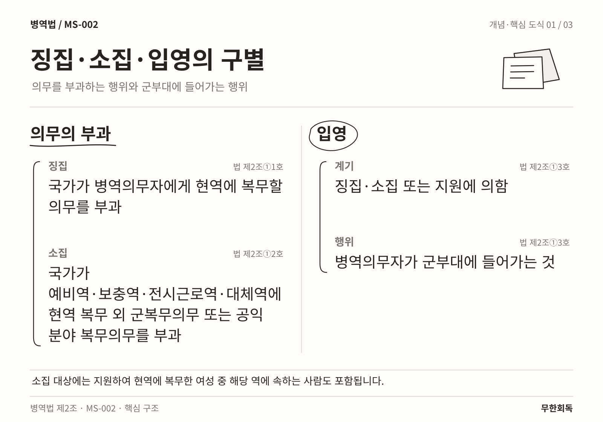
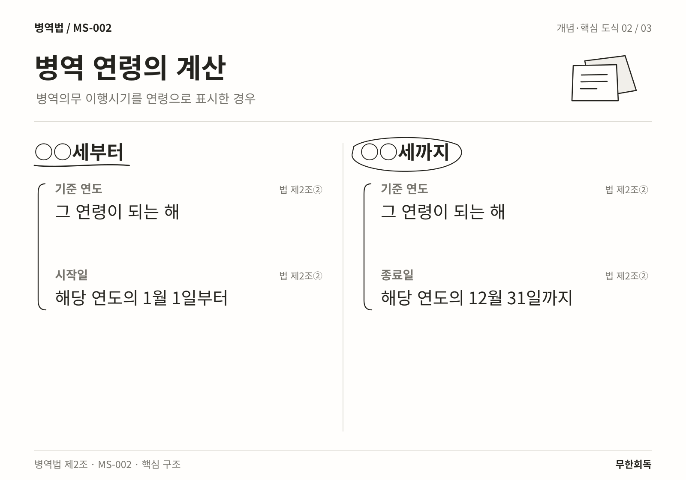
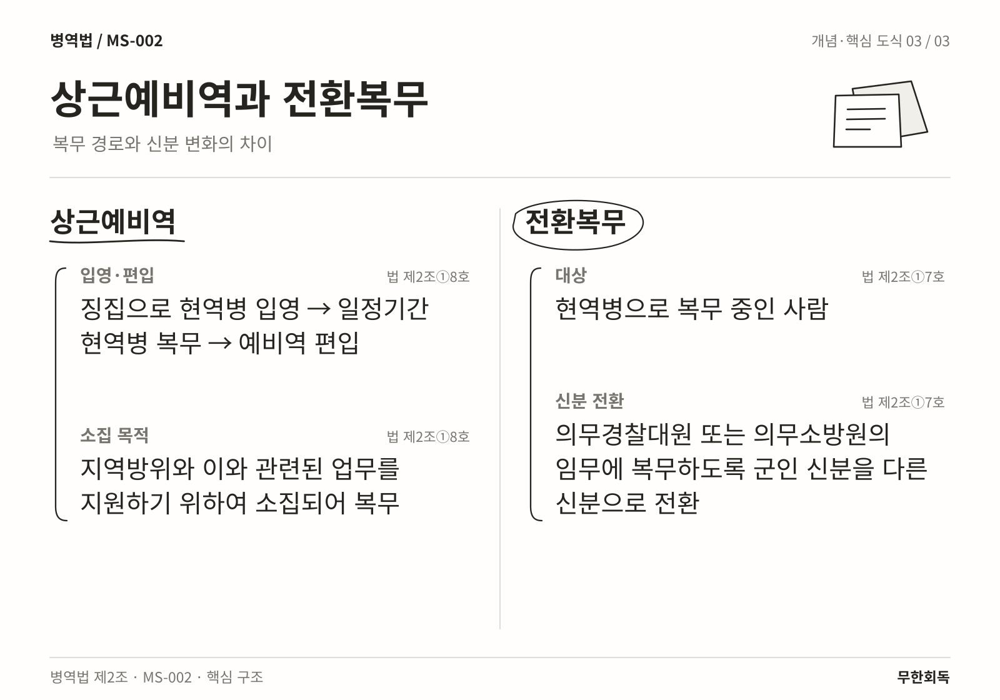

# MS-002 · 병역법 제2조, 정의 등

흑백 편집형 도식 3장 · 1600×1120 · SVG / 무손실 WebP

## 01. 징집·소집·입영의 구별

[강의용 WebP](MS-002-D01-editorial-v1.webp) · [편집용 SVG](MS-002-D01-editorial-v1.svg)

## 02. 병역 연령의 계산

[강의용 WebP](MS-002-D02-editorial-v1.webp) · [편집용 SVG](MS-002-D02-editorial-v1.svg)

## 03. 상근예비역과 전환복무

[강의용 WebP](MS-002-D03-editorial-v1.webp) · [편집용 SVG](MS-002-D03-editorial-v1.svg)

[전체 병역법 도식 목차](../../README.md)
