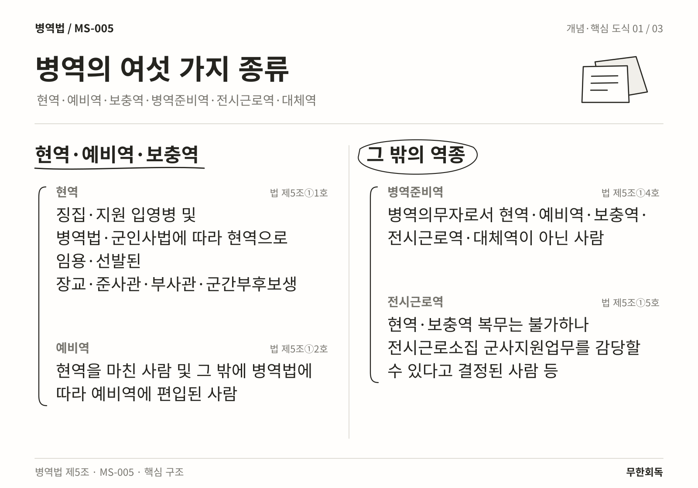
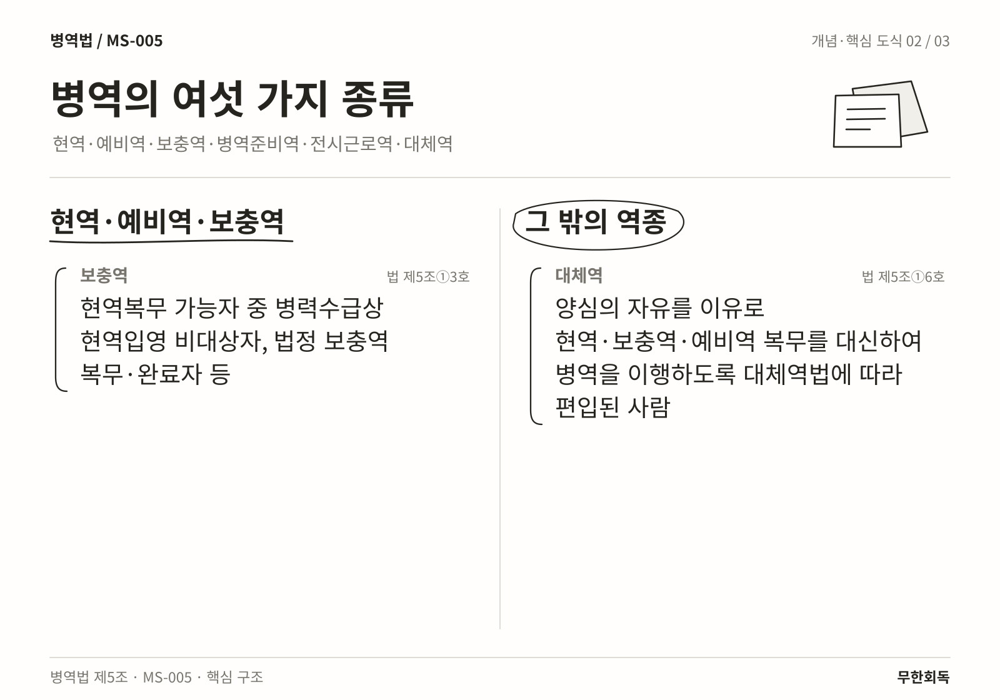
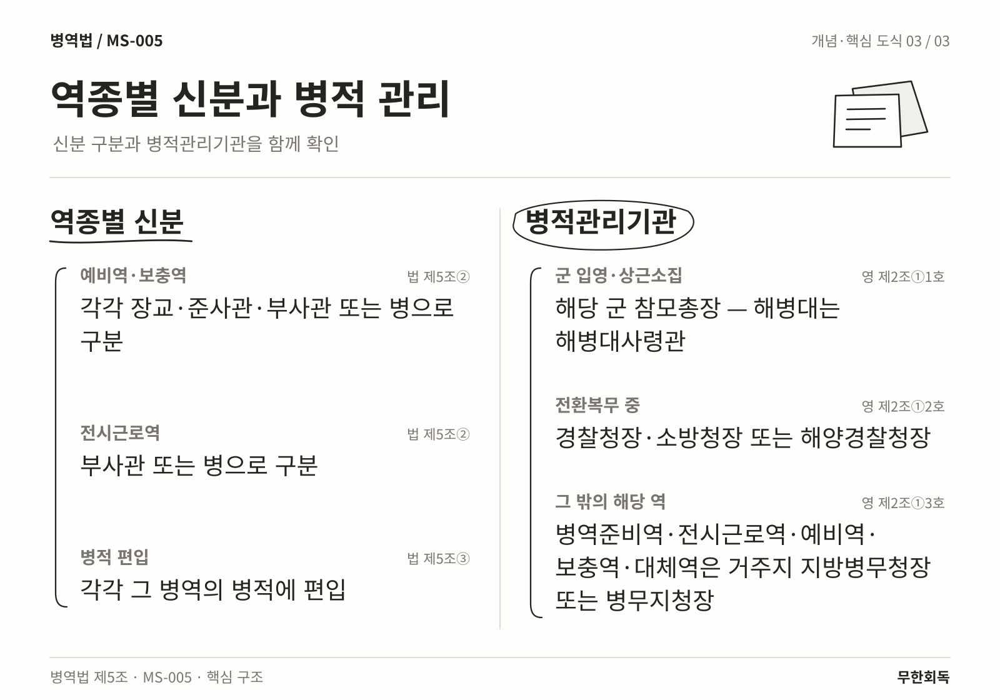

# MS-005 · 병역법 제5조, 병역의 종류

흑백 편집형 도식 3장 · 1600×1120 · SVG / 무손실 WebP

## 01. 병역의 여섯 가지 종류

[강의용 WebP](MS-005-D01-editorial-v1.webp) · [편집용 SVG](MS-005-D01-editorial-v1.svg)

## 02. 병역의 여섯 가지 종류

[강의용 WebP](MS-005-D02-editorial-v1.webp) · [편집용 SVG](MS-005-D02-editorial-v1.svg)

## 03. 역종별 신분과 병적 관리

[강의용 WebP](MS-005-D03-editorial-v1.webp) · [편집용 SVG](MS-005-D03-editorial-v1.svg)

[전체 병역법 도식 목차](../../README.md)
