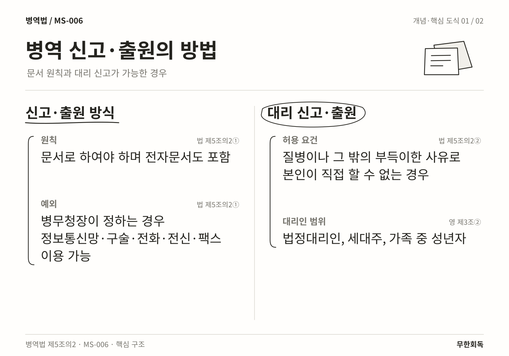
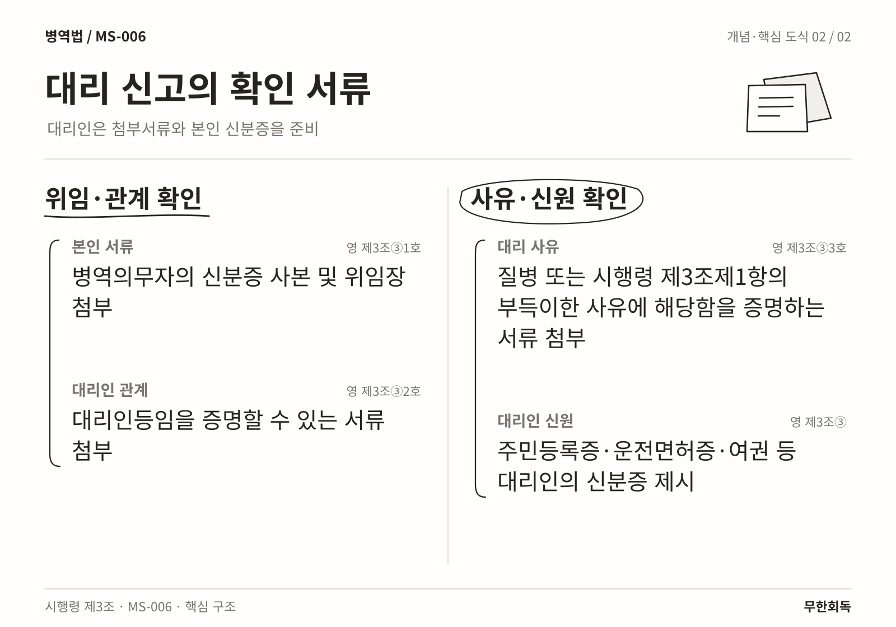

# MS-006 · 병역법 제5조의2, 병역에 관한 신고ㆍ출원

흑백 편집형 도식 2장 · 1600×1120 · SVG / 무손실 WebP

## 01. 병역 신고·출원의 방법

[강의용 WebP](MS-006-D01-editorial-v1.webp) · [편집용 SVG](MS-006-D01-editorial-v1.svg)

## 02. 대리 신고의 확인 서류

[강의용 WebP](MS-006-D02-editorial-v1.webp) · [편집용 SVG](MS-006-D02-editorial-v1.svg)

[전체 병역법 도식 목차](../../README.md)
