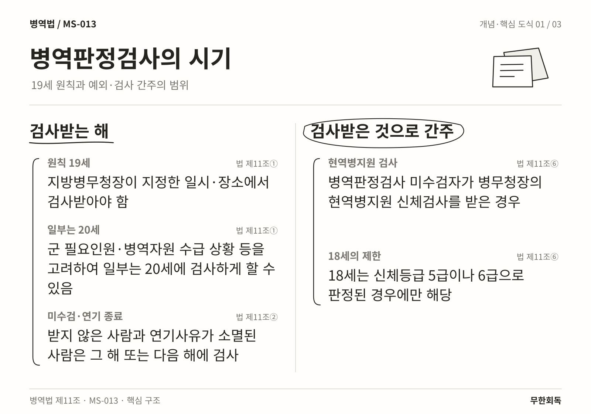
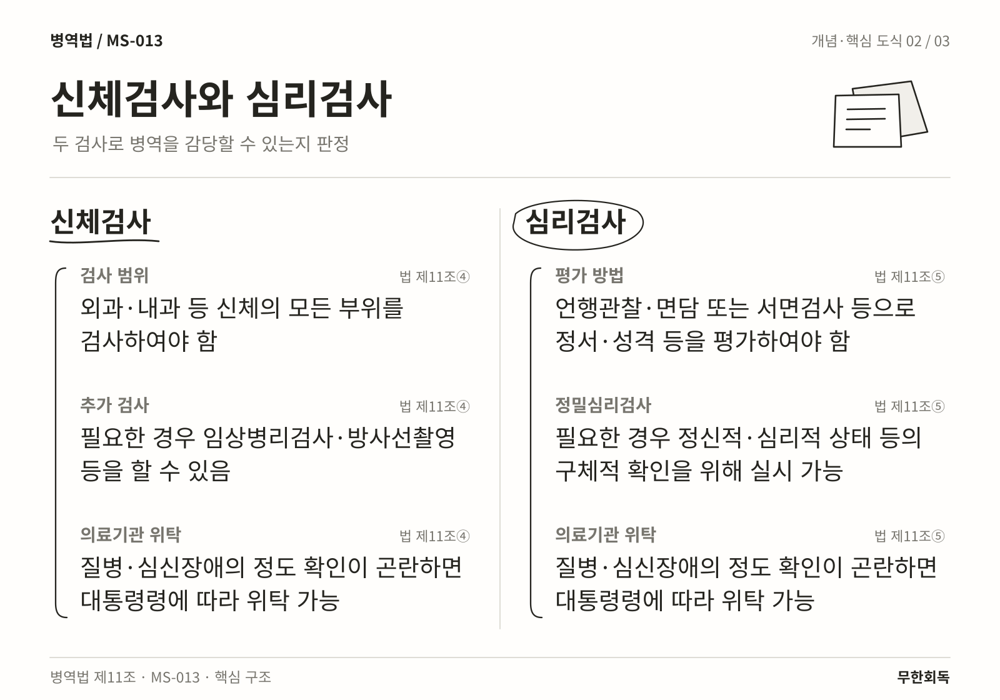
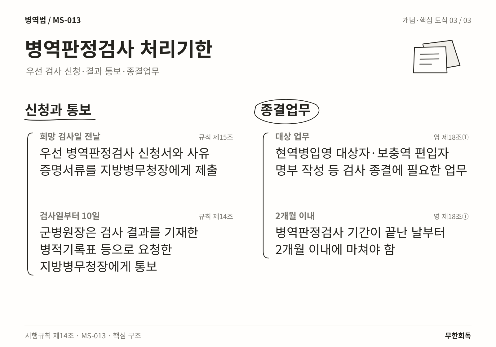

# MS-013 · 병역법 제11조, 병역판정검사

흑백 편집형 도식 3장 · 1600×1120 · SVG / 무손실 WebP

## 01. 병역판정검사의 시기

[강의용 WebP](MS-013-D01-editorial-v1.webp) · [편집용 SVG](MS-013-D01-editorial-v1.svg)

## 02. 신체검사와 심리검사

[강의용 WebP](MS-013-D02-editorial-v1.webp) · [편집용 SVG](MS-013-D02-editorial-v1.svg)

## 03. 병역판정검사 처리기한

[강의용 WebP](MS-013-D03-editorial-v1.webp) · [편집용 SVG](MS-013-D03-editorial-v1.svg)

[전체 병역법 도식 목차](../../README.md)
