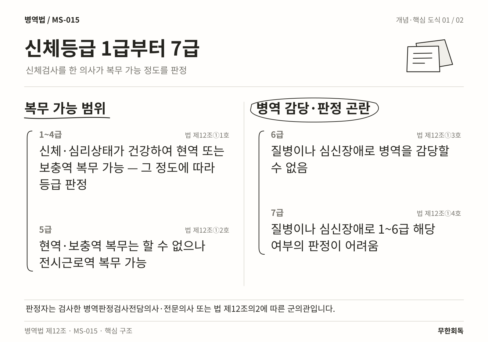
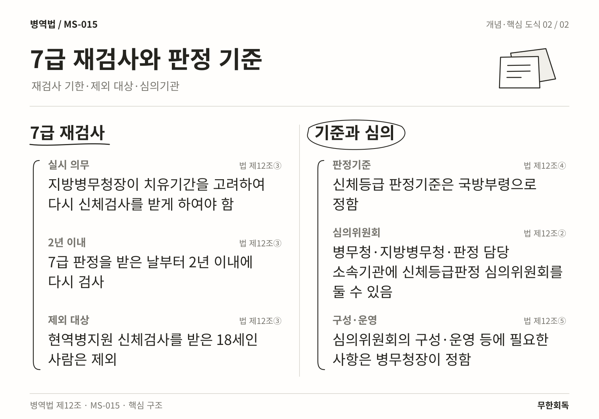

# MS-015 · 병역법 제12조, 신체등급의 판정

흑백 편집형 도식 2장 · 1600×1120 · SVG / 무손실 WebP

## 01. 신체등급 1급부터 7급

[강의용 WebP](MS-015-D01-editorial-v1.webp) · [편집용 SVG](MS-015-D01-editorial-v1.svg)

## 02. 7급 재검사와 판정 기준

[강의용 WebP](MS-015-D02-editorial-v1.webp) · [편집용 SVG](MS-015-D02-editorial-v1.svg)

[전체 병역법 도식 목차](../../README.md)
