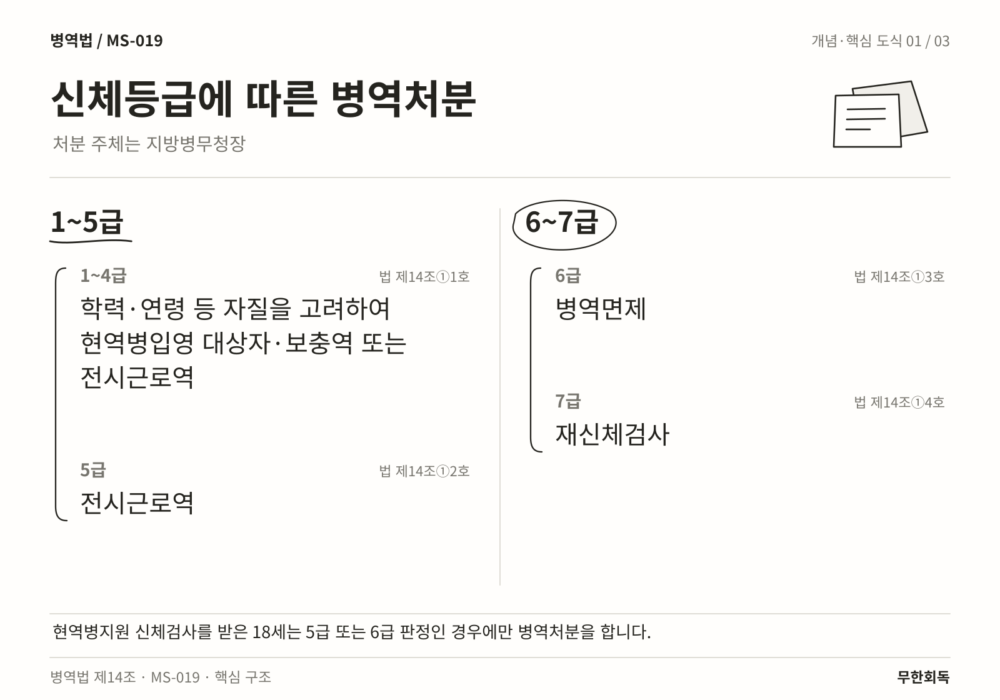
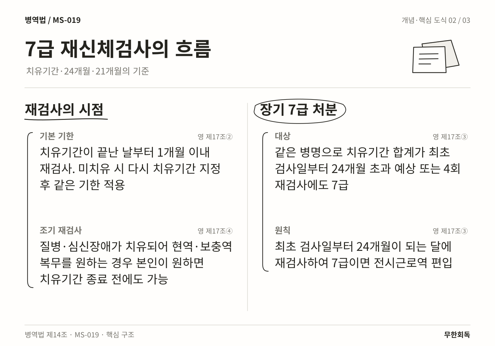
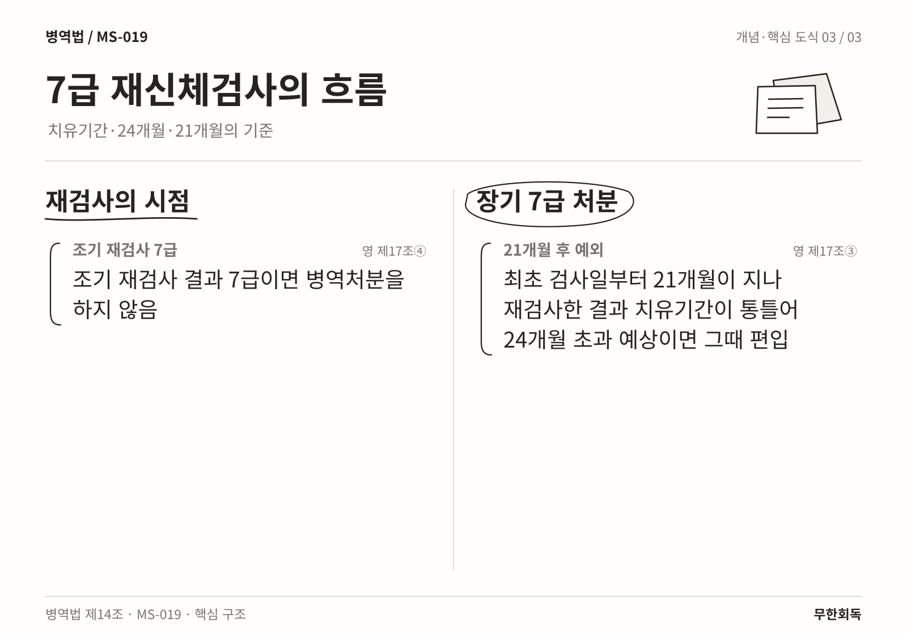

# MS-019 · 병역법 제14조, 병역처분

흑백 편집형 도식 3장 · 1600×1120 · SVG / 무손실 WebP

## 01. 신체등급에 따른 병역처분

[강의용 WebP](MS-019-D01-editorial-v1.webp) · [편집용 SVG](MS-019-D01-editorial-v1.svg)

## 02. 7급 재신체검사의 흐름

[강의용 WebP](MS-019-D02-editorial-v1.webp) · [편집용 SVG](MS-019-D02-editorial-v1.svg)

## 03. 7급 재신체검사의 흐름

[강의용 WebP](MS-019-D03-editorial-v1.webp) · [편집용 SVG](MS-019-D03-editorial-v1.svg)

[전체 병역법 도식 목차](../../README.md)
