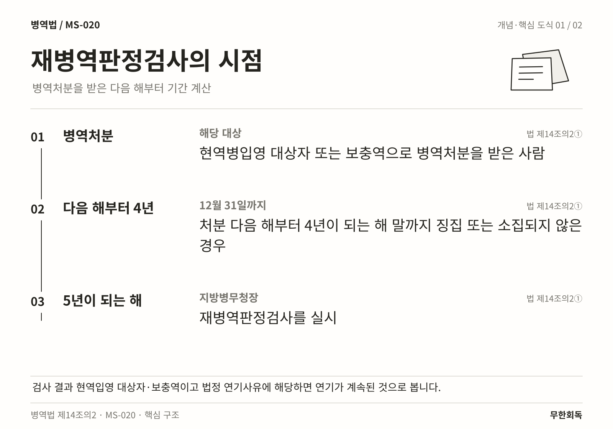
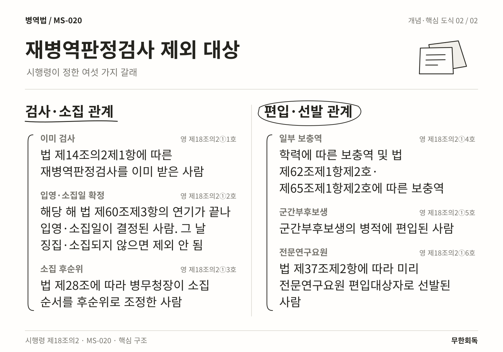

# MS-020 · 병역법 제14조의2, 재병역판정검사

흑백 편집형 도식 2장 · 1600×1120 · SVG / 무손실 WebP

## 01. 재병역판정검사의 시점

[강의용 WebP](MS-020-D01-editorial-v1.webp) · [편집용 SVG](MS-020-D01-editorial-v1.svg)

## 02. 재병역판정검사 제외 대상

[강의용 WebP](MS-020-D02-editorial-v1.webp) · [편집용 SVG](MS-020-D02-editorial-v1.svg)

[전체 병역법 도식 목차](../../README.md)
