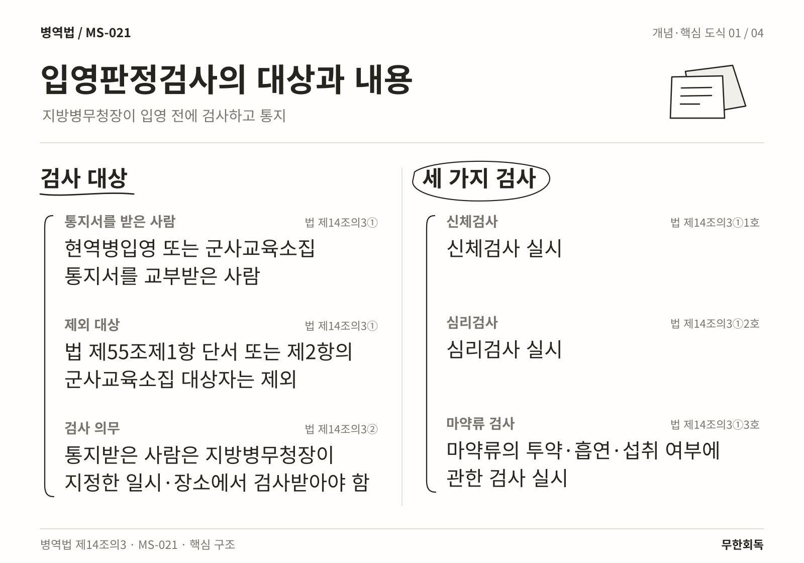
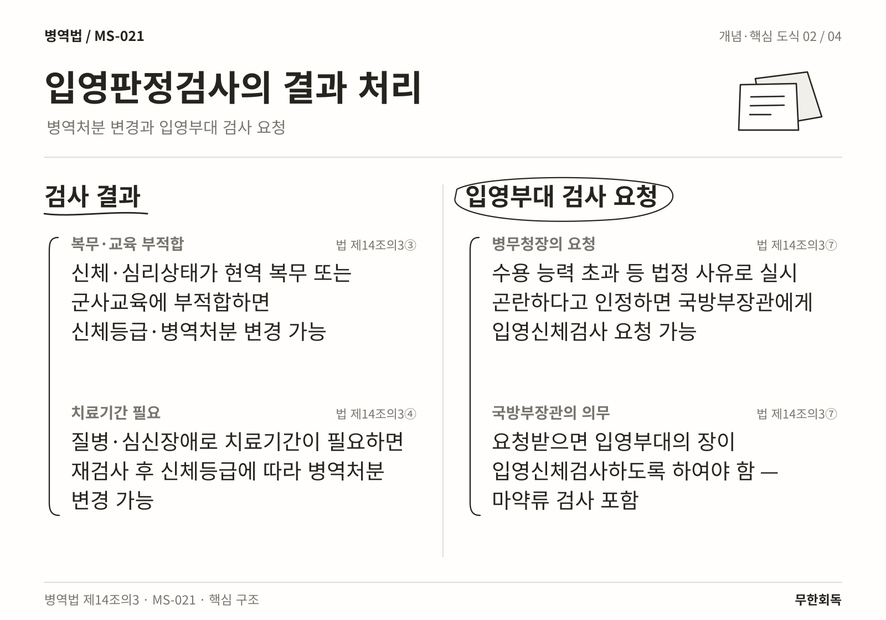
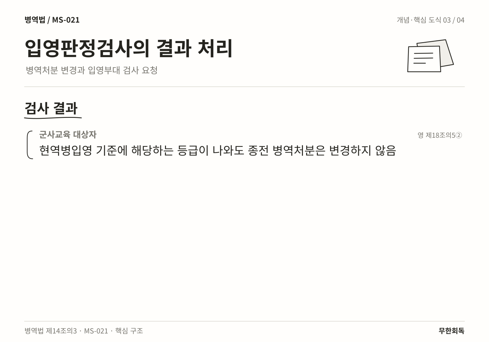
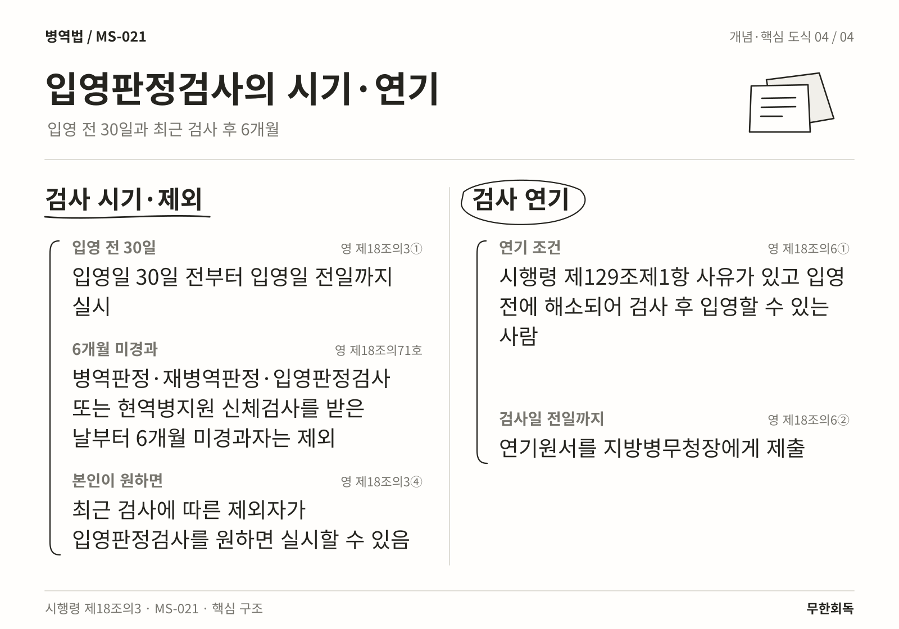

# MS-021 · 병역법 제14조의3, 입영판정검사

흑백 편집형 도식 4장 · 1600×1120 · SVG / 무손실 WebP

## 01. 입영판정검사의 대상과 내용

[강의용 WebP](MS-021-D01-editorial-v1.webp) · [편집용 SVG](MS-021-D01-editorial-v1.svg)

## 02. 입영판정검사의 결과 처리

[강의용 WebP](MS-021-D02-editorial-v1.webp) · [편집용 SVG](MS-021-D02-editorial-v1.svg)

## 03. 입영판정검사의 결과 처리

[강의용 WebP](MS-021-D03-editorial-v1.webp) · [편집용 SVG](MS-021-D03-editorial-v1.svg)

## 04. 입영판정검사의 시기·연기

[강의용 WebP](MS-021-D04-editorial-v1.webp) · [편집용 SVG](MS-021-D04-editorial-v1.svg)

[전체 병역법 도식 목차](../../README.md)
