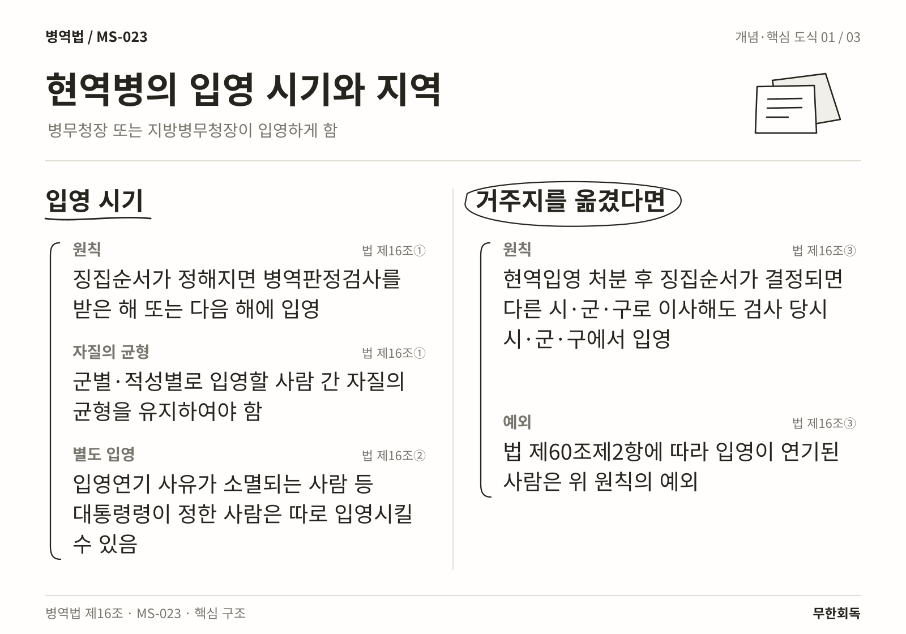
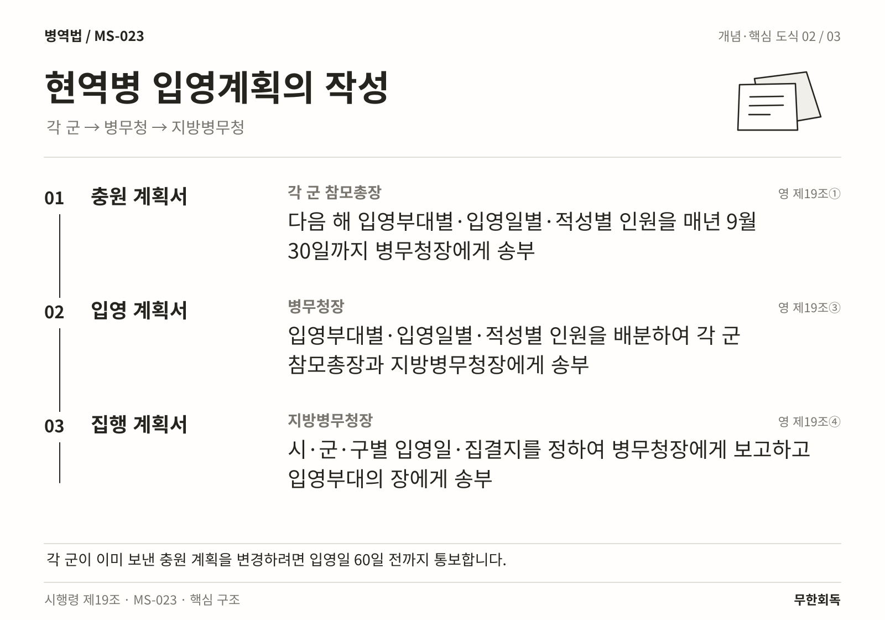
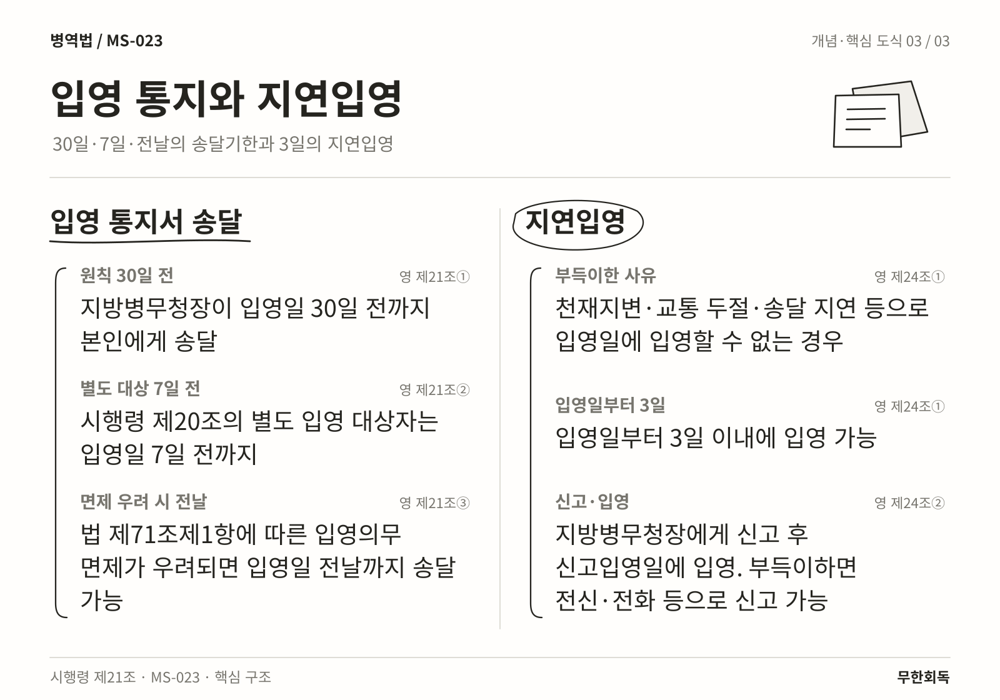

# MS-023 · 병역법 제16조, 현역병입영

흑백 편집형 도식 3장 · 1600×1120 · SVG / 무손실 WebP

## 01. 현역병의 입영 시기와 지역

[강의용 WebP](MS-023-D01-editorial-v1.webp) · [편집용 SVG](MS-023-D01-editorial-v1.svg)

## 02. 현역병 입영계획의 작성

[강의용 WebP](MS-023-D02-editorial-v1.webp) · [편집용 SVG](MS-023-D02-editorial-v1.svg)

## 03. 입영 통지와 지연입영

[강의용 WebP](MS-023-D03-editorial-v1.webp) · [편집용 SVG](MS-023-D03-editorial-v1.svg)

[전체 병역법 도식 목차](../../README.md)
