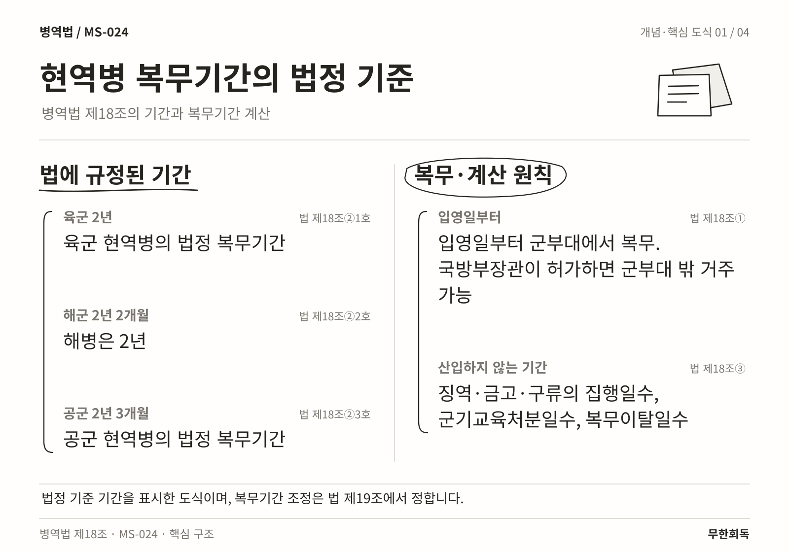
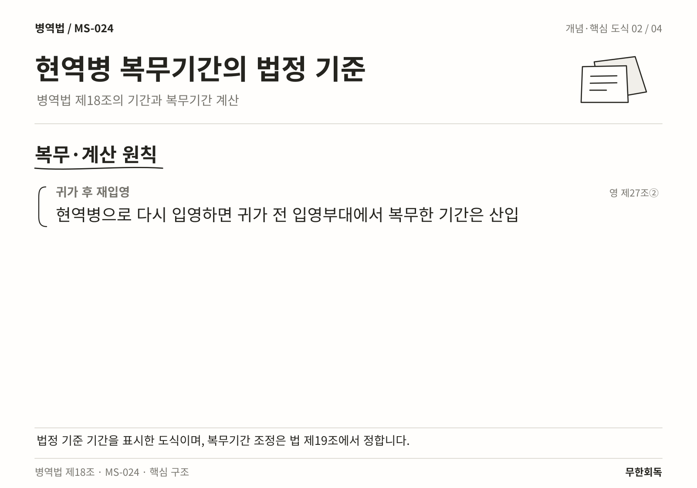
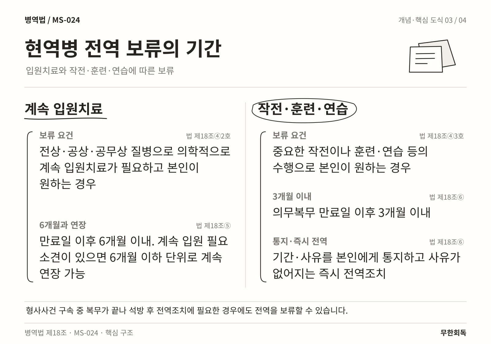
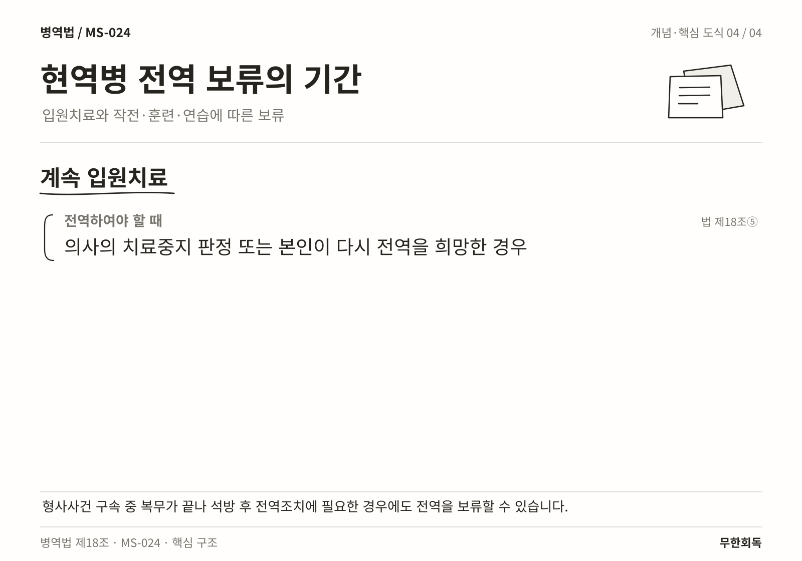

# MS-024 · 병역법 제18조, 현역의 복무

흑백 편집형 도식 4장 · 1600×1120 · SVG / 무손실 WebP

## 01. 현역병 복무기간의 법정 기준

[강의용 WebP](MS-024-D01-editorial-v1.webp) · [편집용 SVG](MS-024-D01-editorial-v1.svg)

## 02. 현역병 복무기간의 법정 기준

[강의용 WebP](MS-024-D02-editorial-v1.webp) · [편집용 SVG](MS-024-D02-editorial-v1.svg)

## 03. 현역병 전역 보류의 기간

[강의용 WebP](MS-024-D03-editorial-v1.webp) · [편집용 SVG](MS-024-D03-editorial-v1.svg)

## 04. 현역병 전역 보류의 기간

[강의용 WebP](MS-024-D04-editorial-v1.webp) · [편집용 SVG](MS-024-D04-editorial-v1.svg)

[전체 병역법 도식 목차](../../README.md)
