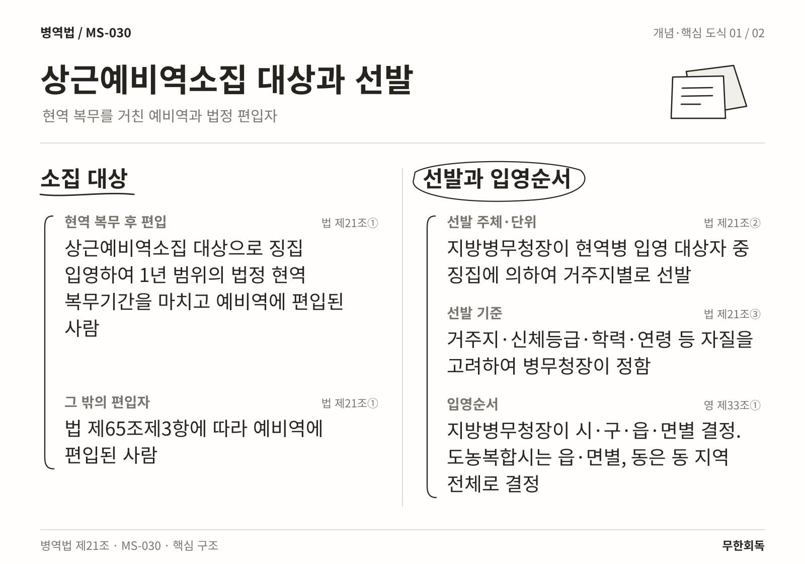
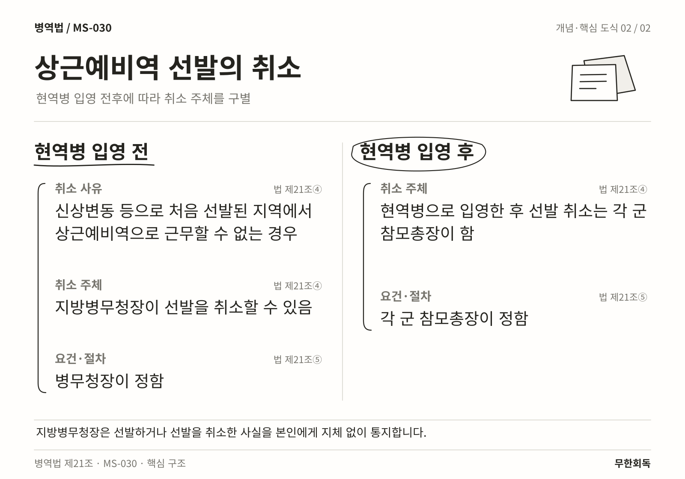

# MS-030 · 병역법 제21조, 상근예비역소집의 대상 및 선발

흑백 편집형 도식 2장 · 1600×1120 · SVG / 무손실 WebP

## 01. 상근예비역소집 대상과 선발

[강의용 WebP](MS-030-D01-editorial-v1.webp) · [편집용 SVG](MS-030-D01-editorial-v1.svg)

## 02. 상근예비역 선발의 취소

[강의용 WebP](MS-030-D02-editorial-v1.webp) · [편집용 SVG](MS-030-D02-editorial-v1.svg)

[전체 병역법 도식 목차](../../README.md)
