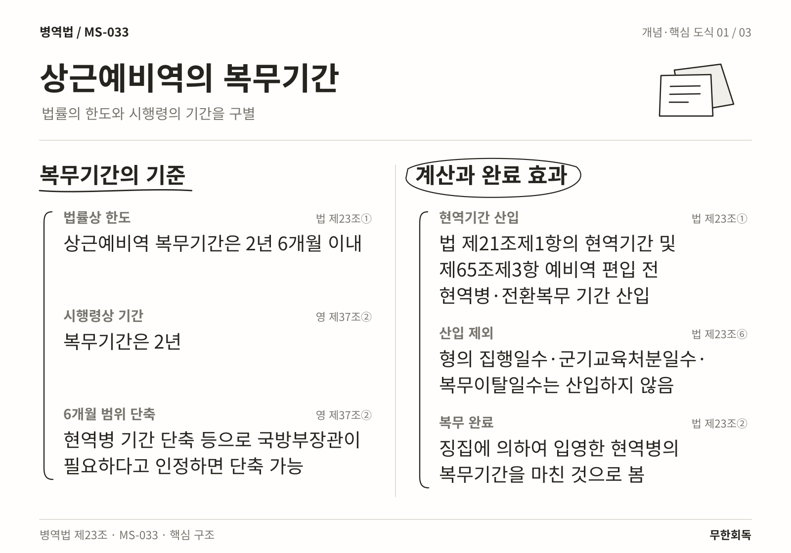
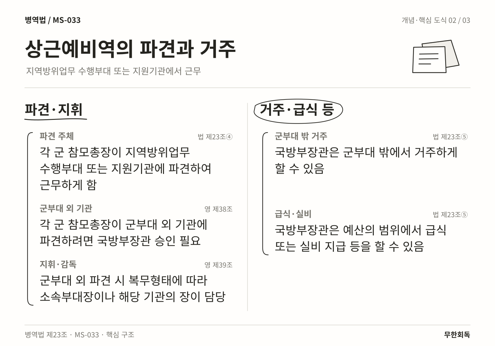
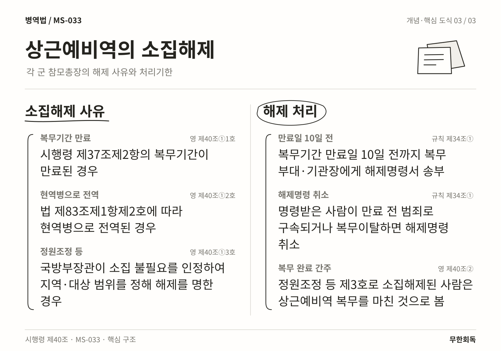

# MS-033 · 병역법 제23조, 상근예비역의 복무

흑백 편집형 도식 3장 · 1600×1120 · SVG / 무손실 WebP

## 01. 상근예비역의 복무기간

[강의용 WebP](MS-033-D01-editorial-v1.webp) · [편집용 SVG](MS-033-D01-editorial-v1.svg)

## 02. 상근예비역의 파견과 거주

[강의용 WebP](MS-033-D02-editorial-v1.webp) · [편집용 SVG](MS-033-D02-editorial-v1.svg)

## 03. 상근예비역의 소집해제

[강의용 WebP](MS-033-D03-editorial-v1.webp) · [편집용 SVG](MS-033-D03-editorial-v1.svg)

[전체 병역법 도식 목차](../../README.md)
