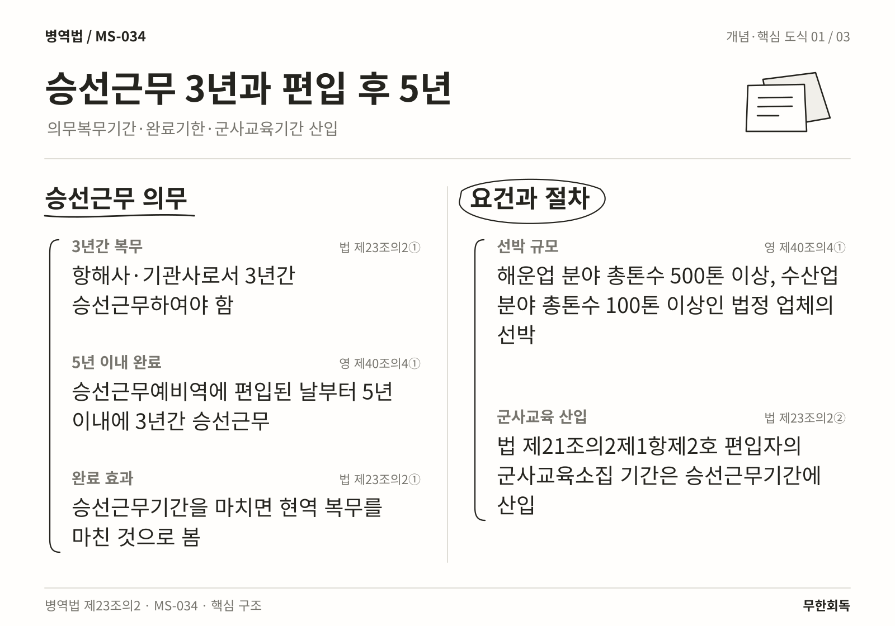
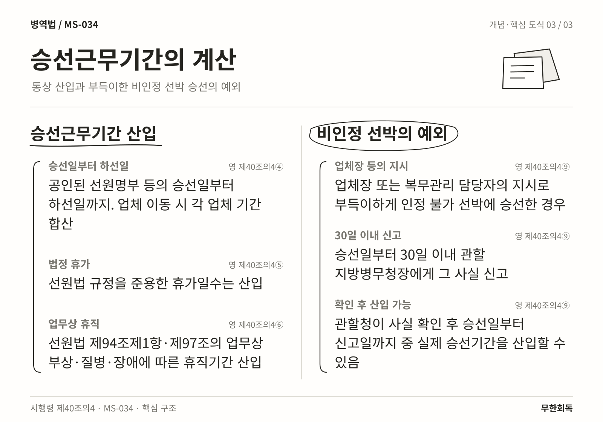

# MS-034 · 병역법 제23조의2, 승선근무예비역의 복무

흑백 편집형 도식 3장 · 1600×1120 · SVG / 무손실 WebP

## 01. 승선근무 3년과 편입 후 5년

[강의용 WebP](MS-034-D01-editorial-v1.webp) · [편집용 SVG](MS-034-D01-editorial-v1.svg)

## 02. 승선근무 3년과 편입 후 5년

[강의용 WebP](MS-034-D02-editorial-v1.webp) · [편집용 SVG](MS-034-D02-editorial-v1.svg)

## 03. 승선근무기간의 계산

[강의용 WebP](MS-034-D03-editorial-v1.webp) · [편집용 SVG](MS-034-D03-editorial-v1.svg)

[전체 병역법 도식 목차](../../README.md)
