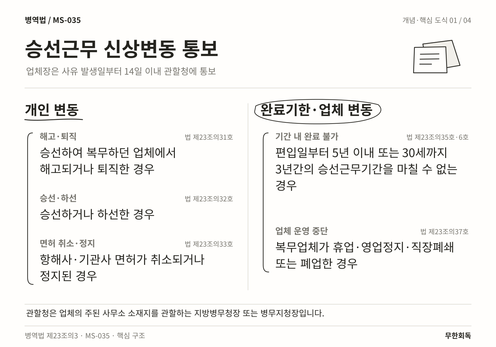
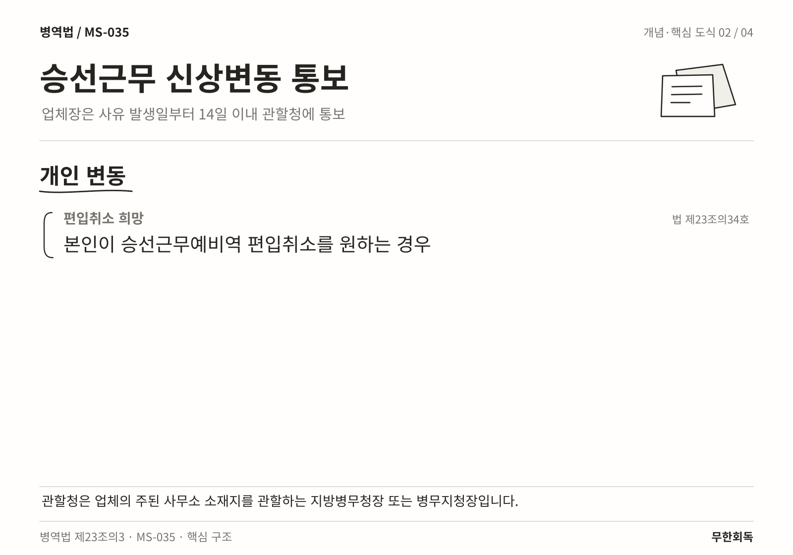
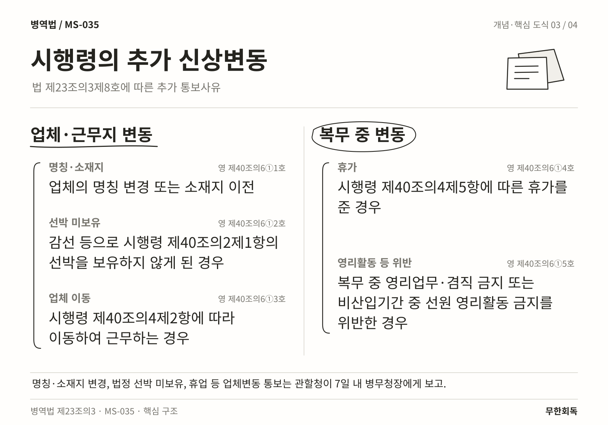
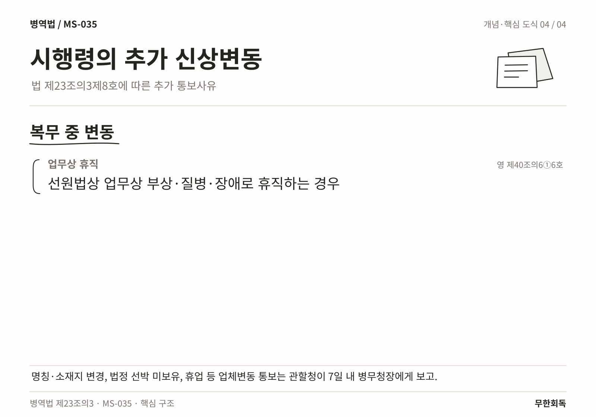

# MS-035 · 병역법 제23조의3, 승선근무예비역의 신상변동 통보

흑백 편집형 도식 4장 · 1600×1120 · SVG / 무손실 WebP

## 01. 승선근무 신상변동 통보

[강의용 WebP](MS-035-D01-editorial-v1.webp) · [편집용 SVG](MS-035-D01-editorial-v1.svg)

## 02. 승선근무 신상변동 통보

[강의용 WebP](MS-035-D02-editorial-v1.webp) · [편집용 SVG](MS-035-D02-editorial-v1.svg)

## 03. 시행령의 추가 신상변동

[강의용 WebP](MS-035-D03-editorial-v1.webp) · [편집용 SVG](MS-035-D03-editorial-v1.svg)

## 04. 시행령의 추가 신상변동

[강의용 WebP](MS-035-D04-editorial-v1.webp) · [편집용 SVG](MS-035-D04-editorial-v1.svg)

[전체 병역법 도식 목차](../../README.md)
