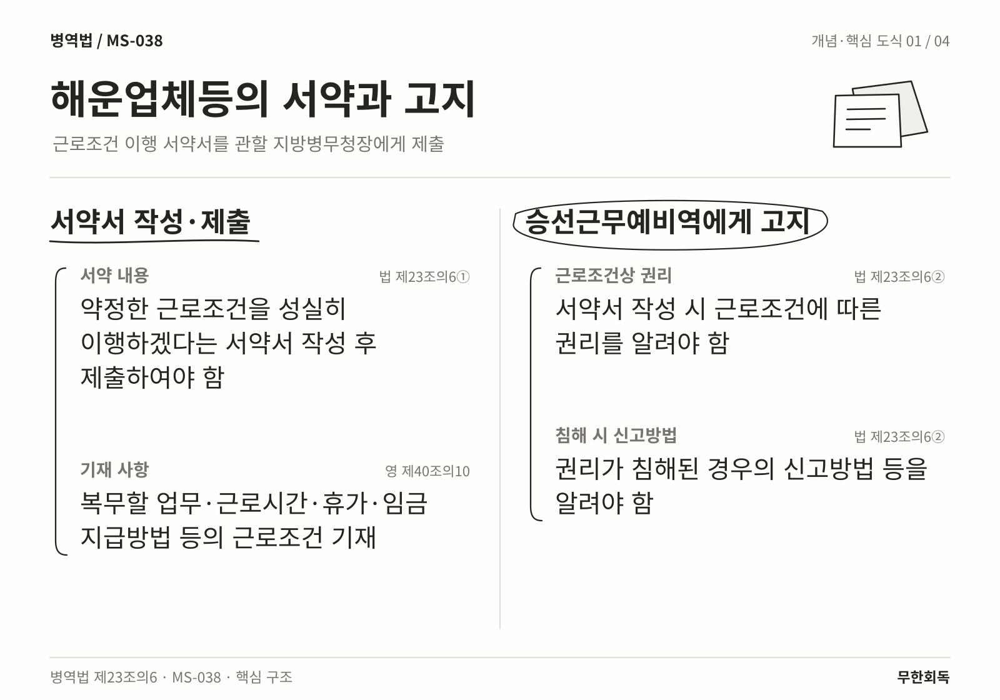
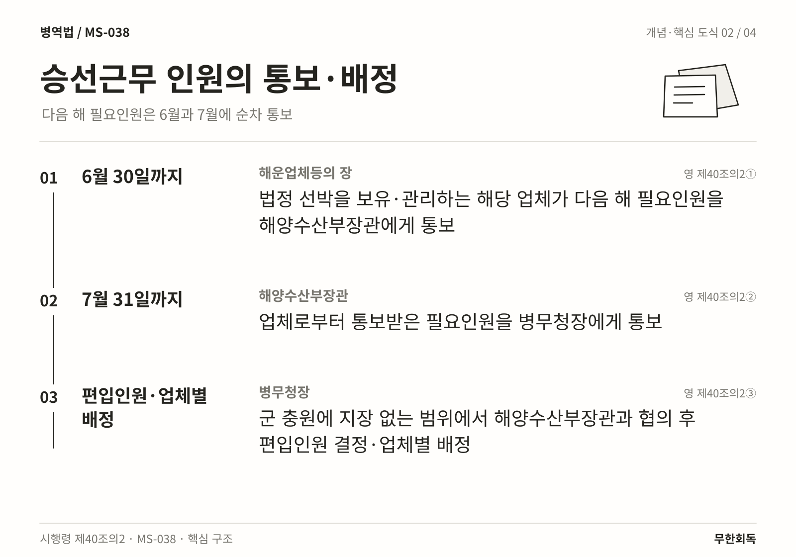
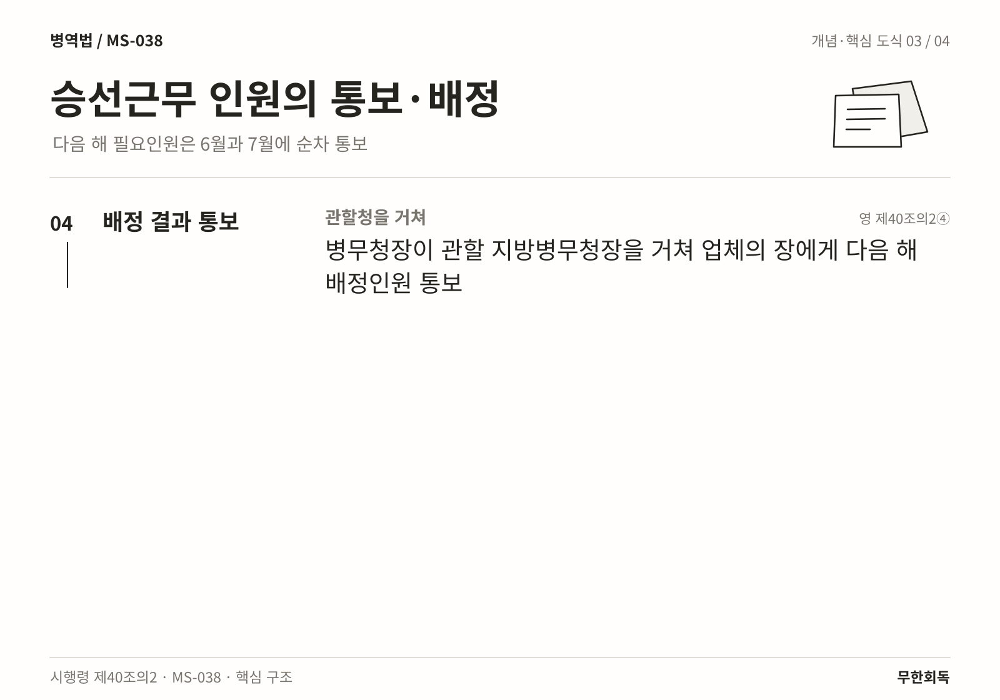
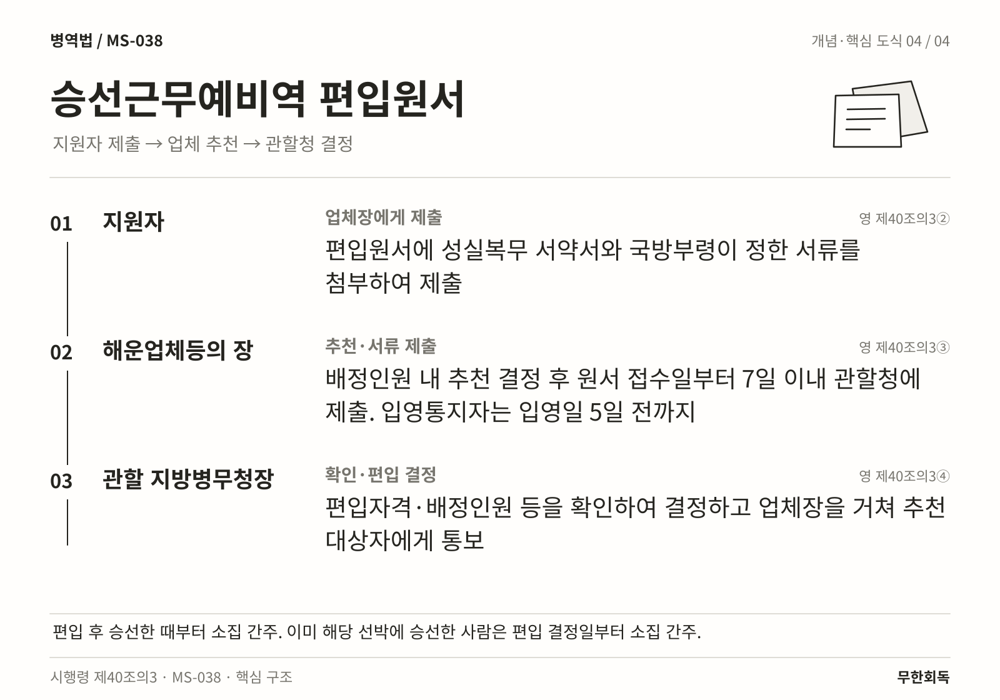

# MS-038 · 병역법 제23조의6, 해운업체등의 장의 서약서 제출 등

흑백 편집형 도식 4장 · 1600×1120 · SVG / 무손실 WebP

## 01. 해운업체등의 서약과 고지

[강의용 WebP](MS-038-D01-editorial-v1.webp) · [편집용 SVG](MS-038-D01-editorial-v1.svg)

## 02. 승선근무 인원의 통보·배정

[강의용 WebP](MS-038-D02-editorial-v1.webp) · [편집용 SVG](MS-038-D02-editorial-v1.svg)

## 03. 승선근무 인원의 통보·배정

[강의용 WebP](MS-038-D03-editorial-v1.webp) · [편집용 SVG](MS-038-D03-editorial-v1.svg)

## 04. 승선근무예비역 편입원서

[강의용 WebP](MS-038-D04-editorial-v1.webp) · [편집용 SVG](MS-038-D04-editorial-v1.svg)

[전체 병역법 도식 목차](../../README.md)
