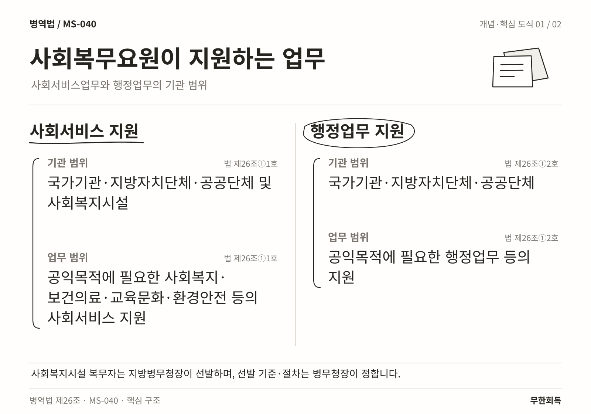
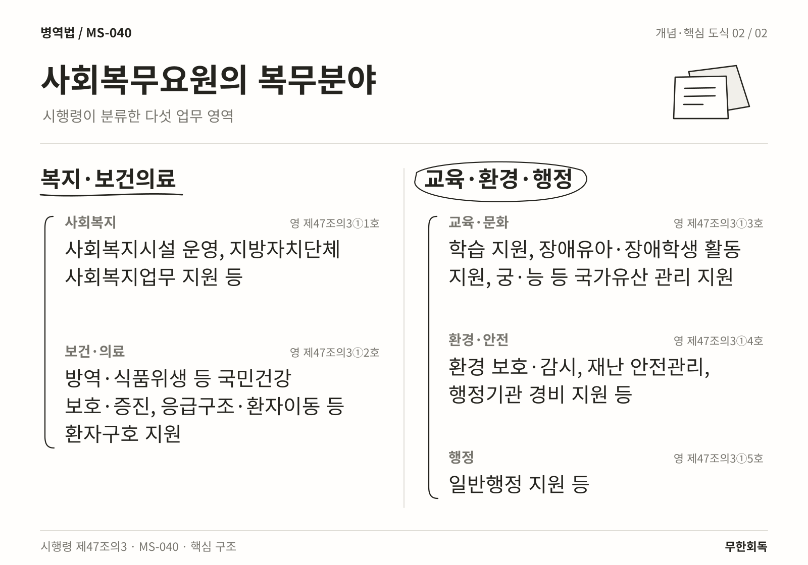

# MS-040 · 병역법 제26조, 사회복무요원의 업무 및 소집 대상

흑백 편집형 도식 2장 · 1600×1120 · SVG / 무손실 WebP

## 01. 사회복무요원이 지원하는 업무

[강의용 WebP](MS-040-D01-editorial-v1.webp) · [편집용 SVG](MS-040-D01-editorial-v1.svg)

## 02. 사회복무요원의 복무분야

[강의용 WebP](MS-040-D02-editorial-v1.webp) · [편집용 SVG](MS-040-D02-editorial-v1.svg)

[전체 병역법 도식 목차](../../README.md)
