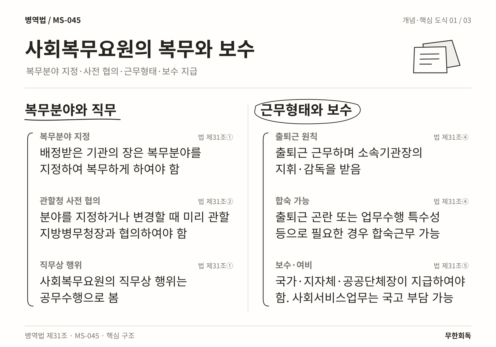
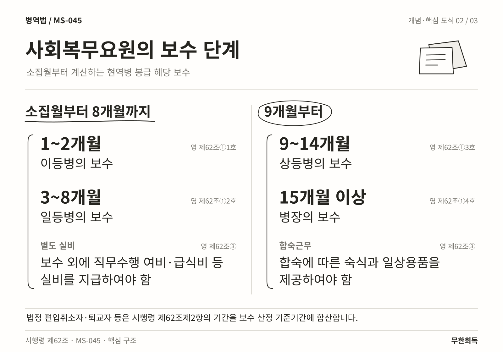
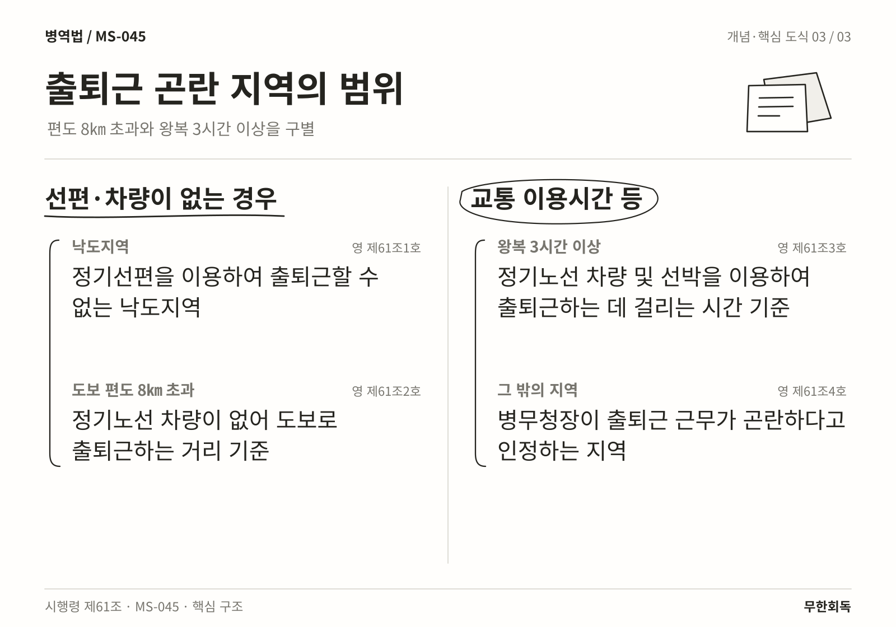

# MS-045 · 병역법 제31조, 사회복무요원의 복무 및 보수 등

흑백 편집형 도식 3장 · 1600×1120 · SVG / 무손실 WebP

## 01. 사회복무요원의 복무와 보수

[강의용 WebP](MS-045-D01-editorial-v1.webp) · [편집용 SVG](MS-045-D01-editorial-v1.svg)

## 02. 사회복무요원의 보수 단계

[강의용 WebP](MS-045-D02-editorial-v1.webp) · [편집용 SVG](MS-045-D02-editorial-v1.svg)

## 03. 출퇴근 곤란 지역의 범위

[강의용 WebP](MS-045-D03-editorial-v1.webp) · [편집용 SVG](MS-045-D03-editorial-v1.svg)

[전체 병역법 도식 목차](../../README.md)
