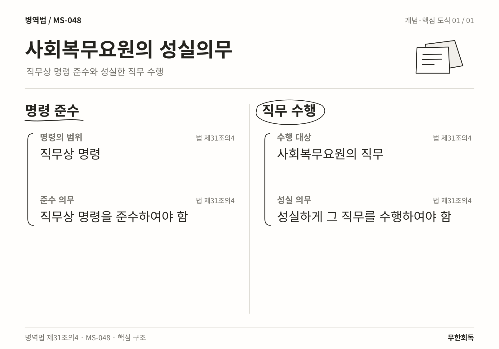

# MS-048 · 병역법 제31조의4, 사회복무요원의 성실의무

흑백 편집형 도식 1장 · 1600×1120 · SVG / 무손실 WebP

## 01. 사회복무요원의 성실의무

[강의용 WebP](MS-048-D01-editorial-v1.webp) · [편집용 SVG](MS-048-D01-editorial-v1.svg)

[전체 병역법 도식 목차](../../README.md)

제80회 기존 원고 대조 완료(기존 도식 재사용). [검수 근거](../../production-evidence/exam80-generation-2/MS-048/001-c7065f3e98f2f9acd4bc8753ee918691cebcc8c0d2b622d23e0d774eaea2baf8.json)
