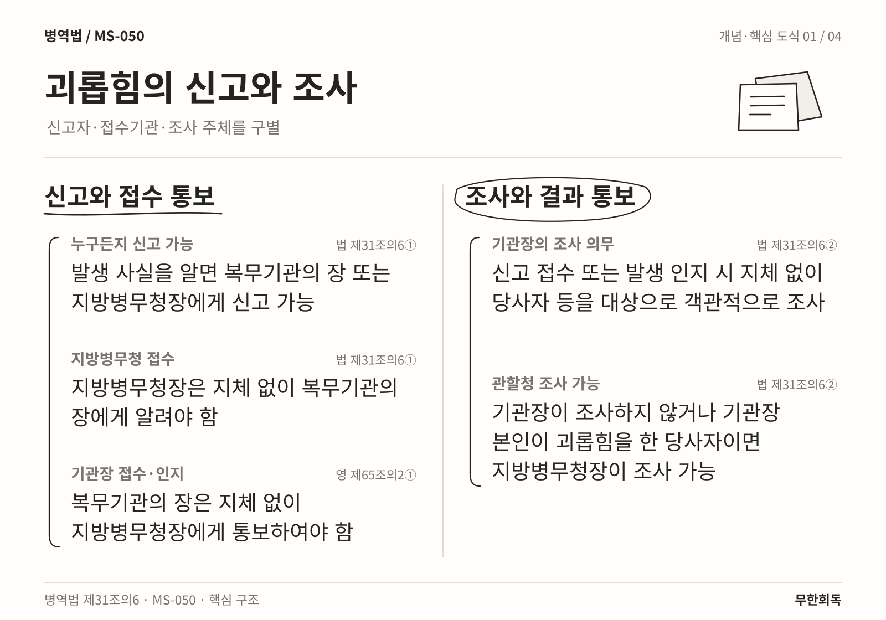
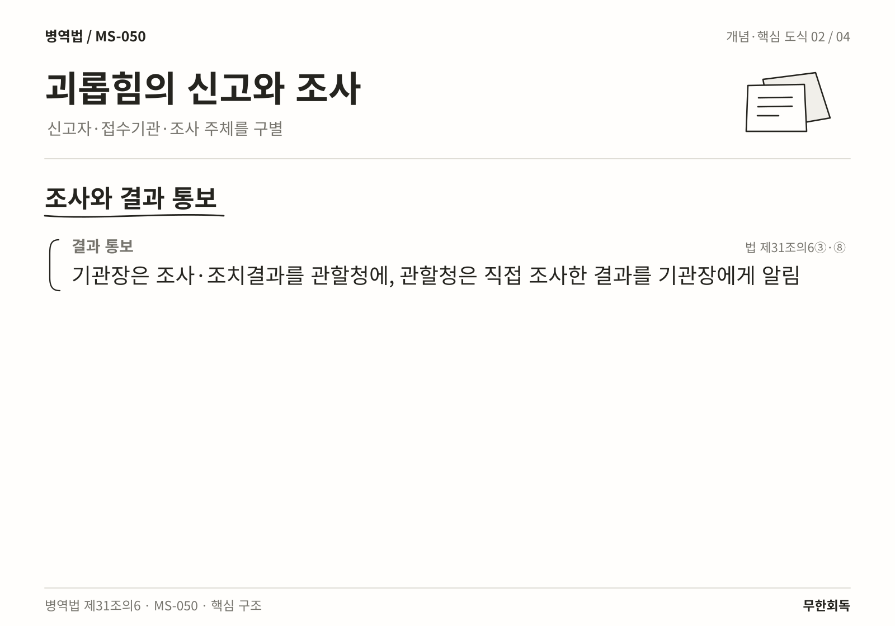
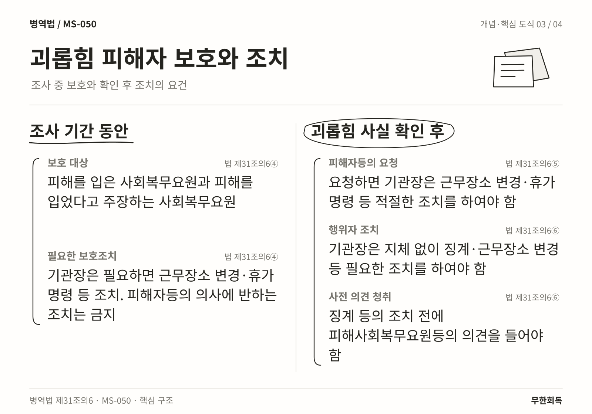
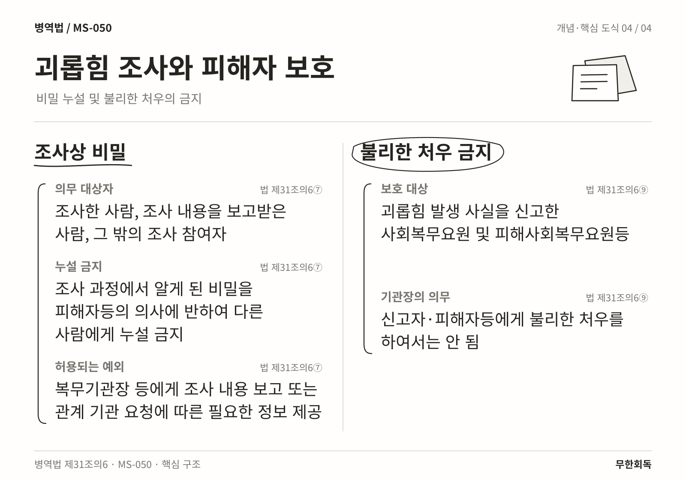

# MS-050 · 병역법 제31조의6, 복무기관 내 괴롭힘 발생 시 조치

흑백 편집형 도식 4장 · 1600×1120 · SVG / 무손실 WebP

## 01. 괴롭힘의 신고와 조사

[강의용 WebP](MS-050-D01-editorial-v1.webp) · [편집용 SVG](MS-050-D01-editorial-v1.svg)

## 02. 괴롭힘의 신고와 조사

[강의용 WebP](MS-050-D02-editorial-v1.webp) · [편집용 SVG](MS-050-D02-editorial-v1.svg)

## 03. 괴롭힘 피해자 보호와 조치

[강의용 WebP](MS-050-D03-editorial-v1.webp) · [편집용 SVG](MS-050-D03-editorial-v1.svg)

## 04. 괴롭힘 조사와 피해자 보호

[강의용 WebP](MS-050-D04-editorial-v1.webp) · [편집용 SVG](MS-050-D04-editorial-v1.svg)

[전체 병역법 도식 목차](../../README.md)
