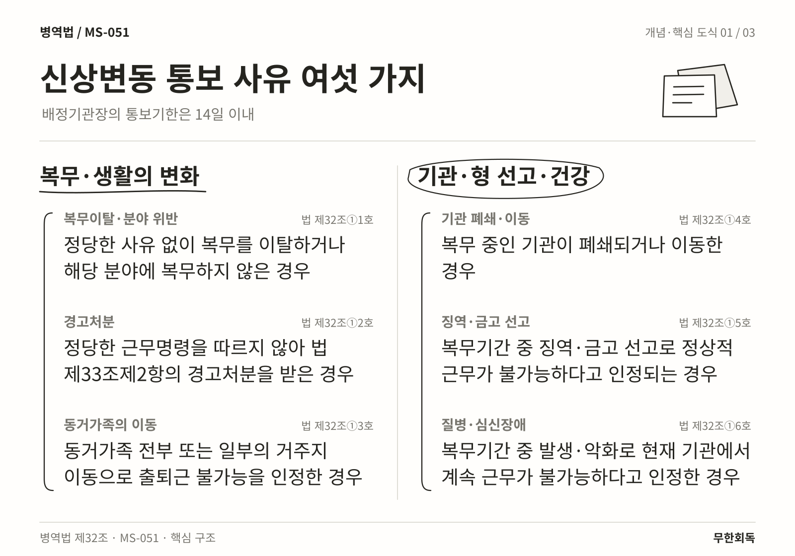
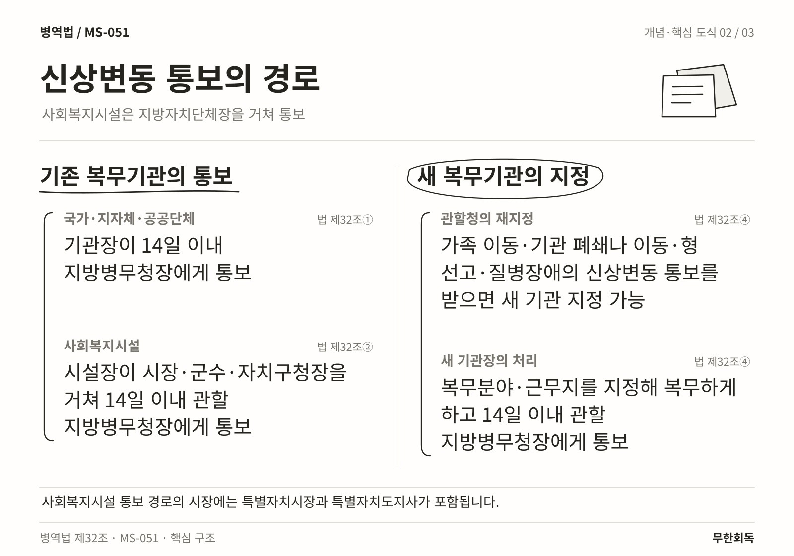
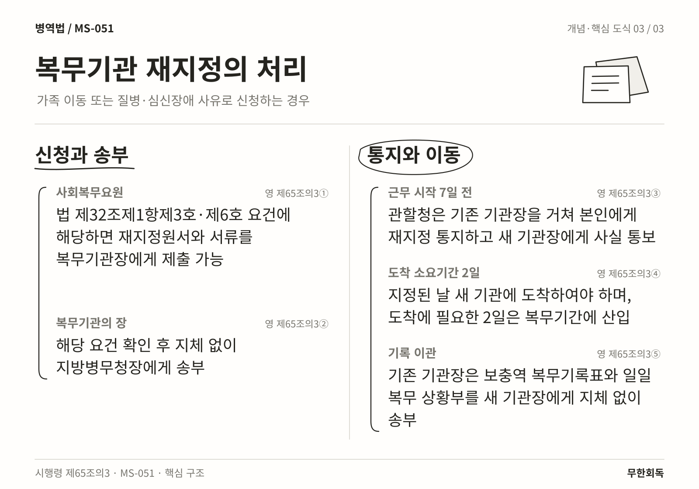

# MS-051 · 병역법 제32조, 사회복무요원의 신상변동 통보

흑백 편집형 도식 3장 · 1600×1120 · SVG / 무손실 WebP

## 01. 신상변동 통보 사유 여섯 가지

[강의용 WebP](MS-051-D01-editorial-v1.webp) · [편집용 SVG](MS-051-D01-editorial-v1.svg)

## 02. 신상변동 통보의 경로

[강의용 WebP](MS-051-D02-editorial-v1.webp) · [편집용 SVG](MS-051-D02-editorial-v1.svg)

## 03. 복무기관 재지정의 처리

[강의용 WebP](MS-051-D03-editorial-v1.webp) · [편집용 SVG](MS-051-D03-editorial-v1.svg)

[전체 병역법 도식 목차](../../README.md)
