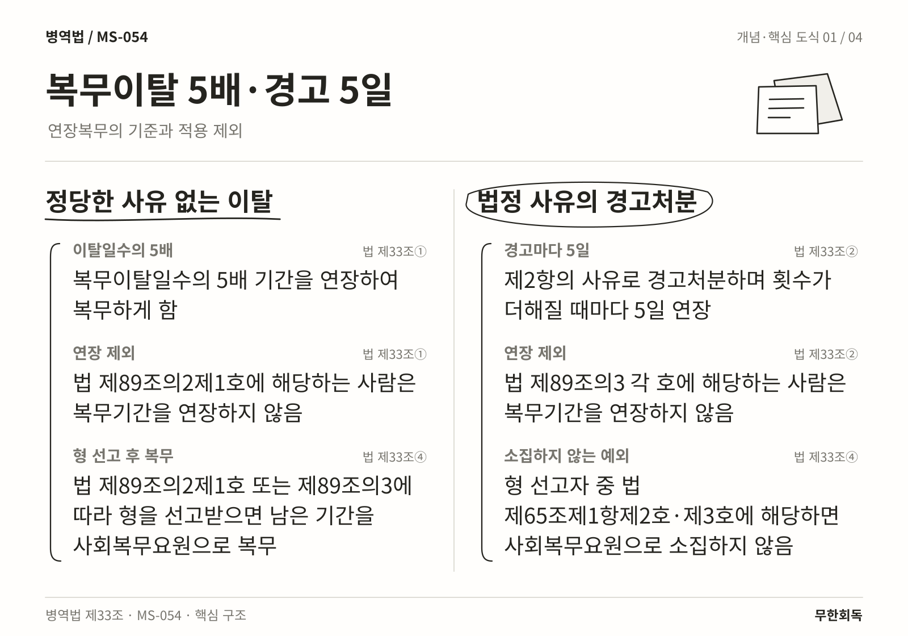
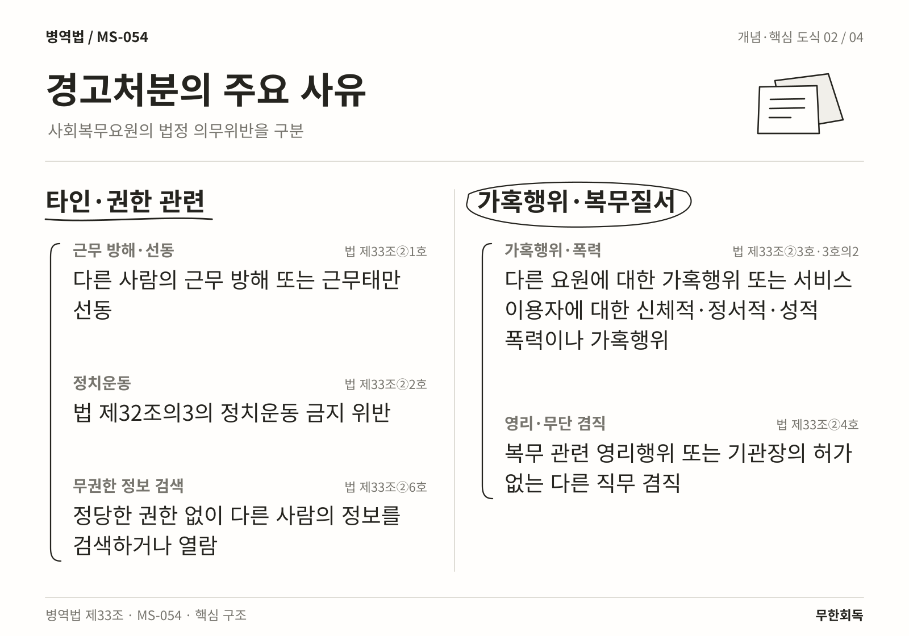
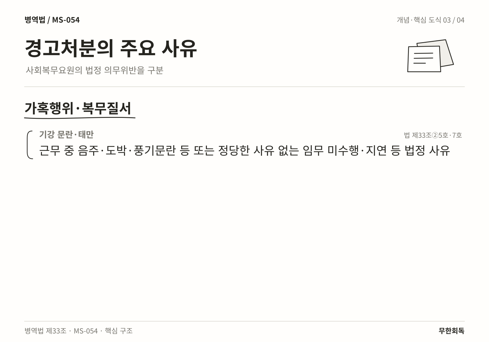
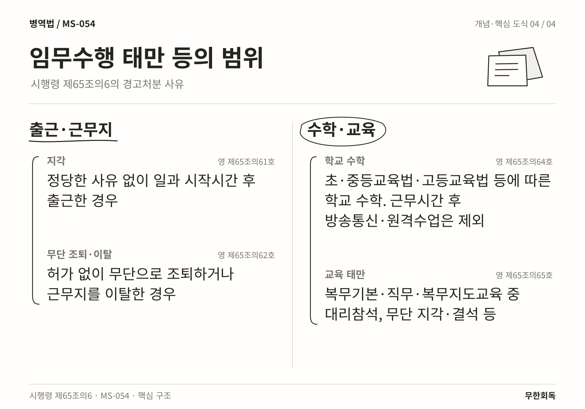

# MS-054 · 병역법 제33조, 사회복무요원의 연장복무 등

흑백 편집형 도식 4장 · 1600×1120 · SVG / 무손실 WebP

## 01. 복무이탈 5배·경고 5일

[강의용 WebP](MS-054-D01-editorial-v1.webp) · [편집용 SVG](MS-054-D01-editorial-v1.svg)

## 02. 경고처분의 주요 사유

[강의용 WebP](MS-054-D02-editorial-v1.webp) · [편집용 SVG](MS-054-D02-editorial-v1.svg)

## 03. 경고처분의 주요 사유

[강의용 WebP](MS-054-D03-editorial-v1.webp) · [편집용 SVG](MS-054-D03-editorial-v1.svg)

## 04. 임무수행 태만 등의 범위

[강의용 WebP](MS-054-D04-editorial-v1.webp) · [편집용 SVG](MS-054-D04-editorial-v1.svg)

[전체 병역법 도식 목차](../../README.md)
