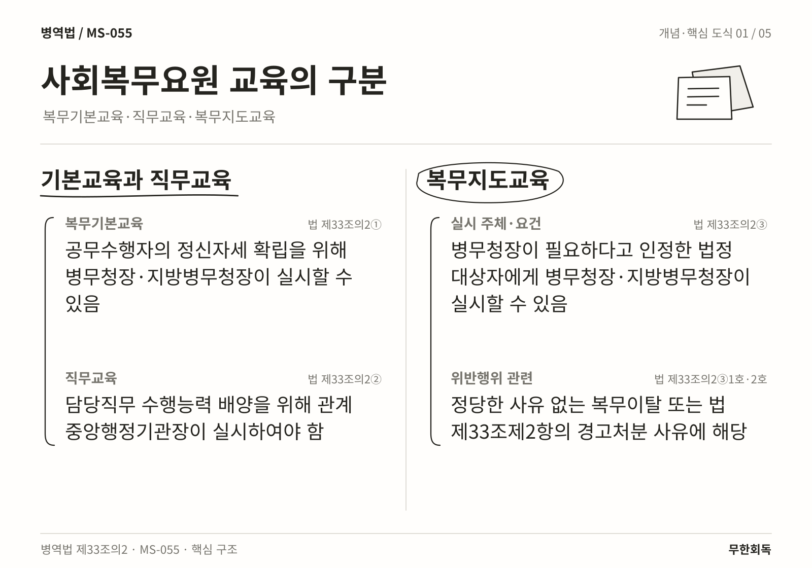
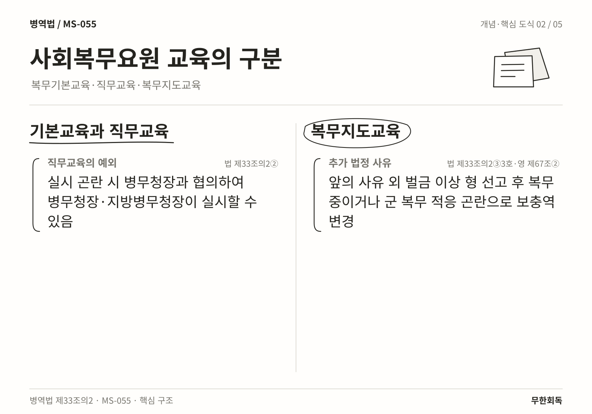
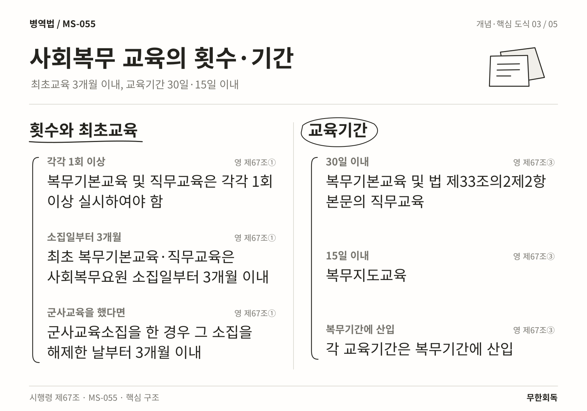
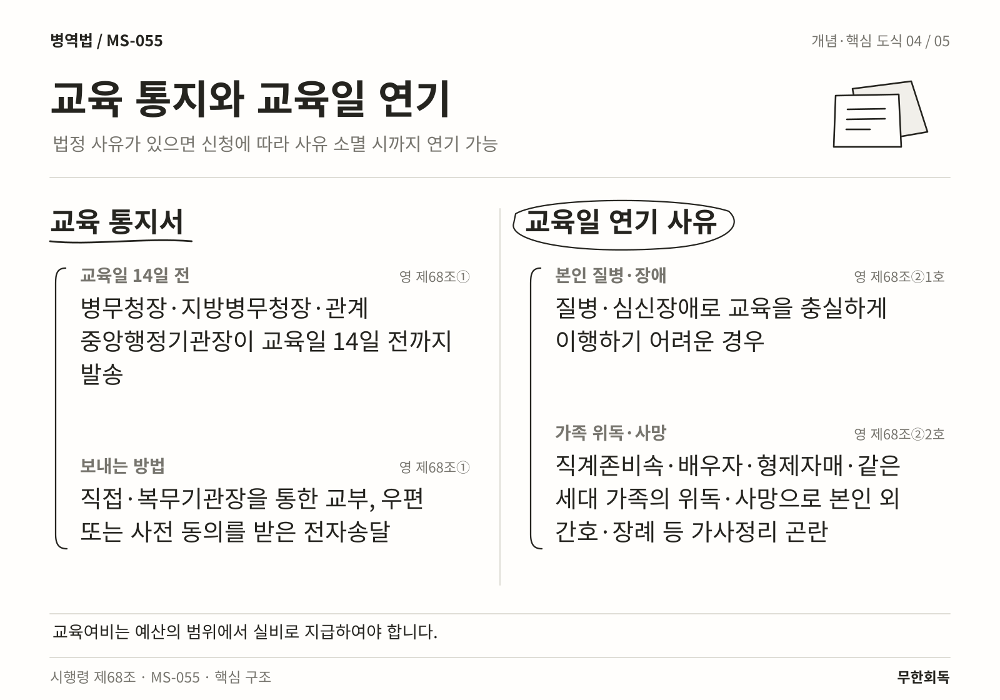
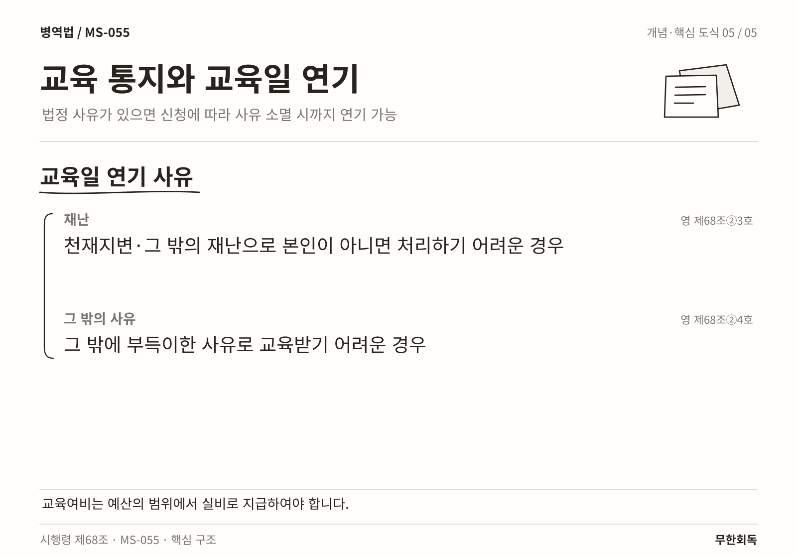

# MS-055 · 병역법 제33조의2, 복무기본교육 및 직무교육 등

흑백 편집형 도식 5장 · 1600×1120 · SVG / 무손실 WebP

## 01. 사회복무요원 교육의 구분

[강의용 WebP](MS-055-D01-editorial-v1.webp) · [편집용 SVG](MS-055-D01-editorial-v1.svg)

## 02. 사회복무요원 교육의 구분

[강의용 WebP](MS-055-D02-editorial-v1.webp) · [편집용 SVG](MS-055-D02-editorial-v1.svg)

## 03. 사회복무 교육의 횟수·기간

[강의용 WebP](MS-055-D03-editorial-v1.webp) · [편집용 SVG](MS-055-D03-editorial-v1.svg)

## 04. 교육 통지와 교육일 연기

[강의용 WebP](MS-055-D04-editorial-v1.webp) · [편집용 SVG](MS-055-D04-editorial-v1.svg)

## 05. 교육 통지와 교육일 연기

[강의용 WebP](MS-055-D05-editorial-v1.webp) · [편집용 SVG](MS-055-D05-editorial-v1.svg)

[전체 병역법 도식 목차](../../README.md)
