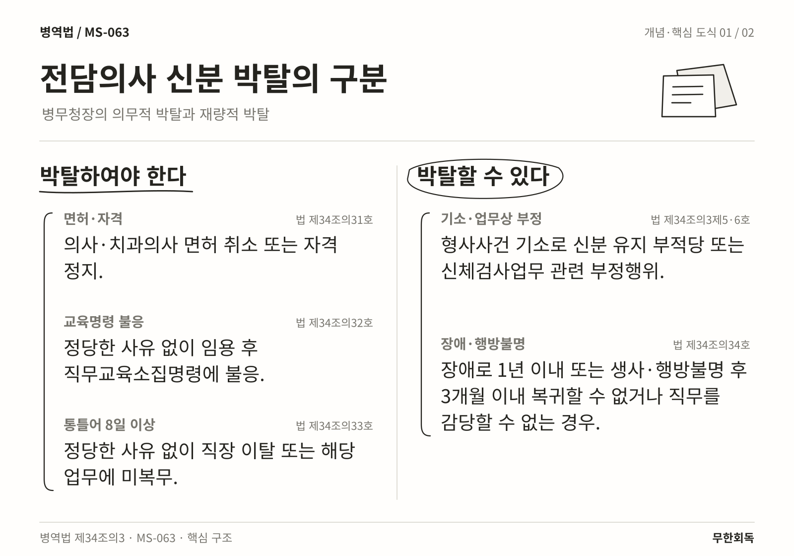
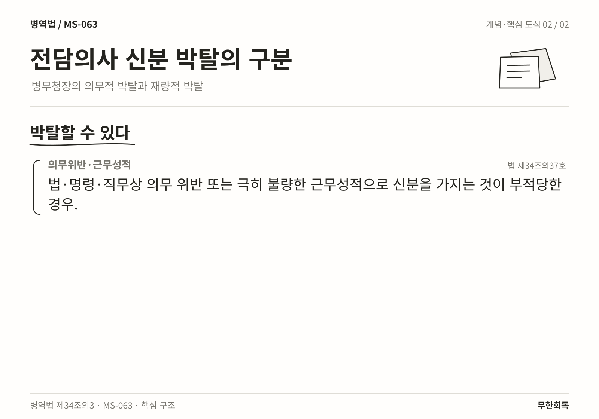

# MS-063 · 병역법 제34조의3, 병역판정검사전담의사의 신분 박탈

흑백 편집형 도식 2장 · 1600×1120 · SVG / 무손실 WebP

## 01. 전담의사 신분 박탈의 구분

[강의용 WebP](MS-063-D01-editorial-v1.webp) · [편집용 SVG](MS-063-D01-editorial-v1.svg)

## 02. 전담의사 신분 박탈의 구분

[강의용 WebP](MS-063-D02-editorial-v1.webp) · [편집용 SVG](MS-063-D02-editorial-v1.svg)

[전체 병역법 도식 목차](../../README.md)
