# MS-077 · 병역법 제41조, 전문연구요원과 산업기능요원의 편입취소 및 의무부과

흑백 편집형 도식 12장 · 1600×1120 · SVG / 무손실 WebP

## 01. 전문연구·산업기능 편입취소

[강의용 WebP](MS-077-D01-editorial-v1.webp) · [편집용 SVG](MS-077-D01-editorial-v1.svg)

## 02. 부정 편입과 부정 전직의 차이

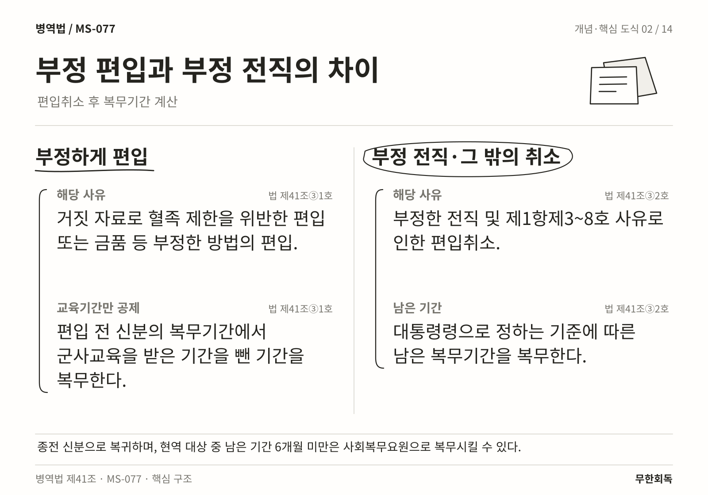

[강의용 WebP](MS-077-D02-editorial-v1.webp) · [편집용 SVG](MS-077-D02-editorial-v1.svg)

## 03. 편입취소 연령과 연장복무

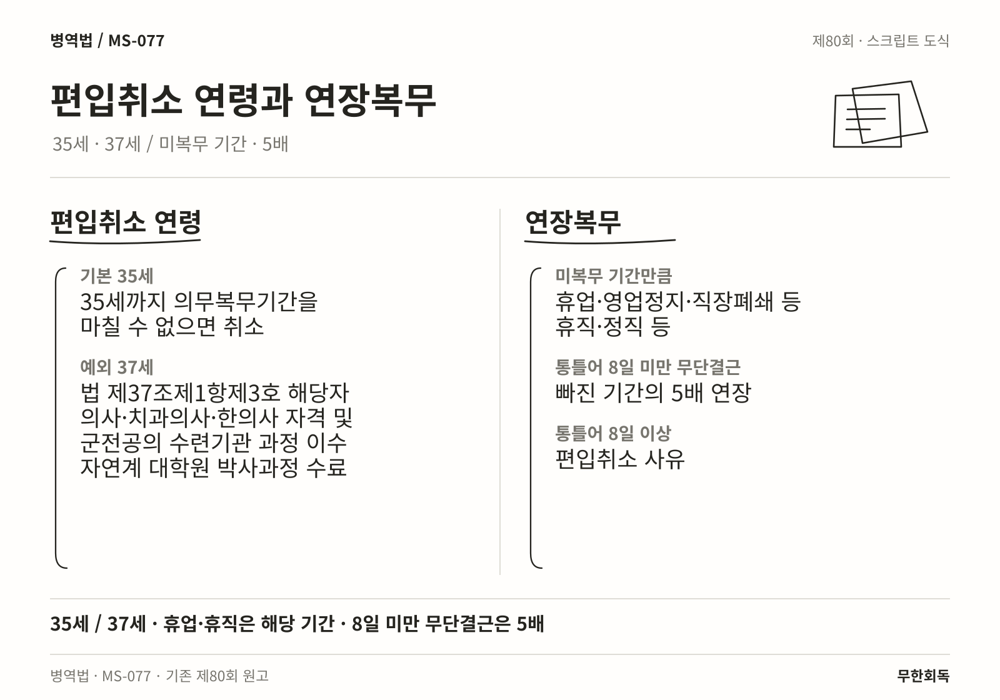

[강의용 WebP](MS-077-D03-editorial-v1.webp) · [편집용 SVG](MS-077-D03-editorial-v1.svg)

## 04. 두 단서, 서로 다른 30일

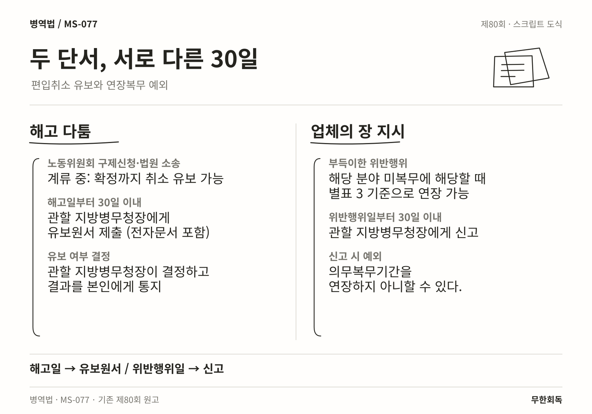

[강의용 WebP](MS-077-D04-editorial-v1.webp) · [편집용 SVG](MS-077-D04-editorial-v1.svg)

## 05. 전직의 사유와 기한

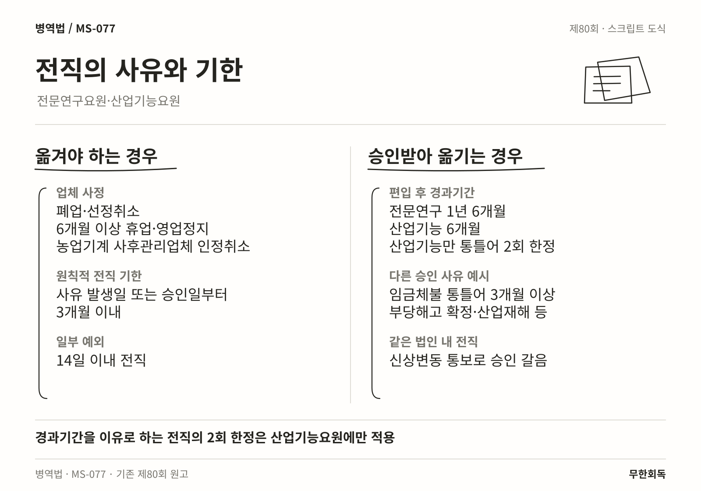

[강의용 WebP](MS-077-D05-editorial-v1.webp) · [편집용 SVG](MS-077-D05-editorial-v1.svg)

## 06. 전직 대상에서 제외되는 곳

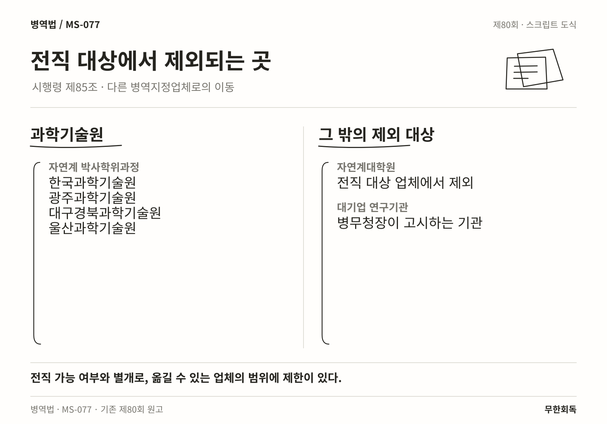

[강의용 WebP](MS-077-D06-editorial-v1.webp) · [편집용 SVG](MS-077-D06-editorial-v1.svg)

## 07. 전직 신청과 대기기간

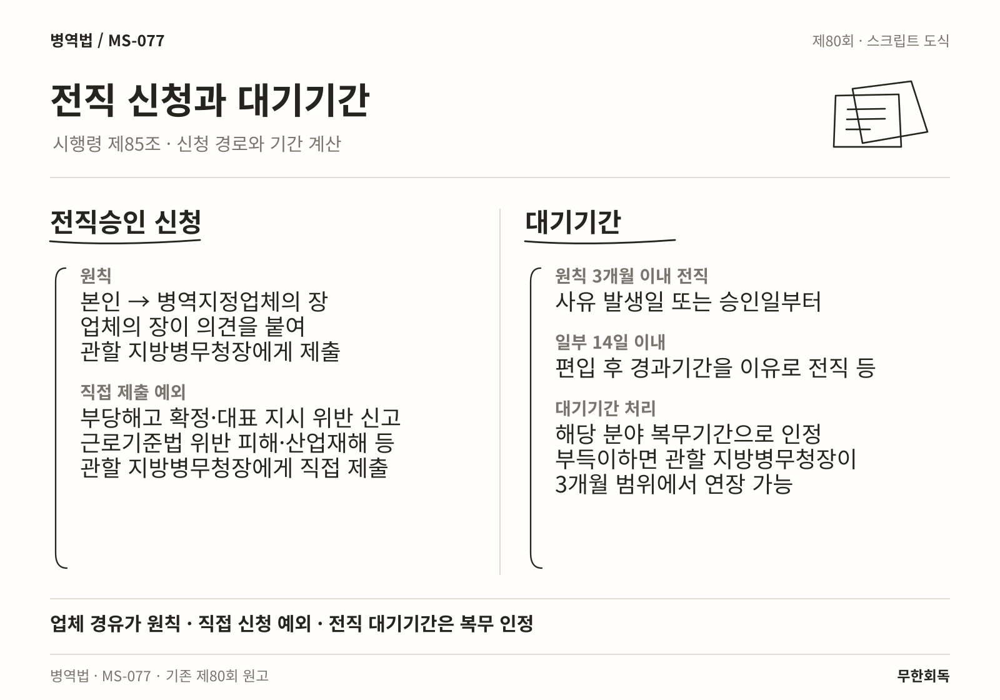

[강의용 WebP](MS-077-D07-editorial-v1.webp) · [편집용 SVG](MS-077-D07-editorial-v1.svg)

## 08. 의무복무 중 수학 제한

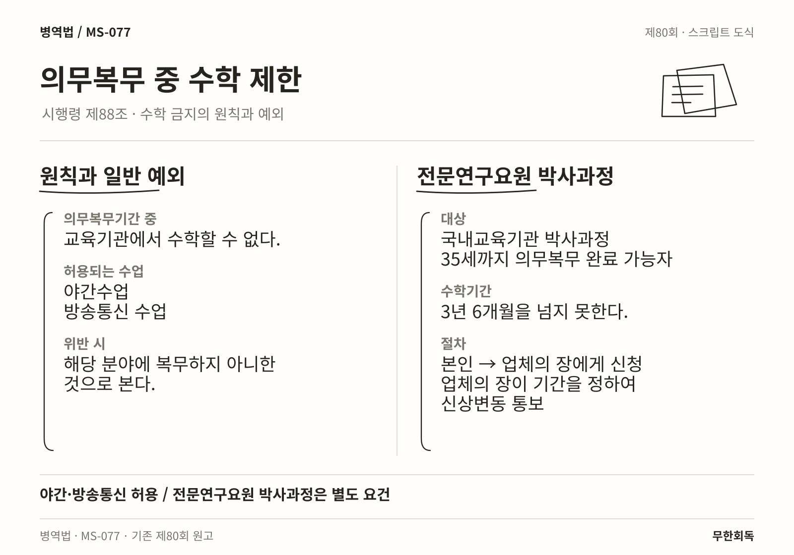

[강의용 WebP](MS-077-D08-editorial-v1.webp) · [편집용 SVG](MS-077-D08-editorial-v1.svg)

## 09. 의무복무기간 계산

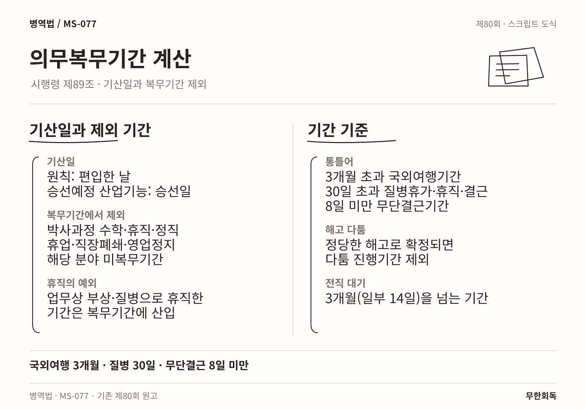

[강의용 WebP](MS-077-D09-editorial-v1.webp) · [편집용 SVG](MS-077-D09-editorial-v1.svg)

## 10. 복무만료 처분의 순서

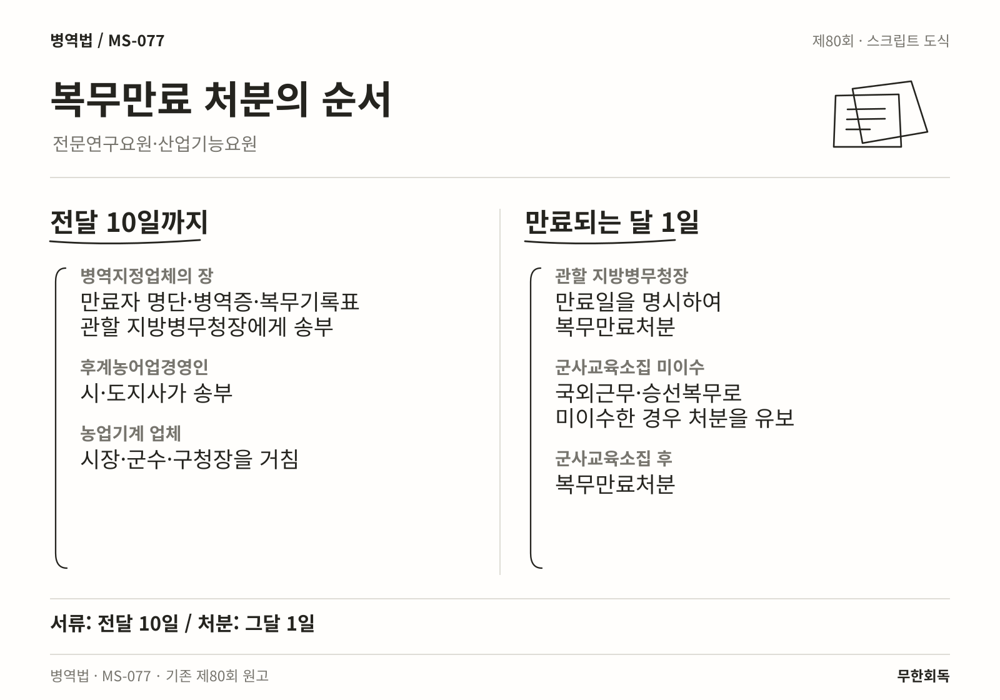

[강의용 WebP](MS-077-D10-editorial-v1.webp) · [편집용 SVG](MS-077-D10-editorial-v1.svg)

## 11. 편입취소자 처리와 잔여 복무

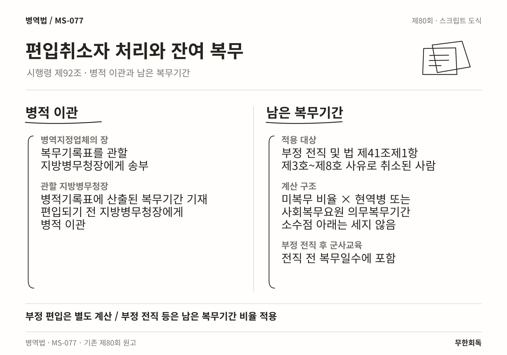

[강의용 WebP](MS-077-D11-editorial-v1.webp) · [편집용 SVG](MS-077-D11-editorial-v1.svg)

## 12. 군 필요인원 통보의 두 날짜

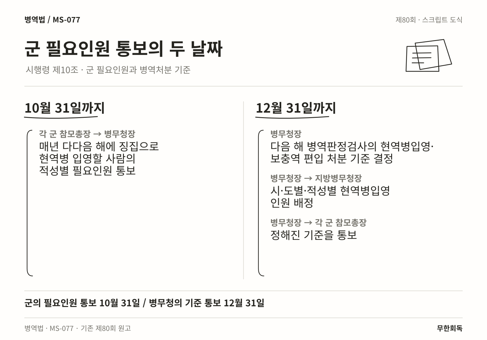

[강의용 WebP](MS-077-D12-editorial-v1.webp) · [편집용 SVG](MS-077-D12-editorial-v1.svg)

[전체 병역법 도식 목차](../../README.md)
