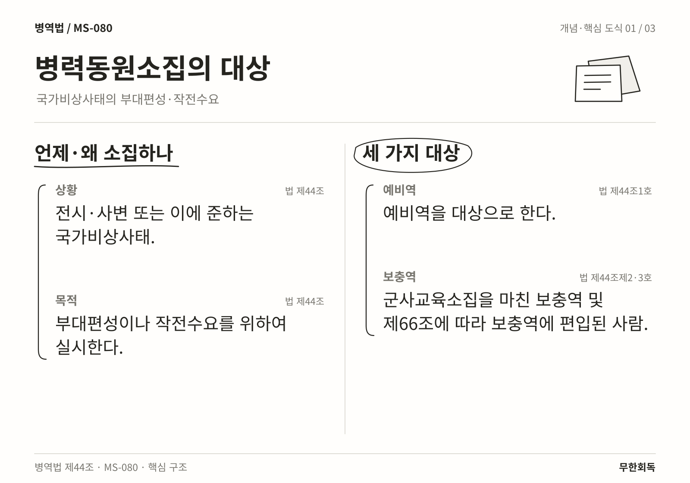
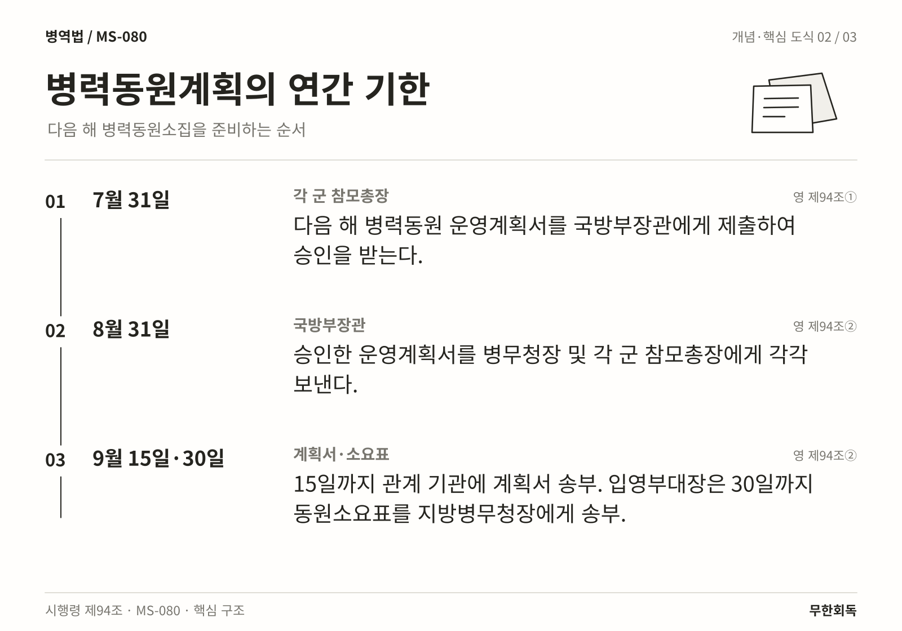
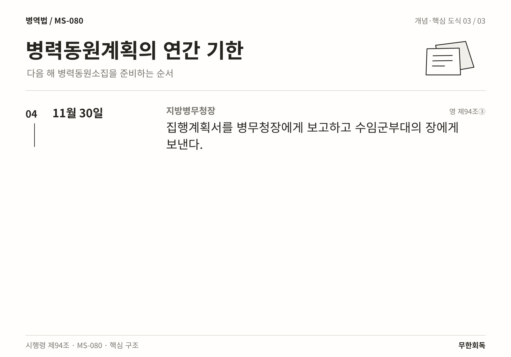

# MS-080 · 병역법 제44조, 병력동원소집 대상

흑백 편집형 도식 3장 · 1600×1120 · SVG / 무손실 WebP

## 01. 병력동원소집의 대상

[강의용 WebP](MS-080-D01-editorial-v1.webp) · [편집용 SVG](MS-080-D01-editorial-v1.svg)

## 02. 병력동원계획의 연간 기한

[강의용 WebP](MS-080-D02-editorial-v1.webp) · [편집용 SVG](MS-080-D02-editorial-v1.svg)

## 03. 병력동원계획의 연간 기한

[강의용 WebP](MS-080-D03-editorial-v1.webp) · [편집용 SVG](MS-080-D03-editorial-v1.svg)

[전체 병역법 도식 목차](../../README.md)
