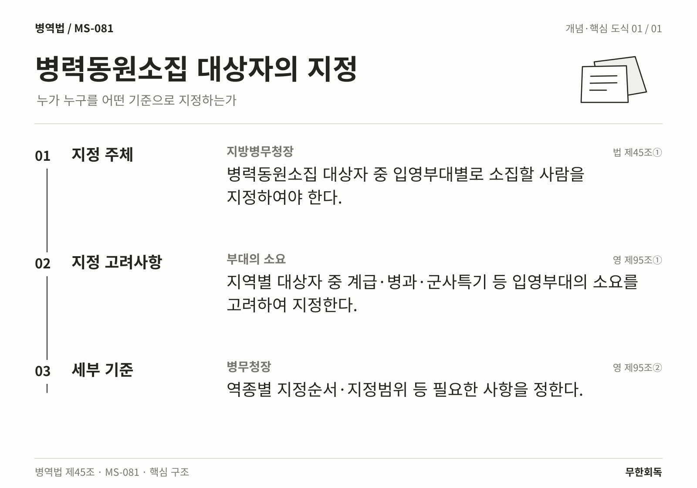

# MS-081 · 병역법 제45조, 병력동원소집 대상자의 지정

흑백 편집형 도식 1장 · 1600×1120 · SVG / 무손실 WebP

## 01. 병력동원소집 대상자의 지정

[강의용 WebP](MS-081-D01-editorial-v1.webp) · [편집용 SVG](MS-081-D01-editorial-v1.svg)

[전체 병역법 도식 목차](../../README.md)
