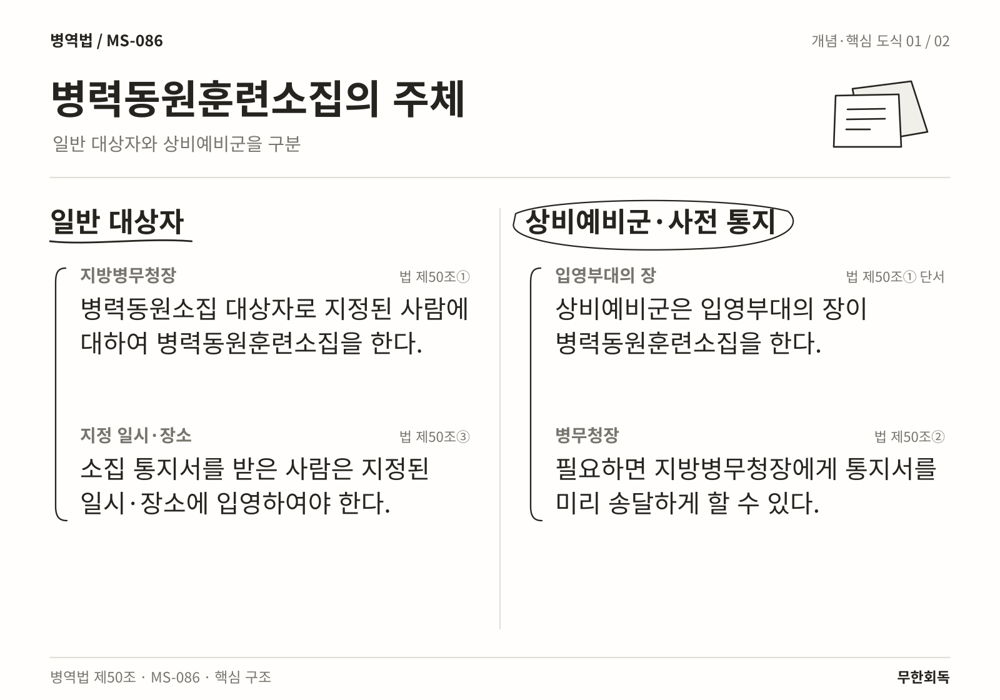
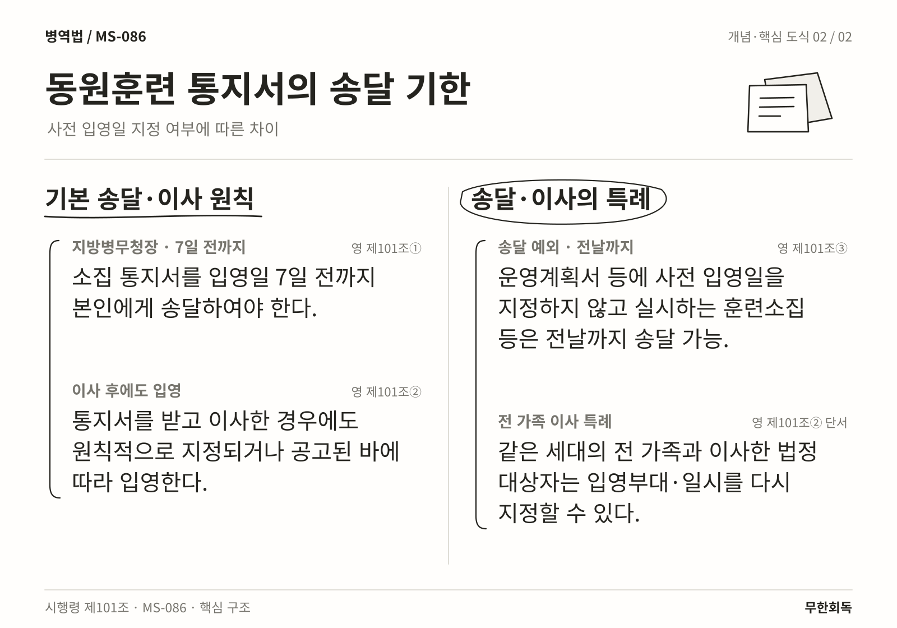

# MS-086 · 병역법 제50조, 병력동원훈련소집

흑백 편집형 도식 2장 · 1600×1120 · SVG / 무손실 WebP

## 01. 병력동원훈련소집의 주체

[강의용 WebP](MS-086-D01-editorial-v1.webp) · [편집용 SVG](MS-086-D01-editorial-v1.svg)

## 02. 동원훈련 통지서의 송달 기한

[강의용 WebP](MS-086-D02-editorial-v1.webp) · [편집용 SVG](MS-086-D02-editorial-v1.svg)

[전체 병역법 도식 목차](../../README.md)
